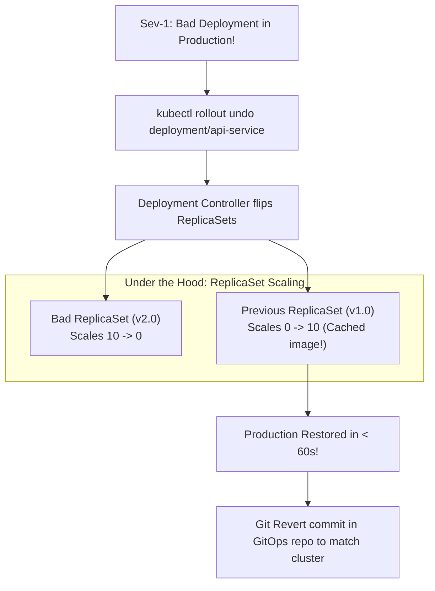

## Fast Revision (10-Second Recall)
- **The Fastest Command in Kubernetes:**
- `kubectl rollout undo deployment/<name> -n <namespace>`
- (Reverts to the immediately preceding revision in &lt; 60 seconds).
- **Targeting a Specific Past Revision:**
- 1. View release history: `kubectl rollout history deployment/<name>`.
- 2. Inspect a past revision: `kubectl rollout history deployment/<name> --revision=3`.
- 3. Revert to that revision: `kubectl rollout undo deployment/<name> --to-revision=3`.
- **How It Works Under the Hood:**
- Kubernetes keeps old **ReplicaSets** around (default `revisionHistoryLimit: 10`). Rolling back simply scales the old ReplicaSet back up and the bad ReplicaSet down!

## The 30-Second Spoken Script
"To roll back a Kubernetes deployment during an incident, I use the 'kubectl rollout undo' command, which leverages Kubernetes' underlying ReplicaSet revision history to restore the previous stable version in under 60 seconds.

Here is the operational procedure:

Step 1: Immediate Emergency Rollback.
If the regression was introduced by the immediate previous deployment, I execute:
'kubectl rollout undo deployment/api-service -n production'
Under the hood, Kubernetes maintains the previous ReplicaSets (controlled by revisionHistoryLimit). The deployment controller instantly begins a rolling update scaling up the previous stable ReplicaSet while scaling down the bad ReplicaSet. Because the older container images are already cached on the worker nodes, the rollback completes in seconds without pulling images.

Step 2: Monitor Rollback Status.
I track the rollback progress until completion:
'kubectl rollout status deployment/api-service -n production'
Once the command returns 'deployment successfully rolled out', I verify error rates in our APM dashboards.

Step 3: Rollback to a Specific Historical Revision.
If multiple bad commits were deployed, I inspect the revision history:
'kubectl rollout history deployment/api-service -n production'
I can inspect a specific past revision to verify its image tag and metadata:
'kubectl rollout history deployment/api-service --revision=3'
And revert directly to that known-good state:
'kubectl rollout undo deployment/api-service --to-revision=3'

Step 4: Sync GitOps Repository.
In a GitOps workflow (using ArgoCD or Flux), running 'kubectl rollout undo' causes drift between the live cluster and the Git repository. Once the emergency is contained, I immediately issue a 'git revert' in our deployment manifest repository to ensure Git remains the true source of truth."

## Scenario / Problem Context
A newly deployed version is throwing errors in production. The incident commander orders an immediate rollback. The interviewer tests your command-line speed, understanding of ReplicaSet revisions, and how to verify rollback completion.

## Architectural Workflow / Sequence


## Deep-Dive Analysis & Root Causes

| Command | Target | Speed |
| --- | --- | --- |
| `kubectl rollout undo` | Immediately preceding revision (Revision $N-1$) | 30 to 60 seconds (cached images on nodes)
`kubectl rollout undo --to-revision=N` | Specific historical revision from history table | 30 to 60 seconds
`kubectl rollout pause / resume` | Temporarily freezes in-flight rollout while investigating | Instantaneous
`git revert` (GitOps) | Updates Git repo; ArgoCD reconciles cluster | 1 to 2 minutes |


## Practical Debugging Commands & Code
```bash
# 1. Fast rollback to immediate previous revision:
kubectl rollout undo deployment/api-service -n production

# 2. View deployment revision history:
kubectl rollout history deployment/api-service -n production

# 3. View details of a specific past revision:
kubectl rollout history deployment/api-service --revision=2 -n production

# 4. Rollback to specific revision:
kubectl rollout undo deployment/api-service --to-revision=2 -n production

# 5. Monitor status of rollback:
kubectl rollout status deployment/api-service -n production
```

## Prevention & Senior Best Practices
- **Maintain Sane `revisionHistoryLimit`:** Ensure `revisionHistoryLimit: 10` is set in the Deployment spec so older ReplicaSets are retained for fast rollback.
- **Keep Older Images on Nodes:** Node container image garbage collection should retain recent images so rollbacks do not suffer from network pull latency.
- **Always Sync GitOps After Manual Rollbacks:** Revert the Git commit in your infrastructure repo so automated GitOps reconcilers do not re-apply the bad version.
