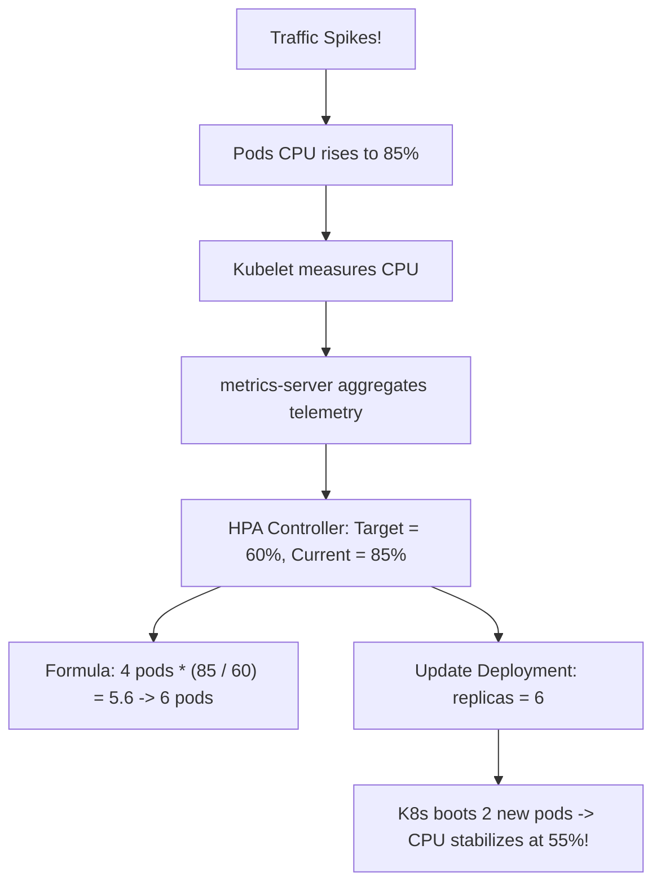

## Fast Revision (10-Second Recall)
- **Prerequisites for CPU-Based HPA:**
- 1. **`metrics-server` installed** in the cluster (scrapes CPU metrics from Kubelets).
- 2. **`resources.requests.cpu` MUST be defined** in the container spec! (HPA calculates utilization as a percentage of **requests**, NOT limits!).
- **The Mathematical Scaling Formula:**
- `TargetReplicas = ceil(CurrentReplicas * (CurrentMetricValue / TargetMetricValue))`
- Example: 4 pods running at 90% CPU, target is 50%: `4 * (90/50) = 4 * 1.8 = 7.2` -> rounds up to 8 pods!
- **Preventing Flapping (Thrashing):** Use `behavior.scaleDown.stabilizationWindowSeconds: 300` so pods don't immediately terminate on momentary dips.

## The 30-Second Spoken Script
"To scale Kubernetes pods automatically based on CPU usage, we implement the Horizontal Pod Autoscaler (HPA) v2 controller backed by the Kubernetes metrics-server.

Here is the implementation architecture:

First, Mandatory Prerequisites.
HPA relies on two critical requirements:
1. The cluster must have metrics-server running to scrape CPU telemetry from Kubelets via the metrics.k8s.io API.
2. Crucially, the container specification in the Deployment MUST declare 'resources.requests.cpu'. A common mistake is defining only limits; if requests are missing, HPA cannot calculate percentage utilization and will remain in an unknown state.

Second, How HPA Calculates Desired Replicas.
HPA executes a reconciliation loop every 15 seconds. It computes desired replicas using the formula:
Target Replicas equals Current Replicas multiplied by Current Metric divided by Target Metric, rounded up.
For example, if we have 5 replicas running at an average of 80% CPU and our target is 50%, HPA calculates: 5 * (80 / 50) = 8 replicas.

Third, Preventing Autoscaling Flapping (Thrashing).
When traffic spikes, you want to scale OUT aggressively to protect latency. When traffic drops, you want to scale DOWN cautiously to prevent thrashing.
In the HPA behavior configuration:
We configure scaleUp to add pods rapidly (e.g., doubling replicas every 30 seconds).
We configure scaleDown with a 5-minute stabilization window (stabilizationWindowSeconds: 300). This prevents HPA from immediately killing pods during temporary traffic lulls."

## Scenario / Problem Context
During flash sales or morning traffic spikes, pods hit 100% CPU and drop requests. You need to configure the Horizontal Pod Autoscaler (HPA) to scale pods out automatically under load and scale down gracefully. The interviewer evaluates your knowledge of HPA math, metrics-server, and stabilization windows.

## Architectural Workflow / Sequence


## Deep-Dive Analysis & Root Causes

| Parameter | Description |
| --- | --- |
| `scaleTargetRef` | Points to the target Deployment or StatefulSet (`apps/v1`)
`averageUtilization: 70` | Calculated as: `(Actual Core Usage / resources.requests.cpu) * 100`
`scaleDown.stabilizationWindowSeconds` | Time window HPA waits before scaling down (prevents rapid flapping)
`maxReplicas` | Hard safety ceiling to prevent runaway cloud bill cost exhaustion |


## Practical Debugging Commands & Code
```bash
# 1. Production HPA configuration YAML snippet:
# apiVersion: autoscaling/v2
# kind: HorizontalPodAutoscaler
# metadata:
#   name: api-hpa
# spec:
#   scaleTargetRef:
#     apiVersion: apps/v1
#     kind: Deployment
#     name: api-service
#   minReplicas: 3
#   maxReplicas: 30
#   metrics:
#   - type: Resource
#     resource:
#       name: cpu
#       target:
#         type: Utilization
#         averageUtilization: 70
#   behavior:
#     scaleDown:
#       stabilizationWindowSeconds: 300

# 2. View active HPA status and current targets:
kubectl get hpa api-hpa -n production

# 3. View node and pod CPU metrics:
kubectl top pods -n production -l app=api-service
```

## Prevention & Senior Best Practices
- **Always Declare `resources.requests.cpu`:** HPA calculates percentage based on requests; without it, HPA fails with `<unknown>/70%`.
- **Set a 5-Minute Scale-Down Stabilization Window:** Prevents rapid pod creation and destruction cycles during fluctuating workloads.
- **Pair HPA with Cluster Autoscaler:** HPA scales pods; Cluster Autoscaler scales the underlying virtual machine nodes when pods cannot be scheduled.
