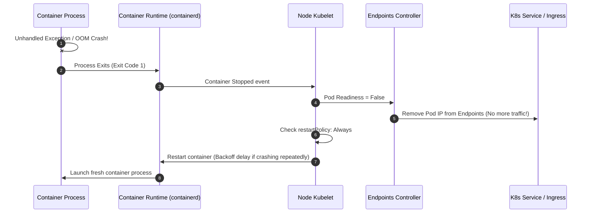

## Fast Revision (10-Second Recall)
- **The Step-by-Step Lifecycle When a Pod Crashes:**
- 1. **Container Exit:** Process dies $\rightarrow$ container runtime (containerd/CRI-O) notifies the local **Kubelet**.
- 2. **Kubelet Evaluates `restartPolicy`:**
-    - `Always` (Default for Deployments): Kubelet restarts container on the same node with exponential backoff (CrashLoopBackOff).
-    - `OnFailure`: Restarts only if exit code != 0.
-    - `Never`: Leaves pod in `Failed` state.
- 3. **Node Failure Scenario:** If the worker node dies completely, the **Kube-Controller-Manager** waits for node eviction timeout (default 5 minutes), marks pods `Terminating`, and the **ReplicaSet** provisions new pods on a healthy worker node.
- 4. **Traffic Rerouting:** As soon as the pod becomes non-ready, the **Endpoints Controller** removes the pod IP from the Service, stopping traffic.

## The 30-Second Spoken Script
"When a container crashes in Kubernetes, the recovery behavior depends on whether it was a single container process crash or an entire worker node failure.

Scenario 1: Single Container Process Crash (on a healthy node).
When an application process dies (such as an unhandled exception or an OOM kill), the container runtime notifies the local Kubelet agent on that worker node.
First, the Kubelet consults the pod's restartPolicy. For Deployments, this defaults to Always. The Kubelet immediately restarts the container in-place on the same node.
Second, the Service Endpoints controller immediately detects that the pod is no longer ready, removing its IP from the Service endpoint slice so live traffic ceases routing to the crashed pod.
Third, if the container keeps crashing repeatedly upon restart, the Kubelet institutes an exponential backoff delay—starting at 10 seconds and doubling up to 5 minutes—entering the familiar CrashLoopBackOff state to prevent node CPU thrashing.

Scenario 2: Entire Worker Node Failure.
If the entire physical or virtual host crashes, the Kubelet can no longer report heartbeats. The Kubernetes Control Plane (kube-controller-manager) waits for the node eviction grace period (default 5 minutes). Once expired, the node is marked NotReady. The ReplicaSet controller detects that the number of running replicas is now below the desired count, and requests the kube-scheduler to schedule brand-new pods on healthy worker nodes."

## Scenario / Problem Context
An unhandled exception or OOM kill terminates a container in production. The interviewer evaluates your knowledge of the Kubernetes control plane, the role of the Kubelet on the worker node, and how ReplicaSets maintain desired state.

## Architectural Workflow / Sequence


## Deep-Dive Analysis & Root Causes

| Component | Role |
| --- | --- |
| Kubelet (Node Agent) | Restarts containers locally on the same host according to `restartPolicy`
Endpoints Controller | Removes the pod's IP address from Service routing tables within milliseconds
ReplicaSet Controller | Reconciles desired vs actual replica count; schedules new pods if node dies
Kube-Scheduler | Selects the optimal healthy worker node to place replacement pods |


## Practical Debugging Commands & Code
```bash
# 1. View pod restart counts and current status:
kubectl get pods -n production -l app=my-service

# 2. Check the exact termination reason and exit code:
kubectl describe pod <pod-name> -n production | grep -A 10 "Last State:"

# 3. View the logs from the crashed container instance before restart:
kubectl logs <pod-name> -n production --previous --tail=100

# 4. View Kubernetes cluster events for crashes and kills:
kubectl get events -n production --sort-by='.metadata.creationTimestamp'
```

## Prevention & Senior Best Practices
- **Always Run Multiple Replicas:** Never set `replicas: 1` in production. Run at least 2 or 3 replicas across different availability zones using pod anti-affinity.
- **Configure PodDisruptionBudgets (PDB):** Ensure maintenance or node drains never take down all replicas simultaneously (`minAvailable: 1`).
- **Implement Readiness Probes:** Ensure traffic is only routed to pods once they are fully bootstrapped and ready to serve requests.
