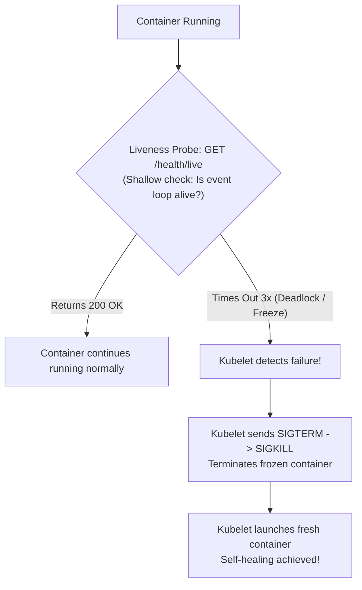

## Fast Revision (10-Second Recall)
- **Core Purpose of Liveness Probe:** Tells Kubernetes **IF the container is healthy or deadlocked**.
- **What Happens When It Fails?**
- - The local Kubelet **KILLS the container** (`SIGTERM` then `SIGKILL`) and restarts it based on `restartPolicy`.
- **The Deadly Trap: Cascading Liveness Restarts:**
- - If you check the database inside your liveness probe, and the database slows down, ALL your pods fail their liveness probes simultaneously! Kubernetes kills and restarts every single pod at once, triggering a catastrophic cascading outage!
- **The Iron Rule:** Liveness probes must be **SHALLOW** (only check if process is responsive). Never check downstream databases in a liveness probe!
- **Use `startupProbe` for Slow-Starting Apps:** Prevents liveness probes from killing apps during slow initialization.

## The 30-Second Spoken Script
"A Liveness Probe is a Kubernetes self-healing health check designed to detect when an application is alive but hopelessly broken—such as an irreversible thread deadlock, fatal memory corruption, or frozen event loop.

When a liveness probe fails consecutively beyond its failureThreshold (typically 3 times):
The Kubelet agent terminates the container process and initiates a clean restart.

However, the most critical architectural concept is avoiding the Cascading Liveness Probe Trap:
A common junior mistake is putting database or external cache checks inside the liveness probe. If the database experiences a momentary latency spike, the liveness probes on all 50 application pods time out simultaneously. Kubernetes decides that every single pod in the cluster is dead and kills them all at once. When all 50 pods reboot simultaneously, they slam the already struggling database with connection storms, creating a catastrophic unrecoverable outage.

Therefore, the senior engineering rule:
1. Liveness probes must be strictly shallow: they should only verify that the local HTTP process can return HTTP 200, proving the process is not deadlocked.
2. Deep checks (checking databases, message queues) belong exclusively in the Readiness Probe, which safely pulls traffic without killing containers.
3. For slow-starting applications like Java Spring Boot, we configure a startupProbe with a generous failureThreshold so Kubernetes does not prematurely kill the app while it loads classes."

## Scenario / Problem Context
A production service enters a deadlock state: the process is still running, so the OS does not terminate it, but all threads are frozen and cannot respond to requests. The interviewer evaluates your knowledge of self-healing mechanisms and the dangerous pitfalls of misconfigured liveness probes.

## Architectural Workflow / Sequence


## Deep-Dive Analysis & Root Causes

| Attribute | Rule | WhatToCheck | DangerIfMisconfigured |
| --- | --- | --- | --- |
| Liveness Probe (Restart) | MUST BE SHALLOW | Does the application process answer HTTP requests? Is the thread pool alive? | Cascading cluster-wide reboot loop if downstream database slows down
Readiness Probe (Route) | CAN BE DEEP | Can the application reach the database? Are caches populated? | Temporary removal from endpoints (Safe; no restarts)
Startup Probe (Boot) | PROTECTS SLOW BOOTS | Has the container finished initial startup? | Disables liveness probe until initial boot completes |


## Practical Debugging Commands & Code
```bash
# 1. Production Liveness and Startup Probe configuration:
# startupProbe:
#   httpGet:
#     path: /health/live
#     port: 8080
#   failureThreshold: 30
#   periodSeconds: 10   # Gives slow JVM apps up to 300s to boot!
#
# livenessProbe:
#   httpGet:
#     path: /health/live
#     port: 8080
#   initialDelaySeconds: 0
#   periodSeconds: 10
#   timeoutSeconds: 2
#   failureThreshold: 3

# 2. View container restart counts caused by failing liveness probes:
kubectl get pods -n production -o wide

# 3. View exact liveness failure event in pod description:
kubectl describe pod <pod-name> -n production | grep -E "Liveness probe failed|Killing"
```

## Prevention & Senior Best Practices
- **Never Check Downstream Dependencies in Liveness Probes:** Ban external HTTP, database, and Redis calls in `/health/live`.
- **Always Pair with a `startupProbe` for Heavy Runtimes:** Use startup probes for JVM or heavy Node applications to avoid premature termination during startup.
- **Set `timeoutSeconds: 3` and `failureThreshold: 3`:** Give pods multiple opportunities to respond under high load before triggering a process kill.
