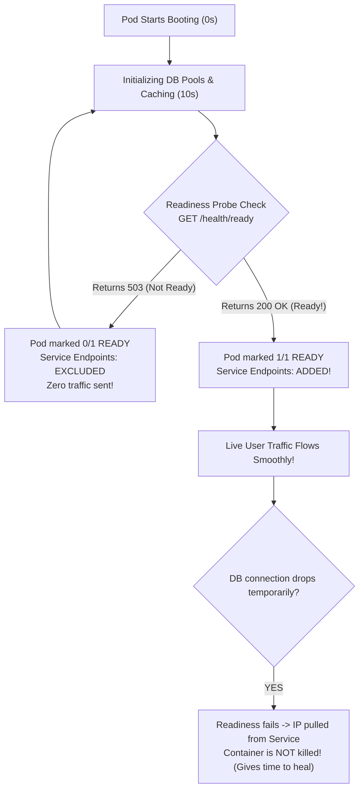

## Fast Revision (10-Second Recall)
- **Core Purpose of Readiness Probe:** Tells Kubernetes **WHEN a pod is ready to accept user traffic**.
- **What Happens When It Fails?**
- - Kubernetes does **NOT restart** the pod!
- - Kubernetes **REMOVES the pod's IP from the Service Endpoints**, stopping all incoming traffic until it becomes healthy again.
- **Readiness vs Liveness:**
- - **Readiness:** "Can I handle traffic right now?" (Controls routing).
- - **Liveness:** "Am I alive or deadlocked?" (Controls restarts).
- **Probe Types:** `httpGet` (e.g. `/health/ready`), `tcpSocket`, `exec` command, or `grpc`.

## The 30-Second Spoken Script
"A Readiness Probe is a health check mechanism in Kubernetes that determines whether a container is ready to accept incoming network traffic.

When a pod first starts up, it often needs several seconds to connect to databases, compile caches, or establish message broker connections. Without a readiness probe, Kubernetes immediately considers the container ready as soon as PID 1 starts, adding its IP to the Service endpoints and routing live customer traffic to it. Users immediately experience 502 Bad Gateway errors.

When you configure a Readiness Probe:
1. Kubernetes periodically probes the container—for example, via an HTTP GET request to /health/ready every 5 seconds.
2. As long as the probe fails or returns non-200, the pod is marked 0/1 READY. The Endpoints controller keeps the pod out of the Service routing table. Zero production traffic reaches it.
3. The moment the readiness probe returns HTTP 200, the pod transitions to 1/1 READY. Kubernetes adds its IP to the Service Endpoints and Ingress, and live traffic begins flowing smoothly.

Crucially, if a running pod becomes temporarily overloaded or loses its database connection later in its lifecycle, the readiness probe fails. Unlike a liveness probe—which would kill and restart the container—a failed readiness probe simply pulls the pod from the load balancer rotation temporarily, giving it time to recover without destructive restarts."

## Scenario / Problem Context
During deployments, users intermittently receive HTTP 502 Bad Gateway because the load balancer routes traffic to newly launched pods before their database connections and caches are initialized. The interviewer tests your understanding of Kubernetes probe mechanics.

## Architectural Workflow / Sequence


## Deep-Dive Analysis & Root Causes

| Attribute | ReadinessProbe | LivenessProbe |
| --- | --- | --- |
| Purpose | Controls traffic routing; gates entry to Service endpoints | Detects deadlocks and hangs; triggers container restart
Action on Failure | Removes pod IP from Endpoints (No restarts) | Kubelet kills container and restarts process
Endpoint Checked | Deep health check: checks DB, Redis, and internal dependencies | Shallow health check: checks only if HTTP server process responds |


## Practical Debugging Commands & Code
```bash
# 1. Production Readiness Probe YAML configuration snippet:
# readinessProbe:
#   httpGet:
#     path: /health/ready
#     port: 8080
#   initialDelaySeconds: 10
#   periodSeconds: 5
#   failureThreshold: 3
#   successThreshold: 1

# 2. View pod readiness status (READY column shows 0/1 vs 1/1):
kubectl get pods -l app=web-api -n production

# 3. Check probe failure messages in pod events:
kubectl describe pod <pod-name> -n production | grep -A 5 "Readiness:"
```

## Prevention & Senior Best Practices
- **Always Configure Readiness Probes for Every Service:** Never deploy production services without a readiness probe, or rolling updates will drop traffic.
- **Separate `/health/ready` from `/health/live`:** Readiness should verify external dependency reachability; Liveness should only check process responsiveness.
- **Tune `initialDelaySeconds`:** Set `initialDelaySeconds` to the realistic warm-up time of your application runtime.
