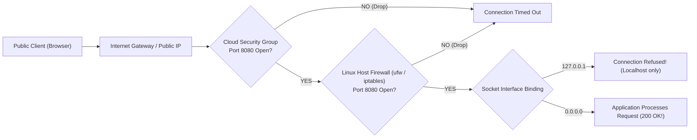

## Fast Revision (10-Second Recall)
- **Top 4 Culprits:**
- 1. **Localhost Socket Binding (`127.0.0.1`):** The application server is bound exclusively to the loopback interface (`127.0.0.1`). It must bind to `0.0.0.0` to accept external packets!
- 2. **Cloud Security Group / Firewall:** Port 8080 is not open to public ingress in AWS Security Group or GCP Firewall Rules.
- 3. **Host Firewall (`ufw` / `iptables`):** Linux firewall is active and dropping incoming packets on eth0.
- 4. **Private Subnet / NAT Gateway:** The server has a private IP and no Public IP or Elastic IP attached, or traffic does not route through an Internet Gateway.

## The 30-Second Spoken Script
"When an application responds successfully to 'localhost' but cannot be reached via its Public IP, the failure always boils down to interface binding or packet filtering at the host or cloud firewall level.

I check three specific checkpoints in order:

Checkpoint 1: The Socket Binding Interface.
By default, frameworks like Spring Boot, Node.js, and Flask often bind to 127.0.0.1 (the local loopback interface).
I run 'ss -tulpn | grep PORT'.
If the output shows '127.0.0.1:8080', the operating system kernel will strictly discard any incoming packet that arrived through the physical network interface card (eth0), allowing only internal connections from localhost.
The fix: reconfigure the application to bind to '0.0.0.0', which instructs the kernel to listen on all network interfaces.

Checkpoint 2: The Host-Level Firewall.
If the app is already bound to 0.0.0.0, I check the server's local Linux firewall using 'sudo ufw status' or 'sudo iptables -L -n -v'. If iptables has a default DROP policy and no ACCEPT rule for port 8080, external packets are silently dropped.

Checkpoint 3: Cloud Provider Perimeter Security.
In AWS or GCP, instances live inside a Virtual Private Cloud (VPC). I verify:
1. Does the AWS Security Group allow inbound TCP traffic on port 8080 from the public internet (0.0.0.0/0)?
2. Does the VPC subnet have a route table entry pointing 0.0.0.0/0 to an Internet Gateway (IGW)? If the instance is in a private subnet, public IPs cannot reach it directly without an Application Load Balancer."

## Scenario / Problem Context
A developer logs into the Linux server via SSH and runs `curl http://localhost:8080`, receiving a valid HTTP 200 response. However, browsing to `http://<Public-IP>:8080` times out or fails with connection refused. The interviewer tests your understanding of IP binding, NAT, and perimeter security.

## Architectural Workflow / Sequence


## Deep-Dive Analysis & Root Causes

| Binding | Reachability | Security |
| --- | --- | --- |
| `127.0.0.1:PORT` (Loopback) | Accessible ONLY from processes on the same server | Safest for internal background workers, broken for web servers
`0.0.0.0:PORT` (INADDR_ANY) | Accessible across all local, private, and public network interfaces | Required for web applications and microservices behind load balancers
`10.0.1.25:PORT` (Specific Private IP) | Accessible only via that specific internal network adapter | Useful for multi-homed servers separating management from public traffic |


## Practical Debugging Commands & Code
```bash
# 1. Check if application is listening on 0.0.0.0 or 127.0.0.1:
ss -tulpn | grep :8080

# 2. Check local Linux firewall status:
sudo ufw status

# 3. Test reaching the service via server's internal eth0 IP from localhost:
curl -Iv http://$(hostname -I | awk '{print $1}'):8080

# 4. Check AWS Security Group inbound rules via AWS CLI:
aws ec2 describe-security-groups --group-ids sg-0123456789abcdef0
```

## Prevention & Senior Best Practices
- **Enforce `HOST=0.0.0.0` in Container Base Images:** Ensure all Docker entrypoints and application configurations explicitly bind to 0.0.0.0.
- **Place Applications Behind an Application Load Balancer:** Never expose raw application ports (like 8080 or 3000) directly to the public internet; terminate TLS on an ALB.
- **Use Infrastructure as Code for Security Groups:** Manage all firewall ingress rules declaratively in Terraform.
