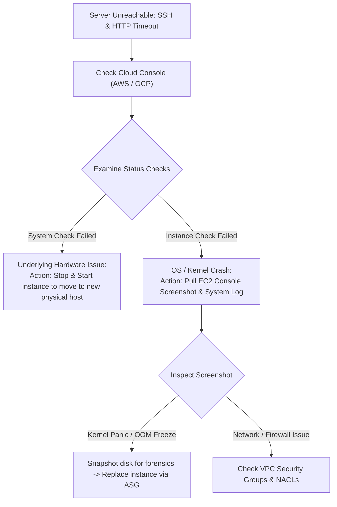

## Fast Revision (10-Second Recall)
- **The Outside-In Triage Path:**
- 1. **Cloud / Infrastructure Level:** Check AWS/GCP Console status checks (System Status Check vs Instance Status Check).
- 2. **Network / Security Group Level:** Did someone modify Security Groups, Route Tables, or NACLs?
- 3. **Hypervisor Serial Console / System Log:** Pull the instance console screenshot and system log to check for Kernel Panic or OOM lockup.
- 4. **Reboot vs Stop/Start:** Stop/Start migrates the instance to a new healthy underlying physical host if hardware degraded.

## The 30-Second Spoken Script
"When an application server suddenly becomes completely unreachable—failing both HTTP and SSH connections—I follow an outside-in triage process starting from cloud infrastructure down to the operating system kernel.

Step 1: Check Cloud Provider Status Checks.
In AWS EC2 or GCP Console, I inspect the instance status checks:
If the 'System Status Check' failed, it indicates underlying physical hardware degradation or network switch failure in the AWS datacenter.
If the 'Instance Status Check' failed, the physical hardware is fine, but the operating system kernel inside the VM has crashed, frozen, or exhausted its network stack.

Step 2: Inspect Cloud Console Screenshot and System Log.
Before rebooting, I pull the EC2 'Get System Log' and 'Get Instance Screenshot'. This captures the virtual video terminal. In 80% of server freezes, the screenshot reveals the exact cause: a Linux Kernel Panic, an Out of Memory freeze where kswapd pegged 100% CPU, or file system corruption during an automatic update.

Step 3: Verify Security Groups and Network ACLs.
I verify that a recently deployed Terraform script or colleague didn't accidentally modify the VPC Security Group or delete the Internet Gateway route table.

Step 4: Remediation: Stop/Start vs Replacement.
If it is an underlying hardware issue, I issue a 'Stop' and then 'Start' command. In cloud environments, Stop/Start forces the VM to launch on a completely different, healthy physical host server.
If the instance is part of an Auto Scaling Group, I let the ASG terminate the unhealthy instance and provision a clean replacement from our base AMI."

## Scenario / Problem Context
At 3:00 PM, an application server drops off the network. SSH times out, HTTP requests fail, and monitoring alerts fire. The interviewer evaluates your systematic triage from cloud hypervisor down to kernel panic debugging.

## Architectural Workflow / Sequence


## Deep-Dive Analysis & Root Causes

| CheckType | Meaning | Remedy |
| --- | --- | --- |
| System Status Check Failed | Loss of network connectivity or hardware power in cloud datacenter | Stop and Start instance (launches on fresh physical hypervisor)
Instance Status Check Failed | OS kernel panic, memory exhaustion, corrupted filesystem, or network stack failure | Inspect serial console log, reboot instance or replace via Auto Scaling Group
Security Group / Route Table Drift | Rules deleted or modified; port 22/443 closed | Audit AWS CloudTrail for `AuthorizeSecurityGroupIngress` events |


## Practical Debugging Commands & Code
```bash
# 1. Check EC2 instance status checks via AWS CLI:
aws ec2 describe-instance-status --instance-ids i-0123456789abcdef0

# 2. Get console screenshot of frozen instance (shows kernel panic screen!):
aws ec2 get-console-screenshot --instance-id i-0123456789abcdef0 --output text > screenshot.jpg

# 3. Pull console system log to inspect kernel panic stack trace:
aws ec2 get-console-output --instance-id i-0123456789abcdef0 --output text | tail -n 50

# 4. Stop and Start instance to migrate away from degraded physical host:
aws ec2 stop-instances --instance-ids i-0123456789abcdef0
aws ec2 start-instances --instance-ids i-0123456789abcdef0
```

## Prevention & Senior Best Practices
- **Use Auto Scaling Groups with Health Checks:** Never rely on single standalone virtual machines for production; let an ASG automatically terminate and replace unhealthy instances.
- **Configure AWS CloudWatch Auto-Recovery:** Attach a CloudWatch alarm that automatically executes `RecoverInstance` if the System Status Check fails for 2 consecutive minutes.
- **Centralize Logs Externally:** Stream all logs to CloudWatch/Datadog in real time so logs survive if an instance crashes.
