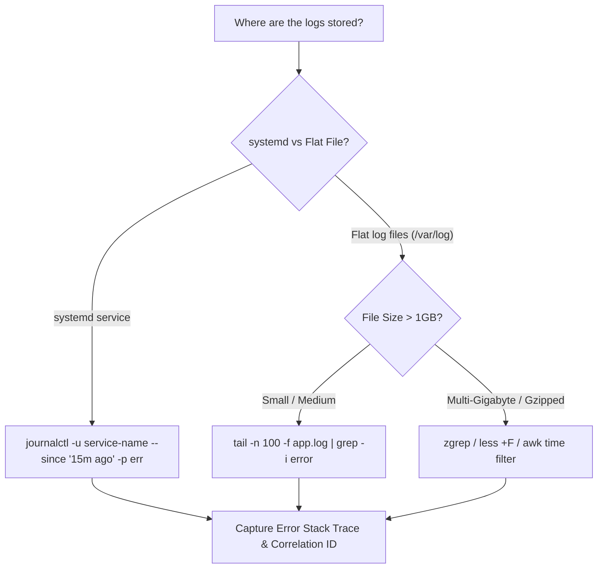

## Fast Revision (10-Second Recall)
- **Systemd Services (`journalctl`):**
- - Tail live logs: `journalctl -u my-service -f`.
- - Filter by time window: `journalctl -u my-service --since "15 minutes ago"`.
- - Filter by log priority: `journalctl -u my-service -p err..emerg`.
- **File-Based Logs (`/var/log`):**
- - Never run `cat` on a 20GB log file! Use `tail`, `less +G`, or `grep`.
- - Real-time follow with grep: `tail -f /var/log/app.log | grep --line-buffered -i error`.
- - Date range search: `awk '$0 >= "2024-03-15 14:00" && $0 <= "2024-03-15 14:15"' app.log`.

## The 30-Second Spoken Script
"Checking application logs efficiently on a Linux server requires choosing the right tool based on whether the application is managed by systemd or writes directly to log files in /var/log.

For services managed by systemd:
I use journalctl. It offers indexed, high-performance filtering without reading the entire disk:
1. To inspect errors in real-time: journalctl -u api-service -f
2. To narrow down to an outage window: journalctl -u api-service --since "15 minutes ago"
3. To filter only errors and fatal crashes: journalctl -u api-service -p err --no-pager

For file-based logs (such as Nginx or Docker container logs):
First, a critical rule: never run 'cat' or open a multi-gigabyte log file in vim, as this will exhaust memory and freeze your terminal.
Instead, I use:
1. 'tail -n 100 -f /var/log/app/production.log' to view recent log flow.
2. If searching for a specific error or correlation ID:
'grep -C 5 "Error 500" /var/log/app/production.log | tail -n 50'
The -C 5 flag includes five lines of context before and after the match, capturing the full stack trace.
3. For structured JSON logs, I pipe output through jq to format and filter specific fields:
`tail -n 100 app.json.log | jq 'select(.level == "error") | {time, error, path}'`

If logs are rotated into compressed archives (.gz), I use zgrep to search directly without manual decompression:
'zgrep "OutOfMemory" /var/log/app/app.log.2.gz'."

## Scenario / Problem Context
During an outage on a Linux VM, you need to find error traces from the last 15 minutes across systemd services, Nginx access logs, and application files without freezing your terminal on a 50GB log file. The interviewer tests your Linux CLI fluency.

## Architectural Workflow / Sequence


## Deep-Dive Analysis & Root Causes

| Tool | BestFor | Command |
| --- | --- | --- |
| `journalctl` | systemd managed services | `journalctl -u my-app --since "10m ago" -f`
`grep -C 5` | Searching text files for exceptions | `grep -C 5 -i "NullPointerException" app.log`
`zgrep` | Searching historical compressed `.gz` logs | `zgrep "Connection refused" /var/log/app.log.*.gz`
`jq` | Parsing structured JSON logs | `tail -n 500 app.json | jq 'select(.status >= 500)'` |


## Practical Debugging Commands & Code
```bash
# 1. Journalctl: View errors from past 20 minutes for api service:
journalctl -u api-service --since "20 minutes ago" -p err --no-pager

# 2. Search for correlation ID with 3 lines of context:
grep -C 3 "req-8f9a2b" /var/log/app/app.log

# 3. Filter JSON logs for 5xx errors using jq:
tail -n 200 /var/log/app/access.json | jq 'select(.status >= 500) | {timestamp, status, path, latency_ms}'

# 4. Search compressed rotated logs without decompressing:
zgrep -i "fatal" /var/log/nginx/access.log.*.gz | head -n 20
```

## Prevention & Senior Best Practices
- **Ship Logs to Centralized APM (Datadog/ELK/Loki):** Never rely on SSH to read production logs. Stream logs to a centralized searchable aggregator.
- **Emit Structured JSON Logs:** Format all logs as single-line JSON with standardized fields (`timestamp`, `level`, `trace_id`, `message`) for fast indexing.
- **Configure Logrotate with Compression:** Prevent disk exhaustion by rotating logs daily with `compress` enabled.
