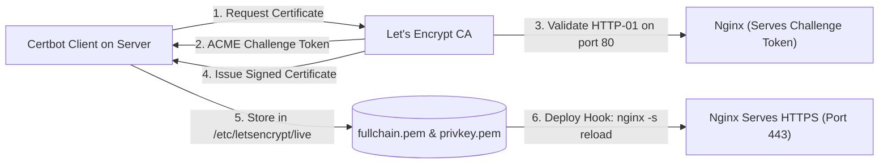

## Fast Revision (10-Second Recall)
- **The Modern Standard: Automated Let's Encrypt via Certbot & ACME:**
- Certbot automatically proves domain ownership via ACME HTTP-01 or DNS-01 challenge, generates 90-day certificates, and installs renewal cron jobs.
- **The 4 Pillars of Modern TLS Configuration:**
- 1. **Protocols:** Enable TLSv1.2 and TLSv1.3 only (Disable SSLv3, TLS 1.0, and 1.1).
- 2. **Cipher Suites:** Use modern forward-secrecy ciphers (ECDHE-ECDSA-AES128-GCM-SHA256).
- 3. **HTTP Strict Transport Security (HSTS):** Enforce browser HTTPS enforcement for 1 year (`max-age=31536000; includeSubDomains; preload`).
- 4. **Automated Renewal:** Systemd timer runs `certbot renew` twice daily, with a post-renewal hook reloading Nginx (`--post-hook "nginx -s reload"`).

## The 30-Second Spoken Script
"Configuring SSL/TLS certificates in production requires combining modern cryptographic hardening with 100% automated lifecycle renewal using the ACME protocol and Let's Encrypt or AWS Certificate Manager (ACM).

Here is my end-to-end configuration process:

First, Certificate Provisioning.
In cloud environments (AWS/GCP), we provision free, auto-renewing certificates via AWS Certificate Manager (ACM) attached directly to our Application Load Balancer or CloudFront CDN. DNS validation is configured once via Route53, and AWS renews the certificates automatically with zero server touch.
On Linux servers or virtual machines, we use Certbot with the Nginx plugin:
'sudo certbot --nginx -d example.com -d api.example.com'
Certbot completes an ACME HTTP-01 challenge against Let's Encrypt, downloads the signed fullchain.pem and private key privkey.pem, and updates the Nginx server block.

Second, Cryptographic Hardening.
We configure Nginx to adhere to Mozilla's Intermediate TLS guidelines:
1. We restrict protocols strictly to TLSv1.2 and TLSv1.3, disabling insecure legacy protocols.
2. We enable OCSP Stapling (ssl_stapling on) so the server delivers cached revocation status, saving clients a DNS lookup during the TLS handshake.
3. We configure HSTS (HTTP Strict Transport Security) with a 1-year max-age to prevent SSL stripping attacks.

Third, Automated Renewal Verification.
Let's Encrypt certificates expire after 90 days. Certbot installs a systemd timer (/lib/systemd/system/certbot.timer) that runs twice daily. We configure a post-renewal hook:
'--deploy-hook "nginx -s reload"'
This ensures that the moment a renewed certificate is written to disk, Nginx reloads its certificates into memory with zero downtime."

## Scenario / Problem Context
Modern web applications require HTTPS. Manually provisioning certificates and forgetting to renew them leads to severe browser security warnings and customer distrust. The interviewer evaluates your knowledge of TLS handshakes, Let's Encrypt automation, and secure cipher suite configuration.

## Architectural Workflow / Sequence


## Deep-Dive Analysis & Root Causes

| Component | Description | Importance |
| --- | --- | --- |
| `fullchain.pem` | Contains server certificate + intermediate CA certificates | Mandatory! Omitting intermediate CA causes mobile/browser "Untrusted Authority" errors
`privkey.pem` | Private RSA or ECDSA key (chmod 600) | Must NEVER be shared, committed to Git, or exposed in public directories
OCSP Stapling | `ssl_stapling on; ssl_stapling_verify on;` | Speeds up TLS handshake by embedding certificate validity proof
HSTS Header | `Strict-Transport-Security: max-age=31536000; includeSubDomains` | Instructs browsers to never connect over unencrypted HTTP |


## Practical Debugging Commands & Code
```bash
# 1. Issue certificate with Certbot for Nginx:
sudo certbot --nginx -d example.com -d www.example.com

# 2. Test automated certificate renewal (dry run):
sudo certbot renew --dry-run

# 3. Secure Nginx SSL snippet (/etc/nginx/snippets/ssl-params.conf):
# ssl_protocols TLSv1.2 TLSv1.3;
# ssl_prefer_server_ciphers on;
# ssl_ciphers "ECDHE-ECDSA-AES128-GCM-SHA256:ECDHE-RSA-AES128-GCM-SHA256";
# ssl_session_cache shared:SSL:10m;
# ssl_session_timeout 1d;
# ssl_stapling on;
# ssl_stapling_verify on;
# add_header Strict-Transport-Security "max-age=31536000; includeSubDomains" always;

# 4. Verify certificate expiration date using openssl CLI:
openssl s_client -connect example.com:443 -servername example.com 2>/dev/null | openssl x509 -noout -dates
```

## Prevention & Senior Best Practices
- **Always Automate Renewal via Systemd Timers:** Never rely on manual calendar reminders to renew certificates; verify `certbot.timer` is active.
- **Bundle Intermediate Certificates (`fullchain.pem`):** Always configure `fullchain.pem` rather than `cert.pem` so client browsers can construct the trust chain to the root authority.
- **Alert on Expiration 30 Days Out:** Use external uptime monitoring (UptimeRobot, Datadog) to alert if a certificate has &lt; 30 days remaining.
