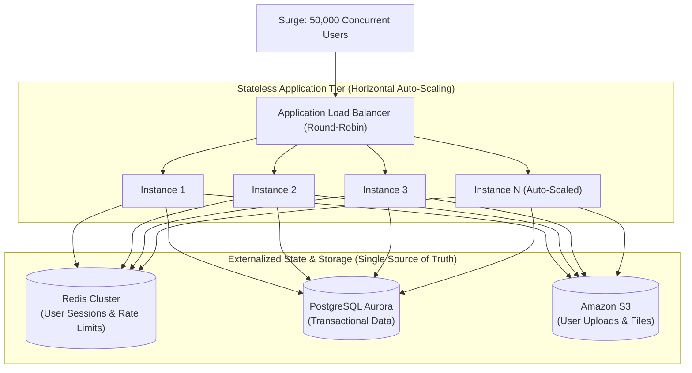

## Fast Revision (10-Second Recall)
- **Vertical (Scale Up) vs Horizontal (Scale Out):**
- - **Vertical:** Add more CPU/RAM to a single server. Simple, zero code changes, but hits hard physical hardware limits and creates a single point of failure.
- - **Horizontal:** Add more server instances behind a load balancer. Unlimited scale, high availability, but requires a strictly **Stateless Application Architecture**.
- **The 4 Requirements for Horizontal Scalability:**
- 1. **Stateless App Tier:** No local user sessions stored in server memory (`req.session`). Sessions must live in Redis or signed JWTs.
- 2. **External File Storage:** No user uploads saved to local disk (`/uploads`). Use Amazon S3 or Google Cloud Storage.
- 3. **Load Balancing:** Distribute traffic evenly via Round Robin or Least Connections using AWS ALB or Nginx.
- 4. **Auto-Scaling Metrics (HPA / ASG):** Scale out based on CPU (70%), memory, or request throughput (RPS).

## The 30-Second Spoken Script
"To scale an application horizontally, the fundamental prerequisite is making the application tier completely stateless, ensuring any incoming request can be handled by any server instance in the pool without data loss.

Here is my 4-step transformation plan:

Step 1: Externalize User Session State.
In a single-server architecture, user sessions are often stored in local server memory. If we add multiple instances, a user whose login session was created on Server 1 will be logged out the moment the load balancer routes their next request to Server 2. We externalize all session state into a distributed in-memory cache like Redis, or transition to stateless cryptographically signed JWT tokens.

Step 2: Externalize File and Media Storage.
Applications that save user-uploaded avatars or PDF invoices to local disk (/uploads) cannot scale horizontally. We refactor the storage layer to stream uploads directly to durable object storage like Amazon S3 or Google Cloud Storage, using CloudFront CDN for global caching.

Step 3: Load Balancing and Health Probing.
We deploy an Application Load Balancer (such as AWS ALB or Nginx) in front of the instances, using Round Robin or Least Connections routing. We configure robust HTTP health checks (/health) so instances that crash or fail are automatically pulled from rotation.

Step 4: Dynamic Auto-Scaling (HPA).
In Kubernetes, we define a Horizontal Pod Autoscaler (HPA) or an AWS Auto Scaling Group. We set scaling targets based on resource saturation: for example, automatically adding pods when average CPU utilization exceeds 70% or when request queue latency spikes.

With these four elements in place, the application tier can scale seamlessly from 2 instances to 200 instances during traffic surges with zero code changes."

## Scenario / Problem Context
Traffic is doubling month over month. The monolithic server is running on the largest available cloud instance (64 vCPUs, 256GB RAM) and cannot be scaled up any further. Leadership tasks you with re-architecting the application for horizontal scalability. The interviewer tests your stateless design and auto-scaling architecture.

## Architectural Workflow / Sequence


## Deep-Dive Analysis & Root Causes

| Aspect | AntiPattern | ScalableSolution |
| --- | --- | --- |
| User Sessions | In-memory session store (`express-session` memory store) | Distributed Redis cluster or stateless JWT tokens
File Uploads | Writing files to local filesystem (`/var/www/uploads`) | Direct S3 pre-signed upload URLs
Scheduled Background Tasks | In-process `node-cron` running on every instance (duplicate execution!) | Distributed queues (BullMQ, SQS, Celery) with dedicated worker pods
Auto-Scaling Metric | Scaling purely on memory (which rarely drops after allocation) | Scale on CPU utilization (70%) and incoming HTTP request rate |


## Practical Debugging Commands & Code
```bash
# 1. Kubernetes Horizontal Pod Autoscaler (HPA) definition snippet:
# apiVersion: autoscaling/v2
# kind: HorizontalPodAutoscaler
# metadata:
#   name: api-autoscaler
# spec:
#   scaleTargetRef:
#     apiVersion: apps/v1
#     kind: Deployment
#     name: api-service
#   minReplicas: 3
#   maxReplicas: 50
#   metrics:
#   - type: Resource
#     resource:
#       name: cpu
#       target:
#         type: Utilization
#         averageUtilization: 70

# 2. View active HPA status and current replica targets:
kubectl get hpa api-autoscaler -n production

# 3. AWS Auto Scaling Group manual capacity scale test:
aws autoscaling set-desired-capacity   --auto-scaling-group-name api-asg-production   --desired-capacity 10
```

## Prevention & Senior Best Practices
- **Strictly Enforce Stateless Application Design:** Ban saving state, temporary caches, or user sessions to local container disk.
- **Decouple Background Schedulers from Web Pods:** Never run cron jobs inside horizontally scaled web pods; run cron as dedicated singleton Kubernetes CronJobs.
- **Use Pre-Signed S3 URLs:** Let client browsers upload large images directly to S3, bypassing application web servers entirely.
