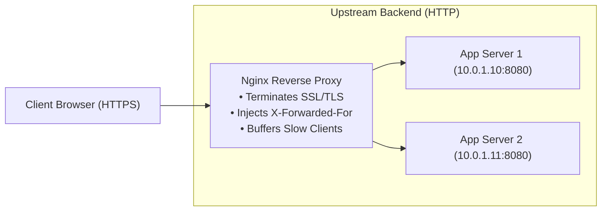

## Fast Revision (10-Second Recall)
- **What is a Reverse Proxy?** A server that sits in front of backend web servers and forwards client requests to those servers, shielding the backend.
- **The 5 Core Responsibilities of a Reverse Proxy:**
- 1. **SSL/TLS Termination:** Offload heavy cryptographic handshakes from application runtimes.
- 2. **Header Forwarding:** Forward original client identity (`X-Forwarded-For`, `X-Forwarded-Proto`, `Host`).
- 3. **Request/Response Buffering:** Protects backend from slow clients (Slowloris attacks).
- 4. **Load Balancing:** Distribute requests across upstream application instances (Round Robin, Least Connections).
- 5. **Static Asset Caching & Compression:** Serve static images/CSS with gzip/brotli without touching the app server.

## The 30-Second Spoken Script
"Configuring a production-grade reverse proxy using Nginx involves four key responsibilities: routing traffic to upstream servers, terminating TLS, forwarding client metadata headers, and buffering requests.

Here is how I structure an enterprise Nginx reverse proxy:

First, Upstream Definition: We define an upstream block with the `least_conn` load balancing algorithm across our backend application nodes, configuring health failure thresholds and keepalive connections to prevent TCP churn.

Second, SSL/TLS Termination: In the server block for port 443, we configure modern TLS 1.2 and 1.3 with strong cipher suites, HTTP/2 enabled, and HSTS headers. A separate server block listens on port 80 and returns a permanent 301 redirect to HTTPS.

Third, Essential Proxy Headers: When Nginx proxies traffic, the backend application sees Nginx as the client IP. We inject standard forwarding headers: `Host`, `X-Real-IP`, `X-Forwarded-For`, and `X-Forwarded-Proto`. This ensures our application logs real client IPs and generates correct HTTPS URLs.

Fourth, Timeouts and Buffering: We enable `proxy_buffering` so Nginx absorbs slow client connections, and configure `proxy_connect_timeout` and `proxy_read_timeout` to 60 seconds to prevent hung worker processes."

## Scenario / Problem Context
Directly exposing application runtimes (Node.js, Python, Go) to the public internet is insecure and inefficient. You need to configure a reverse proxy (Nginx) to terminate SSL, buffer slow clients, forward client IP headers, and load balance traffic. The interviewer tests your production reverse proxy design.

## Architectural Workflow / Sequence


## Deep-Dive Analysis & Root Causes

| Directive | Purpose | Gotcha |
| --- | --- | --- |
| `proxy_pass` | Defines target protocol and upstream address (`http://backend_api`) | Adding a trailing slash changes URI rewriting behavior
`proxy_set_header X-Forwarded-For` | Passes true client IP down to backend application | Without this, all backend logs report `127.0.0.1` as client IP
`proxy_buffering on` | Buffers response in Nginx RAM before sending to slow cellular client | Must be disabled (`proxy_buffering off`) for Server-Sent Events (SSE) or streaming APIs
`keepalive 32` | Maintains open TCP connections between Nginx and backends | Requires `proxy_http_version 1.1;` and clearing Connection header |


## Practical Debugging Commands & Code
```bash
# 1. Production Nginx configuration snippet (/etc/nginx/sites-available/app.conf):
# upstream api_servers {
#     least_conn;
#     server 127.0.0.1:8080;
#     keepalive 32;
# }
# server {
#     listen 443 ssl http2;
#     server_name api.example.com;
#     ssl_certificate /etc/letsencrypt/live/api.example.com/fullchain.pem;
#     ssl_certificate_key /etc/letsencrypt/live/api.example.com/privkey.pem;
#
#     location / {
#         proxy_pass http://api_servers;
#         proxy_http_version 1.1;
#         proxy_set_header Connection "";
#         proxy_set_header Host $host;
#         proxy_set_header X-Real-IP $remote_addr;
#         proxy_set_header X-Forwarded-For $proxy_add_x_forwarded_for;
#         proxy_set_header X-Forwarded-Proto $scheme;
#     }
# }

# 2. Test Nginx configuration syntax before reloading:
sudo nginx -t

# 3. Reload Nginx without dropping active client connections:
sudo nginx -s reload
```

## Prevention & Senior Best Practices
- **Always Run `nginx -t` Before Reloading:** Never run `systemctl reload nginx` without verifying configuration syntax first.
- **Disable Buffering for Streaming / SSE:** If supporting Server-Sent Events or WebSockets, explicitly configure `proxy_buffering off;` on those routes.
- **Enforce HTTP to HTTPS Redirection:** Ensure port 80 returns a permanent `301 Moved Permanently` redirect to HTTPS.
