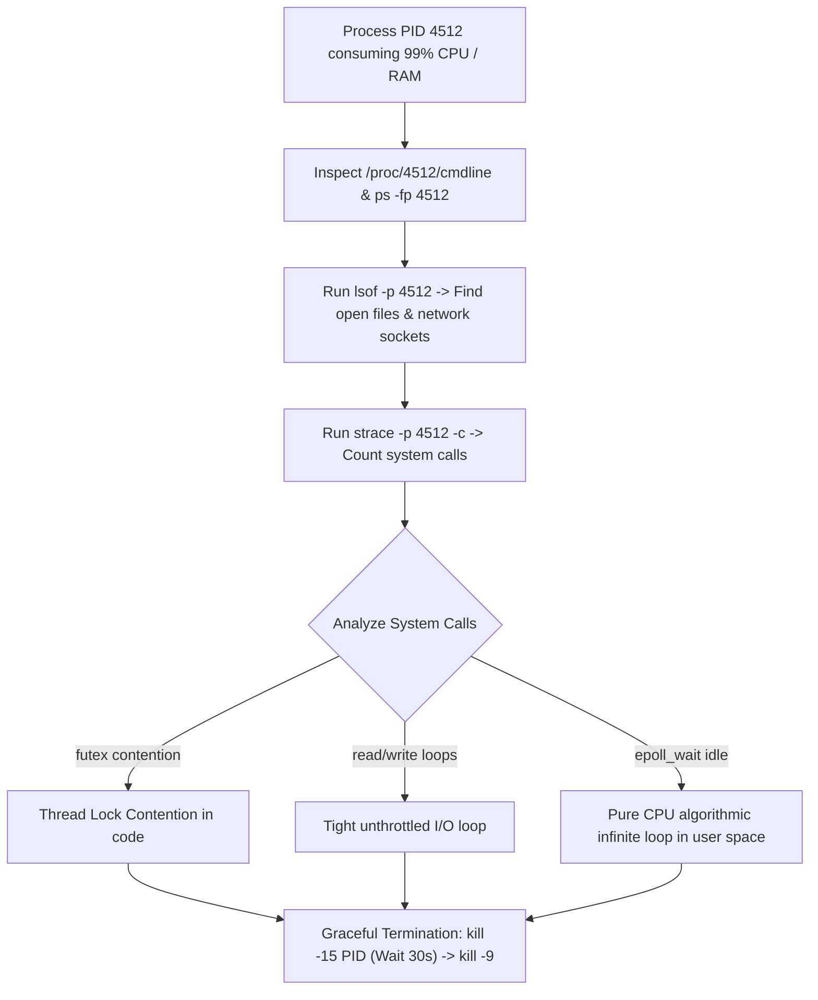

## Fast Revision (10-Second Recall)
- **The Linux Diagnostic Toolbelt:**
- 1. **`top -c -p <PID>`:** Inspect command-line arguments and threads (`H` key).
- 2. **`lsof -p <PID>`:** View all open files, sockets, databases, and network connections.
- 3. **`strace -p <PID> -c`:** Count system calls to see if process is stuck in a loop calling `read()`, `write()`, or `futex()`.
- 4. **`/proc/<PID>/` filesystem:** Inspect `cmdline`, `environ`, `fd`, `status`, and `limits`.
- 5. **`kill -15` (SIGTERM) vs `kill -9` (SIGKILL):** Always attempt graceful termination (`SIGTERM`) first to allow file flushes; only use `SIGKILL` as a last resort.

## The 30-Second Spoken Script
"To investigate a rogue Linux process consuming excessive resources, I inspect its identity, thread state, open file descriptors, and kernel system calls.

First, identify the exact executable and command arguments.
I run 'ps -fp PID' and inspect '/proc/PID/cmdline'. This reveals the exact script, binary path, and runtime parameters.

Second, inspect what the process is communicating with using 'lsof'.
Running 'lsof -p PID' shows every file descriptor held by the process: open log files, active database TCP connections, and listening sockets. This immediately tells me if the process is stalled writing to a saturated disk or waiting on a hanging network socket.

Third, inspect thread-level activity and system calls.
If the process is burning 100% CPU, I attach 'strace' using:
'strace -p PID -c'
The summary output shows what system calls the process is making. If it is executing millions of 'futex' calls per second, it indicates severe thread lock contention. If it is stuck in an endless loop of 'read' or 'write' calls, it points to a tight I/O loop in user code.

Fourth, graceful remediation.
If the process is causing an active outage, I never blindly run 'kill -9'. I issue 'kill -15' (SIGTERM) to allow the process to flush write buffers and close database connections cleanly. If it fails to terminate within 30 seconds, I follow up with 'kill -9' (SIGKILL)."

## Scenario / Problem Context
A single mystery process is consuming 99% CPU or 15GB of RAM, impacting other services on the host. The engineering lead asks you to identify what this process is doing, what files or sockets it has open, and how to safely remediate it without data loss.

## Architectural Workflow / Sequence


## Deep-Dive Analysis & Root Causes

| Tool | Purpose | Value |
| --- | --- | --- |
| `lsof -p PID` | List open files, network sockets, pipes, and devices | Reveals which database or client IP the runaway process is talking to
`strace -p PID -c` | Profile kernel system calls made by the process | Identifies whether CPU is burned in system calls or pure user computation
`/proc/PID/limits` | Inspect OS resource limits (max open files, memory limits) | Identifies if process is nearing `ulimit` exhaustion
`gdb -p PID` / Thread Dumps | Attach debugger to inspect live call stacks | Pinpoints the exact source code function running |


## Practical Debugging Commands & Code
```bash
# 1. Inspect exact binary path and working directory from /proc:
ls -l /proc/4512/exe
ls -l /proc/4512/cwd
cat /proc/4512/environ | tr '\0' '\n'

# 2. View all network connections and open files for the process:
lsof -p 4512

# 3. Attach strace to summarize system calls for 10 seconds:
sudo strace -p 4512 -c

# 4. Graceful termination with fallback:
kill -15 4512 && sleep 5 && kill -9 4512 2>/dev/null || true
```

## Prevention & Senior Best Practices
- **Enforce Linux cgroup Limits via Systemd / Docker:** Limit maximum CPU and memory per service unit using `CPUQuota=200%` and `MemoryMax=4G`.
- **Configure Sane `ulimit` Defaults:** Set file descriptor limits (`nofile 65535`) in `/etc/security/limits.conf`.
- **Automate Process Monitoring via Monit or Systemd:** Configure systemd with `Restart=on-failure` and `WatchdogSec=30s` to self-heal stalled processes.
