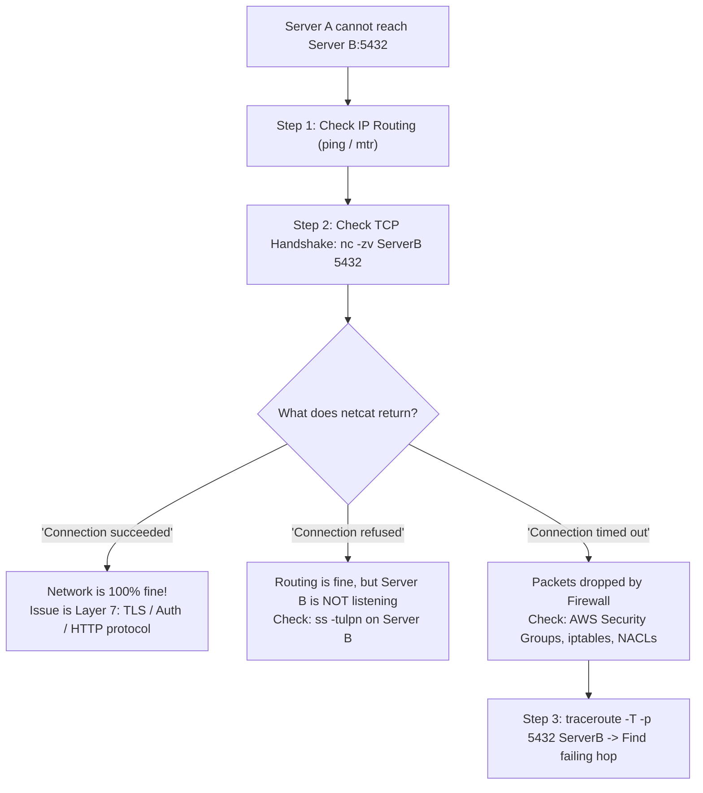

## Fast Revision (10-Second Recall)
- **The 4-Step Network Diagnostic Ladder:**
- 1. **Layer 3 (IP Routing):** `ping <Server-B-IP>` (Tests ICMP reachability; note that many cloud firewalls disable ping!).
- 2. **Layer 4 (TCP Port / Handshake):** `nc -zv <Server-B-IP> 5432` or `curl -Iv telnet://...` (Verifies TCP 3-way handshake succeeds).
- 3. **Routing Hop Tracing:** `traceroute -T -p 5432 <Server-B-IP>` (Shows exactly which intermediate router or firewall drops packets).
- 4. **Packet Inspection (The Source of Truth):** `sudo tcpdump -i any host <Server-B-IP> and port 5432 -nn` (Verifies SYN sent vs SYN-ACK received).

## The 30-Second Spoken Script
"When investigating network connectivity issues between two servers, I follow the OSI model bottom-up—from Layer 3 IP routing up to Layer 7 application protocols.

Step 1: Verify Layer 3 IP Reachability.
From Server A, I test IP routing to Server B:
I run 'ping SERVER_B_IP'. If ping responds, Layer 3 routing is functional. However, because modern cloud security groups often block ICMP ping by default, a failed ping does not necessarily mean the network is down.

Step 2: Verify Layer 4 TCP Port Connectivity.
The most definitive test is a TCP handshake check using netcat:
'nc -zv SERVER_B_IP PORT'
If netcat returns 'Connection to SERVER_B_IP PORT succeeded', the TCP 3-way handshake completed.
If netcat returns 'Connection refused', Server B's IP is reachable, but the application service on Server B is either stopped or listening on the wrong interface (e.g. bound to 127.0.0.1).
If netcat hangs with 'Connection timed out', packets are being dropped by a firewall, AWS Security Group, or network routing table.

Step 3: Trace the Network Path with traceroute.
I run 'traceroute -T -p PORT SERVER_B_IP'. The -T flag uses TCP SYN packets matching our target port. This reveals the exact network hop or gateway router where packets stop forwarding.

Step 4: Packet Capture with tcpdump.
If the issue is intermittent or drops during payload transfer, I run tcpdump on both Server A and Server B simultaneously. Comparing packet captures reveals whether the sender sent the TCP SYN, whether Server B received it, and whether Server B responded with a SYN-ACK or TCP RST packet."

## Scenario / Problem Context
App Server A cannot communicate with Database Server B. The developer says "the network is down". You need to pinpoint the exact failure point between Layer 3 (IP), Layer 4 (TCP), and Layer 7 (Application). The interviewer tests your OSI model troubleshooting methodology.

## Architectural Workflow / Sequence


## Deep-Dive Analysis & Root Causes

| Result | Layer | Meaning |
| --- | --- | --- |
| `Connection to IP succeeded` | Layer 4 (TCP) | TCP handshake succeeded; network is healthy. Issue is Layer 7 (TLS certificate, auth, or API error)
`Connection refused` | Layer 4 (TCP) | Packets reached Server B, but the OS returned a TCP RST. Service is not running or listening on localhost
`Connection timed out` | Layer 3 / 4 Firewall | Packets dropped in transit. Security Group, iptables, or missing route table entry
`Destination Host Unreachable` | Layer 3 (IP) | No routing table entry or ARP resolution failure |


## Practical Debugging Commands & Code
```bash
# 1. Test TCP port accessibility using netcat:
nc -zv 10.0.1.50 5432

# 2. Modern TCP traceroute to identify which hop drops packets:
traceroute -T -p 5432 10.0.1.50

# 3. Capture TCP handshake packets on Server A:
sudo tcpdump -i any host 10.0.1.50 and port 5432 -nn -vv

# 4. Interactive network path quality and latency tool (MTR):
mtr --tcp --port 5432 --report 10.0.1.50
```

## Prevention & Senior Best Practices
- **Automate VPC Peering & Security Group Validation in CI:** Validate Terraform network topology rules in pull requests to prevent broken routes.
- **Implement Mutual Health Checks:** Have services report downstream dependency reachability via structured readiness probes.
- **Set Connection Timeouts:** Ensure client libraries configure explicit connection timeouts (e.g. 3s) so failed connections fail fast rather than hanging indefinitely.
