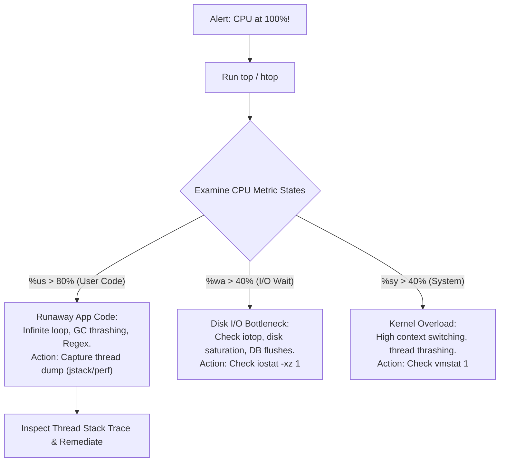

## Fast Revision (10-Second Recall)
- **The 3 CPU Modes to Identify First:**
- 1. **`%us` (User CPU):** Application code is burning CPU (infinite loop, regex catastrophically backtracking, unindexed JSON parsing, GC thrashing).
- 2. **`%sy` (System / Kernel CPU):** Heavy context switching, thousands of fork/thread calls, or saturated network socket interrupts.
- 3. **`%wa` (I/O Wait):** CPU is actually idle waiting for slow disk I/O (NVMe throttling, database checkpointing, saturated EBS bandwidth).
- **The First 4 Commands:** `uptime` (load average) $\rightarrow$ `top -c` (sort by %CPU) $\rightarrow$ `pidstat -u 1` (per-process CPU) $\rightarrow$ `perf top` or thread dump.

## The 30-Second Spoken Script
"When a server's CPU suddenly pegs at 100%, I follow a disciplined 4-step diagnostic protocol to categorize whether the bottleneck is user code, kernel overhead, or disk I/O wait.

Step 1: Check Load Average and CPU breakdown.
I run 'uptime' and 'top' to examine the load average relative to the number of CPU cores. More importantly, I check the CPU breakdown row:
If %us (user) is 90%+, it means our application code is running a runaway computation—such as an infinite loop, catastrophic regex backtracking, or JVM garbage collection thrashing.
If %sy (system) is high, the server is overwhelmed by kernel context switching, memory page allocation, or socket interrupts.
If %wa (iowait) is high, the CPU is not actually calculating anything; it is stalled waiting for slow disk or network I/O.

Step 2: Identify the culprit process and threads.
Pressing 'P' in top sorts processes by CPU. Once I identify the PID, I press 'H' in top or run 'pidstat -t -p PID 1' to view the specific thread within that process consuming the CPU.

Step 3: Capture stack traces or profile before killing.
If the culprit is a Java or Node.js process, I never kill it blindly without capturing a diagnostic thread dump or CPU profile (using jstack or perf record). This captures the exact line of code executing during the 100% CPU spike.

Step 4: Immediate remediation and auto-scaling.
If customer traffic is failing, I horizontally scale the cluster or restart the runaway container to restore service while engineering analyzes the thread dump."

## Scenario / Problem Context
At peak hours, server CPU pegs at 100%, causing HTTP requests to queue up and time out. The interviewer evaluates your Linux systems diagnostic instincts, your ability to interpret CPU metric states (%usr, %sys, %wa), and your triage steps.

## Architectural Workflow / Sequence


## Deep-Dive Analysis & Root Causes

| CpuState | Meaning | CommonCauses |
| --- | --- | --- |
| `%us` (User Space) | Time spent executing unprivileged user code | Complex algorithm loops, JSON serialization of massive payloads, crypto hashing, GC thrashing
`%sy` (System Space) | Time spent in Linux kernel system calls | High context switching rate, process forking, thousands of active TCP connections
`%wa` (I/O Wait) | CPU cycles stalled waiting for disk or network I/O | PostgreSQL checkpointing, unbuffered log writes, AWS EBS IOPS burst depletion
`%si` / `%hi` (Interrupts) | Software / hardware interrupt processing | Network interface card (NIC) saturation, packet flooding, SYN flood DDoS |


## Practical Debugging Commands & Code
```bash
# 1. Instant overview of load average and CPU usage:
uptime
top -b -n 1 | head -n 20

# 2. Track per-thread CPU consumption for PID 1234:
pidstat -u -t -p 1234 1 5

# 3. Capture thread dump for Node.js or Java:
# Java thread dump:
# jstack 1234 > /tmp/thread_dump.txt
# Node.js inspector CPU profile:
# kill -USR1 1234

# 4. Profile kernel and user functions in real time with perf:
perf top -p 1234
```

## Prevention & Senior Best Practices
- **Configure Kubernetes CPU Requests and Limits:** Enforce container resource quotas to prevent a single runaway container from starving the host node.
- **Alert on CPU at 75% Before It Hits 100%:** Trigger auto-scaling (Horizontal Pod Autoscaler) at 70% CPU so new instances absorb traffic before degradation occurs.
- **Audit Regular Expressions:** Ban unanchored or nested quantifiers (e.g. `(a+)+$`) that trigger polynomial catastrophic backtracking.
