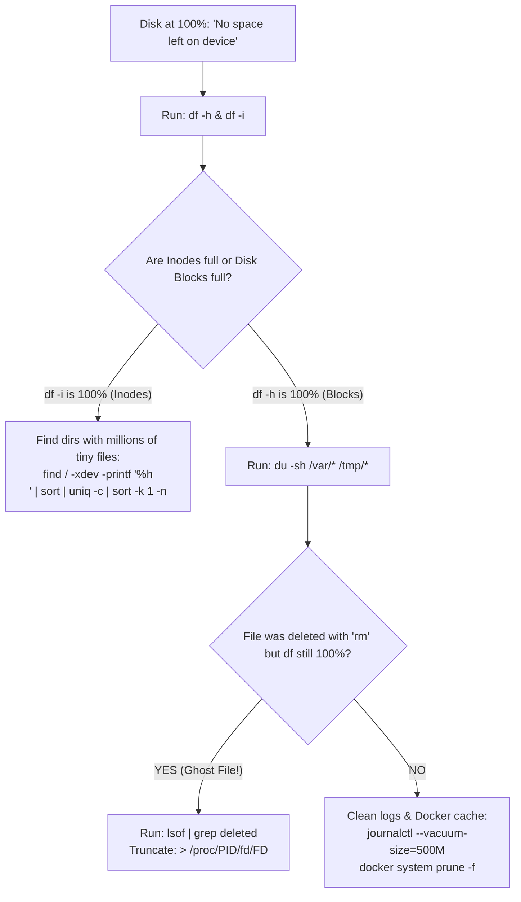

## Fast Revision (10-Second Recall)
- **The "Ghost File" Trap (`df` vs `du` Mismatch):**
- If you delete a large file with `rm` while a running process (Nginx, app) still holds an open file descriptor, Linux unlinks the name, but **does not free the disk blocks until the process closes the file!**
- `df -h` shows 100% full, but `du -sh` cannot find the file!
- **The Fix:** Find open deleted files with `lsof | grep deleted` and truncate the file: `> /proc/<PID>/fd/<FD>` or restart the process.
- **Top 4 Disk Hogs:**
- 1. Unrotated logs in `/var/log` or application logs.
- 2. Docker dangling images and build cache (`/var/lib/docker`).
- 3. Core dumps / heap snapshots in `/tmp`.
- 4. Exhausted Inodes (`df -i` shows 100% inodes full even if disk space is 50%).

## The 30-Second Spoken Script
"When a server disk reaches 100% utilization, the system can freeze, corrupt databases, and reject SSH sessions. I resolve this in four distinct steps:

Step 1: Check disk space and inode consumption.
I run 'df -h' to see which mount point is 100% full (such as / or /var). I also run 'df -i' to verify inode utilization—frequently, millions of tiny session files or uncompressed logs exhaust the filesystem inode table even when gigabytes of disk space remain.

Step 2: Identify the largest files and directories.
I run 'du -ahx / | sort -rh | head -n 20' or inspect common culprit directories: /var/log, /tmp, and /var/lib/docker.

Step 3: Handle the 'Deleted File Still Consuming Space' trap.
A frequent production trap occurs when an engineer deletes a massive 30GB log file using rm, but df -h continues reporting 100% full. This happens because the application process still holds an open file descriptor to the deleted file. I run 'lsof +L1' or 'lsof | grep deleted' to identify the process holding the ghost file. Instead of killing the process, I truncate the open file descriptor directly using '> /proc/PID/fd/FD', which instantly frees the disk blocks without restarting the service.

Step 4: Clean up Docker artifacts and system logs safely.
I run 'journalctl --vacuum-time=2d' to shrink systemd journals and 'docker system prune -af --volumes' to clean up orphaned containers and build caches.

Finally, to prevent recurrence, we configure logrotate with strict retention and configure Prometheus alerts at 80% disk capacity."

## Scenario / Problem Context
Database and web services crash with `No space left on device`. SSH commands start failing. An engineer runs `rm -f /var/log/app.log`, but `df -h` still reports 100% full! The interviewer tests your Linux filesystem mastery, understanding of unlinked open file descriptors, and safe disk cleanup.

## Architectural Workflow / Sequence


## Deep-Dive Analysis & Root Causes

| Scenario | Symptom | Solution |
| --- | --- | --- |
| Deleted File Trap (`rm` on open file) | `df -h` shows 100% full, but `du -sh` shows only 20GB used | `lsof | grep deleted` $\rightarrow$ truncate file descriptor `> /proc/$PID/fd/$FD`
Inode Exhaustion | `df -h` shows 50GB free, but creating a file fails with `No space left on device` | `df -i` reveals 100% inodes used; delete millions of empty files in `/tmp` or PHP sessions
Systemd Journal Bloat | `/var/log/journal` consuming 25GB | `journalctl --vacuum-time=3d` to purge historical journals
Docker Storage Bloat | `/var/lib/docker` filling root disk | `docker system prune -af` to remove dangling images and layers |


## Practical Debugging Commands & Code
```bash
# 1. Check disk capacity and inode consumption:
df -h
df -i

# 2. Find open files that were deleted but still consuming disk space:
lsof +L1 | grep deleted

# 3. Truncate open deleted file descriptor directly without restarting service:
# Example: PID 1420 has file descriptor 3 pointing to deleted /var/log/app.log:
> /proc/1420/fd/3

# 4. Safely clean systemd journals and Docker cache:
sudo journalctl --vacuum-size=500M
docker system prune -af --volumes
```

## Prevention & Senior Best Practices
- **Enforce Automated Log Rotation:** Ensure `/etc/logrotate.d/` is configured with `maxsize 100M`, `daily`, and `rotate 7` with `copytruncate` or `compress`.
- **Separate Mount Points:** Put `/var/log` and database data directories on separate physical volumes so log bloat never halts the root filesystem.
- **Set Disk Alerts at 75% and 85%:** Alert on disk capacity before the disk hits 100% to allow automated cleanup scripts to intervene.
