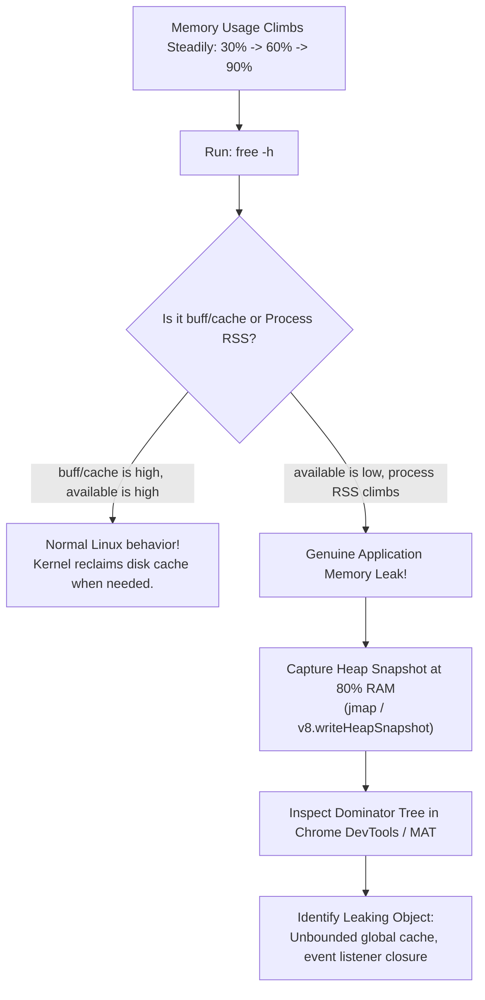

## Fast Revision (10-Second Recall)
- **Linux Buffer/Cache vs Genuine Memory Leak:**
- - Linux uses free RAM for `buff/cache`. This is normal and released instantly when applications need memory!
- - Check **`available`** memory in `free -m`, NOT `free`!
- **Signs of a Real Memory Leak:**
- The process **RSS (Resident Set Size)** steadily increases monotonically without leveling off, regardless of traffic drops.
- **Top 3 Runtime Memory Leak Causes:**
- 1. **Unbounded Caches / Global Variables:** Storing user session tokens or search results in an in-memory JS Object/Map without eviction (TTL/LRU).
- 2. **Event Listeners / Timers Leaks:** Adding event listeners inside request handlers without cleanup.
- 3. **Unclosed Connections / File Descriptors:** Leaking database cursors or HTTP client response streams.

## The 30-Second Spoken Script
"When server memory usage steadily increases without stabilizing, I first verify whether the memory is genuinely consumed by application processes or simply held by the Linux page cache.

Step 1: Check 'available' memory using 'free -m'.
Linux automatically uses unused RAM for filesystem cache (buff/cache). If 'available' memory remains healthy, the server is operating normally. However, if 'available' memory decreases monotonically while the process's Resident Set Size (RSS) climbs, it confirms a genuine application memory leak.

Step 2: Inspect process memory consumption.
I run 'ps aux --sort=-%mem | head -n 10' to verify which specific PID is accumulating memory.

Step 3: Capture a runtime heap dump before OOM occurs.
Once memory hits 80%, I capture a heap snapshot before the Linux OOM Killer executes SIGKILL (Exit 137). For Node.js, I trigger a heap dump using v8.writeHeapSnapshot(); for Java, I use jmap -dump:live,format=b,file=heap.bin.

Step 4: Analyze heap dump for retaining paths.
Opening the heap dump in Chrome DevTools or Eclipse Memory Analyzer (MAT) immediately reveals the retaining tree. 90% of memory leaks are caused by unbounded global arrays or Maps used as ad-hoc in-memory caches without TTLs, or leaked event listener closures capturing request context.

Step 5: Remediate and enforce guardrails.
I replace in-memory maps with Redis or an LRU cache like lru-cache, and configure the container runtime memory limit to restart cleanly if thresholds are exceeded."

## Scenario / Problem Context
Over a 48-hour period, memory steadily climbs from 30% to 95% until the Linux kernel terminates the process with an Out of Memory (OOM) error. The interviewer tests your ability to distinguish between normal cache buffering and genuine memory leaks, as well as runtime heap dump profiling.

## Architectural Workflow / Sequence


## Deep-Dive Analysis & Root Causes

| Metric | Meaning | RiskLevel |
| --- | --- | --- |
| `VIRT` (Virtual Memory) | Total memory the process has requested (including mapped files and shared libs) | Harmless; high VIRT does not mean physical RAM is exhausted
`RSS` (Resident Set Size) | Actual physical RAM currently allocated to the process | Critical; continuous RSS climb confirms active memory leak
`buff/cache` | RAM used by Linux kernel to cache files read from disk | Completely safe; freed immediately on demand
`Available` | Estimate of memory available for starting new applications without swapping | The true indicator of server memory health |


## Practical Debugging Commands & Code
```bash
# 1. Check true available memory and swap usage:
free -h

# 2. List top 5 memory-consuming processes by RSS in megabytes:
ps -eo pid,user,rss,%mem,command --sort=-rss | head -n 6 | awk 'NR==1 {print $0} NR>1 {$3=int($3/1024)"MB"; print $0}'

# 3. Trigger Java heap dump:
jmap -dump:live,format=b,file=/tmp/heap.hprof <PID>

# 4. Trigger Node.js heap snapshot via signal:
# node --max-old-space-size=2048 --heapsnapshot-signal=SIGUSR2 app.js
kill -USR2 <PID>
```

## Prevention & Senior Best Practices
- **Never Use Unbounded In-Memory Collections:** Mandate LRU eviction and maximum entry limits on all in-memory caching libraries.
- **Configure Heap Size Smaller Than Container Limit:** Set JVM `-Xmx` or Node `--max-old-space-size` to 75% of the container memory limit to avoid sudden kernel OOM kills.
- **Automate Leak Detection in Staging:** Run 2-hour soak tests in staging under simulated load while monitoring heap growth gradients.
