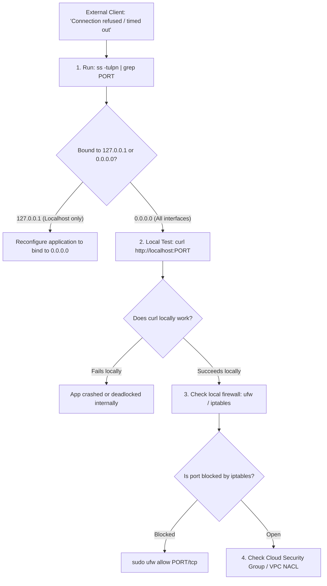

## Fast Revision (10-Second Recall)
- **The 4 Essential Layers to Check:**
- 1. **Process Listening & Socket Binding:** Is the process actually listening on the port? Is it bound to `127.0.0.1` (localhost only) or `0.0.0.0` (all interfaces)?
- 2. **Local Host Firewall:** Is Linux `ufw`, `firewalld`, or `iptables` dropping incoming packets on that port?
- 3. **Cloud Security Groups / NACLs:** Does AWS Security Group or GCP Firewall Rule permit inbound TCP on that port from the caller's CIDR?
- 4. **SELinux / AppArmor:** Is Linux security module blocking socket binding to non-standard ports?

## The 30-Second Spoken Script
"When a service process is running but its port cannot be accessed, I systematically isolate the issue through four network layers:

Layer 1: Socket Binding Verification (netstat / ss).
First, I verify if the process is actually listening and examine its bound IP address:
I run 'ss -tulpn | grep PORT'.
A very common root cause: the service is bound to 127.0.0.1 (localhost) instead of 0.0.0.0 (all interfaces). If bound to 127.0.0.1, the application can only accept connections originating from the same local machine. External traffic from the load balancer or other servers will be instantly rejected with Connection Refused.

Layer 2: Localhost Loopback Test.
I test the service locally from inside the server using 'curl -Iv http://localhost:PORT'. If localhost responds successfully with HTTP 200, it proves the application process is 100% healthy, and the blockage is strictly in the network or firewall layer.

Layer 3: Local Host Firewall (iptables / ufw).
I check whether local Linux firewall software is blocking incoming traffic:
I run 'sudo ufw status' or 'sudo iptables -L -n -v'. If iptables has a default DROP policy and lacks an ACCEPT rule for that port, incoming packets are dropped.

Layer 4: Cloud Security Groups and Network ACLs.
If local firewalls are open, the blocker is external. I inspect AWS Security Group ingress rules to verify that TCP traffic on that port is permitted from the caller's IP range or VPC CIDR."

## Scenario / Problem Context
`ps aux` shows the application process is running, but external curl commands return `Connection refused` or hang indefinitely. The interviewer evaluates your step-by-step diagnostic process across OS sockets, local firewalls, and cloud network boundaries.

## Architectural Workflow / Sequence


## Deep-Dive Analysis & Root Causes

| Symptom | Cause |
| --- | --- |
| `Connection refused` immediately | Process is not listening, crashed, or bound to `127.0.0.1` while caller is external
`Connection timed out` after 30 seconds | Packets silently dropped by a firewall (`iptables -j DROP` or AWS Security Group)
Works via `127.0.0.1` but fails via server private IP | Service explicitly configured with `host: "localhost"` in app configuration |


## Practical Debugging Commands & Code
```bash
# 1. Check which process is listening on port 8080 and its bound interface:
ss -tulpn | grep :8080
# Look for: 0.0.0.0:8080 (CORRECT) vs 127.0.0.1:8080 (LOCAL ONLY)

# 2. Check local Linux firewall status:
sudo ufw status verbose
sudo iptables -L INPUT -n -v

# 3. Test TCP port accessibility from remote machine using netcat / nmap:
nc -zv <server-ip> 8080

# 4. Trace packet drops using tcpdump on the server:
sudo tcpdump -i any port 8080 -nn
```

## Prevention & Senior Best Practices
- **Always Configure Servers to Bind to `0.0.0.0`:** In containers and production services, explicitly set `HOST=0.0.0.0` in configuration templates.
- **Standardize Security Group Rules via Terraform:** Prevent manual security group edits by defining all ingress rules in version-controlled Terraform modules.
- **Use Readiness Probes in K8s:** Ensure Kubernetes only routes traffic to pods once the port is actively listening and responsive.
