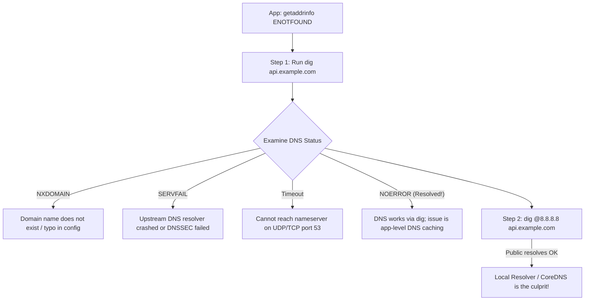

## Fast Revision (10-Second Recall)
- **The 3 Common DNS Return Codes:**
- 1. **`NXDOMAIN` (Non-Existent Domain):** The DNS server is healthy, but the requested domain name does NOT exist.
- 2. **`SERVFAIL` (Server Failure):** The DNS nameserver encountered an internal crash or upstream timeout.
- 3. **`REFUSED`:** The nameserver refused to answer (firewall or zone restriction).
- **The Diagnostic Ladder:**
- `/etc/resolv.conf` (check nameservers) $\rightarrow$ `dig domain.com` $\rightarrow$ `dig @nameserver domain.com` (bypass local cache) $\rightarrow$ Check Kubernetes CoreDNS logs.

## The 30-Second Spoken Script
"Troubleshooting DNS resolution failures requires verifying configuration from local resolver files up through intermediate caches to authoritative nameservers.

My step-by-step diagnostic workflow:

Step 1: Test resolution using 'dig' or 'nslookup'.
I run 'dig api.example.com'. I check the status code in the header:
If status is NXDOMAIN, the DNS server is working fine, but the domain record does not exist or has a typo.
If status is SERVFAIL, the nameserver failed to reach authoritative upstream servers or had a DNSSEC validation failure.
If dig times out, the client cannot reach the configured nameserver over UDP port 53.

Step 2: Inspect '/etc/resolv.conf'.
I inspect the local resolver configuration:
1. What nameserver IPs are listed? Are they reachable using 'nc -zvu NAMESERVER 53'?
2. Is 'options ndots:5' present? In Kubernetes, ndots:5 causes external domain lookups (like api.stripe.com) to append 4 local search domains first, generating 4 unnecessary queries before querying the root.

Step 3: Test against a public DNS server directly.
I bypass local resolver caches by querying a public resolver:
'dig @8.8.8.8 api.example.com'
If 8.8.8.8 resolves successfully but the local server fails, the domain record is valid, and the failure is isolated to our local caching resolver or Kubernetes CoreDNS.

Step 4: Troubleshoot Kubernetes CoreDNS.
In Kubernetes, DNS issues usually stem from CoreDNS scaling. I check CoreDNS pod logs using:
'kubectl logs -l k8s-app=kube-dns -n kube-system'
If CoreDNS pods are restarting, hitting CPU limits, or being rate-limited by cloud provider DNS (such as AWS Route53 1024 packets/sec limit), I scale CoreDNS replicas and deploy NodeLocal DNSCache to cache DNS queries directly on every worker node."

## Scenario / Problem Context
Applications intermittently fail with `getaddrinfo ENOTFOUND`, `EAI_AGAIN`, or `Server failure: NXDOMAIN`. Database and external API calls drop. The interviewer assesses your understanding of DNS query mechanics, caching, and Kubernetes CoreDNS troubleshooting.

## Architectural Workflow / Sequence


## Deep-Dive Analysis & Root Causes

| ReturnCode | Meaning | NextStep |
| --- | --- | --- |
| `NOERROR` | Query successful; answers returned | If app still fails, check application-level connection pool or TLS
`NXDOMAIN` | Authoritative nameserver confirms domain name does not exist | Check spelling, CNAME chains, or newly created DNS records
`SERVFAIL` | Resolver could not communicate with authoritative nameserver | Check upstream network routing or DNSSEC misconfiguration
`Timeout` | Packets dropped on UDP/TCP port 53 | Check firewall egress rules for UDP port 53 |


## Practical Debugging Commands & Code
```bash
# 1. Perform detailed DNS lookup with query time and nameserver:
dig api.example.com +trace

# 2. Test lookup against specific nameserver directly:
dig @1.1.1.1 api.example.com +short

# 3. Check Kubernetes resolver configuration inside pod:
cat /etc/resolv.conf

# 4. Check CoreDNS health and logs in Kubernetes:
kubectl get pods -n kube-system -l k8s-app=kube-dns
kubectl logs -n kube-system -l k8s-app=kube-dns --tail=100
```

## Prevention & Senior Best Practices
- **Deploy NodeLocal DNSCache in Kubernetes:** Caches DNS lookups locally on each node, slashing CoreDNS latency and avoiding AWS Route53 throttling.
- **Tune `ndots:2` in Pod Specs:** Reduce `ndots:5` to `ndots:2` for pods making heavy external API calls to avoid 4 redundant search domain queries.
- **Avoid Setting DNS TTLs to 0:** Maintain realistic TTLs (60s to 300s) so client caches prevent DNS flood during traffic spikes.
