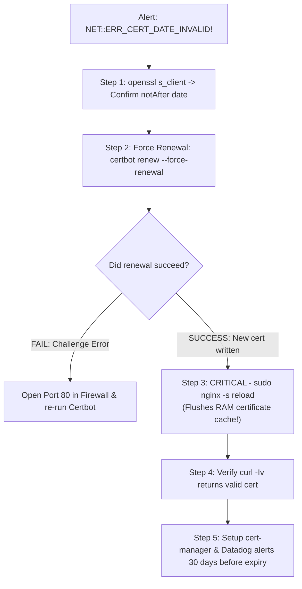

## Fast Revision (10-Second Recall)
- **Emergency Action Steps:**
- 1. **Confirm Expiry Date:** `echo | openssl s_client -connect domain.com:443 2>/dev/null | openssl x509 -noout -dates`.
- 2. **Execute Emergency Renewal:** Run `sudo certbot renew --force-renewal`.
- 3. **Reload Web Server:** `sudo nginx -s reload` (Nginx caches certificates in memory; simply renewing on disk does NOT update live connections until reloaded!).
- 4. **Verify Live Handshake:** Confirm browsers and external cURL return valid expiration date.
- **Why Automated Renewal Failed (Top 3 Causes):**
- 1. ACME HTTP-01 challenge blocked because port 80 was closed in firewall.
- 2. Nginx configuration had a syntax error, preventing the post-renewal reload hook.
- 3. Certbot was renewed on disk, but the process was never reloaded.

## The 30-Second Spoken Script
"An expired SSL certificate in production is a critical Sev-1 incident because modern browsers actively block users with intimidating security warnings.

My emergency remediation procedure:

Step 1: Verify the expiration and certificate details.
I test the live SSL handshake from my terminal:
'openssl s_client -connect api.example.com:443 -servername api.example.com | openssl x509 -noout -dates -subject'
This confirms the exact notAfter expiration timestamp and ensures we are debugging the right domain and load balancer.

Step 2: Trigger emergency renewal.
If the certificate is managed by Certbot/Let's Encrypt on Linux:
I execute: 'sudo certbot renew --force-renewal'
If the renewal fails, it is usually because the ACME HTTP-01 challenge failed. I verify that port 80 is open to the public internet, since Let's Encrypt requires port 80 to validate domain ownership.

Step 3: Reload the web server memory cache.
A common failure in certificate fixes: an engineer successfully renews the certificate files on disk, but users continue seeing the expired certificate warning! This happens because Nginx and Apache load certificates into RAM at startup. I execute:
'sudo nginx -s reload'
This reloads the new certificate into active worker processes in under 10 milliseconds without dropping in-flight client connections.

Step 4: Verify the resolution globally.
I verify via curl from external networks and check SSL Labs or Datadog synthetic monitors.

Step 5: Root Cause and Permanent Prevention.
Why did the automated cron fail?
1. If port 80 was closed, we open port 80 permanently (redirecting to 443).
2. In Kubernetes, we deploy cert-manager with automated Prometheus alerts if any certificate has fewer than 21 days until expiration."

## Scenario / Problem Context
Users wake up to full-screen browser warnings: "Your connection is not private (NET::ERR_CERT_DATE_INVALID)". Traffic plummets by 95%. The production SSL certificate expired 2 hours ago. The interviewer assesses your emergency remediation steps, reload mechanics, and permanent architectural prevention.

## Architectural Workflow / Sequence


## Deep-Dive Analysis & Root Causes

| FailureCause | WhyItBreaks | Fix |
| --- | --- | --- |
| Port 80 Blocked in Firewall | Let's Encrypt ACME HTTP-01 challenge connects over HTTP port 80 to verify domain control | Ensure port 80 is open on Security Group and Nginx redirects to HTTPS
Certificate Renewed but Nginx Not Reloaded | New `.pem` files exist on disk, but Nginx workers still hold old expired cert in memory | Execute `sudo nginx -s reload` or configure `--deploy-hook "nginx -s reload"`
Corrupted Nginx Config Blocks Renewal Hook | Nginx failed `nginx -t` test due to an unrelated bad config, aborting reload | Fix Nginx syntax error and manually reload |


## Practical Debugging Commands & Code
```bash
# 1. Emergency one-liner to check SSL expiry date of remote server:
echo | openssl s_client -connect example.com:443 -servername example.com 2>/dev/null | openssl x509 -noout -enddate

# 2. Force immediate certificate renewal:
sudo certbot renew --force-renewal

# 3. Reload Nginx without downtime to load new certificate into RAM:
sudo nginx -s reload

# 4. Check status of Certbot automated renewal systemd timer:
sudo systemctl status certbot.timer
sudo systemctl list-timers | grep certbot
```

## Prevention & Senior Best Practices
- **Always Configure a `--deploy-hook`:** Ensure `certbot renew` automatically executes `nginx -s reload` upon successful renewal.
- **Automate Certificate Management in K8s with `cert-manager`:** Use Kubernetes `cert-manager` custom resources that automatically rotate certificates 30 days before expiration.
- **Set Multi-Tiered Expiration Alerts:** Configure alerts at 30 days, 14 days, and 7 days prior to expiry in Prometheus or Datadog.
