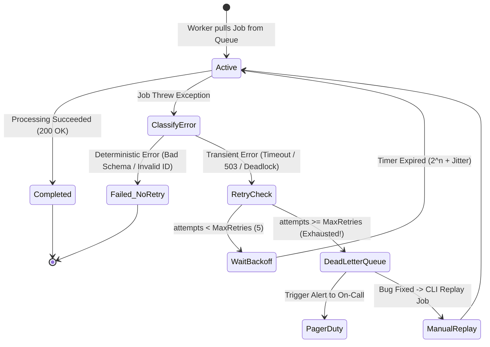

## Fast Revision (10-Second Recall)
- **The Core Rule of Retries:** Never retry immediately! Immediate retries create a **thundering herd storm** that keeps struggling downstream databases or third-party APIs down.
- **Transient vs Deterministic Errors:**
  - *Transient (Safe to Retry):* Network timeouts (`ETIMEDOUT`), DB connection pool starvation, HTTP 503/429 rate limits.
  - *Deterministic / Permanent (Do NOT Retry):* `JSON.parse` syntax error, invalid customer account ID, missing mandatory parameter. (Retrying will fail 100% of the time).
- **Exponential Backoff with Full Jitter:** Calculate retry delays using $t = 2^{\text{attempts}} \times \text{base\_delay} + \text{random\_jitter}$.
- **Dead Letter Queue (DLQ):** When maximum retry limits (e.g. 5 attempts) are exhausted, the job is moved to a quarantine DLQ to prevent blocking subsequent jobs.
- **Alerting on DLQ Arrival:** Any message landing in a Dead Letter Queue must trigger an automated high-priority alert to the on-call team.

## The 30-Second Spoken Script
> "Handling failed background jobs reliably requires distinguishing between transient infrastructure hiccups and permanent deterministic errors.
>
> In production architectures, we implement a multi-layered fault-tolerance lifecycle:
> First, **Error Classification**: In our worker logic, we catch errors and classify them. If an error is deterministic—such as an invalid customer ID or schema validation failure—we abort immediately, fail the job, and update our database without wasting compute retrying.
> Second, **Exponential Backoff with Full Jitter**: If the error is transient—such as a database deadlock, Redis timeout, or third-party HTTP 503—we retry using exponential backoff with randomized jitter. Randomized jitter is critical: it prevents thousands of failed jobs from retrying at the exact same second, which would recreate a thundering herd against the recovering dependency.
> Third, **Dead Letter Queue (DLQ) Quarantine**: If a job fails after 5 retries, it transitions to a Dead Letter Queue. An alert notifies the on-call team, and the job payload, stack trace, and execution attempts are preserved.
> Finally, **Replay Tooling**: Once the bug is patched or the dependency recovers, engineers replay DLQ messages with a single CLI command without losing customer state."

## Scenario / Problem Context
A logistics platform processed driver payout calculations in background worker pods. On a Friday night, the third-party banking payout API experienced a 2-minute network hiccup.

The background worker was configured with naive retry logic:
```typescript
// DANGEROUS: Fixed instant retry loop!
try {
  await executePayout(driverId, amount);
} catch (err) {
  // Retries immediately in a while loop up to 50 times!
}
```

When the bank API had its 2-minute blip:
1. 8,000 pending payout jobs failed simultaneously.
2. All 8,000 jobs began retrying immediately in a tight loop, firing over 40,000 HTTP requests per second at the bank's API gateway.
3. The bank's edge DDoS protection permanently blacklisted the logistics company's corporate IP address for 12 hours.
4. Hundreds of driver payouts were processed three times because network drop timeouts occurred after the bank had already authorized the transaction.

The engineering department requires an enterprise retry framework with exponential backoff, jitter, and dead letter queue quarantining.

## Architectural Workflow / Sequence


## Deep-Dive Analysis & Root Causes

### 1. The Math of Exponential Backoff with Jitter
- **Fixed Delay:** All 5,000 failed jobs retry at $t=10\text{s}$, creating synchronized traffic spikes (thundering herds).
- **Exponential Backoff:** $t = 2^{\text{attempts}} \times 1\text{s}$ (Delays: 2s, 4s, 8s, 16s, 32s). While exponential backoff spaces out retries over time, all jobs that failed at the same moment still retry at the exact same future seconds!
- **Exponential Backoff with Full Jitter (AWS Architecture Standard):**
  $$\text{Sleep} = \text{random}(0, \min(\text{MaxBackoff}, \text{BaseDelay} \times 2^{\text{attempts}}))$$
  Jitter distributes retries evenly across a continuous time spectrum, flattening traffic curves and allowing the recovering service to stabilize.

### 2. Idempotency is Mandatory for Retries
If a network timeout occurs during an external payment or SMS dispatch, you cannot know if the operation succeeded or failed on the remote server:
- If you retry without an `Idempotency-Key`, the user is charged twice or receives two SMS messages!
- **Rule:** Every background job performing state mutations must generate a deterministic idempotency key derived from `job.id` or transaction metadata.

### 3. DLQ Retention and Poison Pill Isolation
Without a Dead Letter Queue:
- A poison pill message causes the worker process to crash.
- The queue broker redelivers the message to the next worker.
- The next worker crashes.
- In minutes, all worker pods in the cluster enter `CrashLoopBackOff`, halting the entire pipeline.
- A DLQ quarantines the poison pill after $N$ attempts, preserving cluster uptime.

## Practical Debugging Commands & Code

### Step 1: Configuring BullMQ with Exponential Backoff and Jitter
```typescript
// src/queues/payoutQueue.ts
import { Queue } from 'bullmq';

export const payoutQueue = new Queue('driver-payouts', {
  connection: { host: process.env.REDIS_HOST, port: 6379 },
  defaultJobOptions: {
    attempts: 5, // Maximum 5 retry attempts before moving to DLQ
    backoff: {
      type: 'exponential',
      delay: 2000, // Initial delay: 2s (Retries at ~2s, ~4s, ~8s, ~16s, ~32s)
    },
    removeOnComplete: 1000, // Keep last 1,000 successful jobs for history
    removeOnFail: false,    // NEVER delete failed jobs! Retain for DLQ inspection
  },
});
```

### Step 2: Intelligent Worker Implementation with Error Classification
```typescript
// src/workers/payoutWorker.ts
import { Worker, Job, UnrecoverableError } from 'bullmq';
import { executeBankTransfer } from '../services/bankGateway';

export const payoutWorker = new Worker(
  'driver-payouts',
  async (job: Job) => {
    const { driverId, amountCents, currency } = job.data;

    try {
      // Pass job.id as idempotency key to prevent double payout on retry!
      return await executeBankTransfer({
        driverId,
        amountCents,
        currency,
        idempotencyKey: `payout_${job.id}_attempt_${job.attemptsMade}`,
      });

    } catch (error: any) {
      // 1. Check for Deterministic / Permanent errors (Invalid Account, Currency Not Supported)
      if (error.code === 'INVALID_ROUTING_NUMBER' || error.statusCode === 422) {
        console.error(`Unrecoverable error in job ${job.id}: ${error.message}. Aborting retries.`);
        // BullMQ UnrecoverableError skips all remaining retries and fails the job immediately!
        throw new UnrecoverableError(error.message);
      }

      // 2. Transient error (ETIMEDOUT, 503, 504) -> Normal throw triggers backoff retry
      console.warn(`Transient error in job ${job.id} on attempt ${job.attemptsMade + 1}. Retrying...`);
      throw error;
    }
  },
  {
    connection: { host: process.env.REDIS_HOST, port: 6379 },
    concurrency: 5,
  }
);

// Listen for permanently failed jobs moved to DLQ state
payoutWorker.on('failed', (job, err) => {
  if (job && job.attemptsMade >= job.opts.attempts!) {
    console.error(`CRITICAL: Job ${job.id} exhausted all retries! Moved to DLQ. Reason: ${err.message}`);
    // Trigger PagerDuty or Slack alert to on-call
    notifyOnCallDlqAlert(job.id, err.message);
  }
});
```

### Step 3: CLI Script to Inspect and Replay Dead Letter Queue Jobs
A production maintenance script allowing engineers to inspect and replay failed jobs:

```typescript
// scripts/replayDlqJobs.ts
import { Queue } from 'bullmq';

const queue = new Queue('driver-payouts', { connection: { host: 'localhost', port: 6379 } });

async function replayFailedJobs() {
  const failedJobs = await queue.getFailed(0, 100);
  console.log(`Found ${failedJobs.length} failed jobs in DLQ.`);

  for (const job of failedJobs) {
    console.log(`Job ID: ${job.id} | Reason: ${job.failedReason}`);
    
    // Retry this job
    await job.retry();
    console.log(`Re-enqueued job ${job.id} for processing.`);
  }

  process.exit(0);
}

replayFailedJobs();
```

## Prevention & Senior Best Practices
1. **Never Retry Deterministic Errors:** Use `UnrecoverableError` to immediately fail jobs caused by validation errors, missing IDs, or 4xx business rejections.
2. **Always Use Exponential Backoff with Jitter:** Ensure all retry policies incorporate randomized jitter to prevent thundering herd retry storms against recovering services.
3. **Mandate Idempotency Keys Across All Retries:** Pass deterministic idempotency keys (`payout_${job.id}`) to external APIs so network drop retries never cause duplicate charges.
4. **Retain Failed Jobs in the DLQ:** Set `removeOnFail: false` so failed jobs remain in the Dead Letter Queue for forensic analysis and manual replay.
5. **Alert on DLQ Backlog Depth:** Configure Prometheus or CloudWatch alarms on `bullmq_jobs_failed_total > 0` to alert the engineering team before customers report missing transactions.

