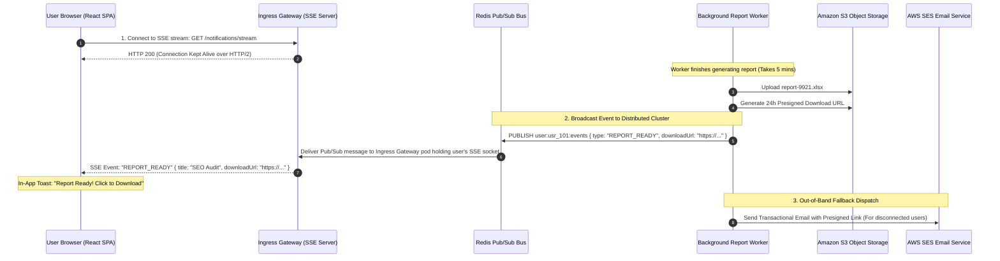

## Fast Revision (10-Second Recall)
- **The Core User Experience Challenge:** A user requests a report and continues working. How do you notify them when the report is ready—whether they are still on the page, browsing another screen, or closed their laptop?
- **The 3 Primary Notification Channels:**
  1. *Active In-App (Real-Time):* **Server-Sent Events (SSE)** or **WebSockets** pushed via Redis Pub/Sub. Triggers an in-app toast notification and opens a download dialog.
  2. *Passive Out-of-Band:* **Transactional Email** (SendGrid, AWS SES) with a time-limited presigned S3 download link.
  3. *B2B Programmatic:* **Webhooks** delivered via HTTP POST to third-party endpoints.
- **Why SSE is Superior to WebSockets for Job Completion:** Server-Sent Events run over standard HTTP/2, auto-reconnect natively, traverse corporate corporate firewalls, and use a lightweight unidirectional stream.
- **Security Invariant:** Never attach the raw multi-megabyte PDF/Excel file to the email! Always send an encrypted presigned download link that expires in 24 hours.

## The 30-Second Spoken Script
> "Notifying users when a background report completes requires a dual-track strategy catering to both active in-app sessions and disconnected users.
>
> In production architectures, we implement:
> First, **Real-Time In-App Push via Server-Sent Events (SSE)**: When a user initiates a report, the frontend listens on an SSE stream (`/api/v1/notifications/stream`). When the background worker finishes generating the report in S3, it publishes an event to a Redis Pub/Sub channel keyed by the user's ID: `user:{userId}:notifications`. The API gateway consumes the message and pushes an SSE event to the browser. An in-app toast notification appears: *'Your Q3 Audit Report is ready'*, allowing instant one-click download without page reloads.
>
> Second, **Out-of-Band Email Fallback**: Because users frequently close their browser tab after requesting a 5-minute report, the worker always dispatches an asynchronous transactional email via AWS SES. The email contains a personalized, secure Amazon S3 presigned download URL expiring in 24 hours.
>
> This guarantees that whether the user is actively working inside the web app or checking their phone on the train, they receive immediate access to their completed report."

## Scenario / Problem Context
A SaaS analytics platform generated complex SEO audit reports taking 4 to 8 minutes. 

The original frontend relied entirely on short polling:
The browser kept a tab open and fired `GET /api/reports/:id/status` every 2 seconds.

This caused two severe business and technical failures:
1. **User Frustration:** Over 65% of users closed their browser tab after 45 seconds or put their laptop to sleep. When they reopened the site later, the polling loop was dead, and there was no visual indicator of where their finished report went. Support received hundreds of angry tickets: *"Where is my report?"*
2. **Server Thundering Herd:** Impatient users opened multiple tabs and repeatedly refreshed the page, generating 12,000 status polling requests per second against the database, causing severe connection pool starvation across the API fleet.

The engineering organization needs a unified notification architecture that pushes real-time in-app alerts and sends automated emails with secure download links.

## Architectural Workflow / Sequence


## Deep-Dive Analysis & Root Causes

### 1. Server-Sent Events (SSE) vs WebSockets for Job Completion
- **WebSockets:** Full-duplex protocol. Requires handling WebSocket upgrade handshakes, managing socket ping/pongs, and configuring custom load balancer sticky sessions. Overkill when you only need one-way server-to-client notifications.
- **Server-Sent Events (SSE):** Built on standard HTTP (`Content-Type: text/event-stream`). Operates seamlessly over HTTP/2 multiplexing, automatically reconnects with `Last-Event-ID` tracking, and passes through corporate enterprise firewalls without proxy issues.

### 2. Multi-Pod Scaling with Redis Pub/Sub
In a Kubernetes cluster with 10 API gateway pods:
- User A's browser holds an SSE connection to **Pod 3**.
- The background worker executes on **Worker Pod 7**.
- Worker Pod 7 cannot speak directly to Pod 3 over memory!
- **Solution:** Worker Pod 7 publishes to Redis Pub/Sub: `PUBLISH user:usr_101:events <payload>`. All API gateway pods subscribe to Redis; Pod 3 sees the event for `usr_101` and forwards it down the active SSE connection.

### 3. Email Attachment vs Presigned Link
Never attach a 50MB PDF or Excel file directly to an email:
- Corporate email gateways (Outlook, Gmail) reject attachments exceeding 20MB.
- Emails containing attachments can be stored in cleartext across intermediate mail transfer agents (MTAs).
- **Rule:** Always generate a time-limited (e.g. 24 hours) Amazon S3 or CloudFront presigned URL and embed it as a download button in the email body.

## Practical Debugging Commands & Code

### Step 1: Server-Sent Events (SSE) Gateway with Redis Pub/Sub in Node.js
```typescript
// src/routes/notificationStream.ts
import { Request, Response } from 'express';
import { createClient } from 'redis';

const redisSubscriber = createClient({ url: process.env.REDIS_URL });
redisSubscriber.connect();

export async function handleNotificationStream(req: Request, res: Response) {
  const userId = (req as any).user.id;

  // 1. Establish SSE HTTP headers
  res.setHeader('Content-Type', 'text/event-stream');
  res.setHeader('Cache-Control', 'no-cache');
  res.setHeader('Connection', 'keep-alive');
  res.setHeader('X-Accel-Buffering', 'no'); // Disable Nginx proxy buffering!

  res.write(`data: ${JSON.stringify({ status: 'CONNECTED', message: 'SSE stream established' })}\n\n`);

  // 2. Subscribe to Redis channel for this specific user
  const userChannel = `user:${userId}:notifications`;

  const listener = (message: string) => {
    // Forward Redis event down the active SSE connection
    res.write(`data: ${message}\n\n`);
  };

  await redisSubscriber.subscribe(userChannel, listener);

  // 3. Clean up on client disconnect
  req.on('close', async () => {
    await redisSubscriber.unsubscribe(userChannel, listener);
    res.end();
  });
}
```

### Step 2: Background Worker Broadcasting Completion and Sending Email
```typescript
// src/workers/reportCompletionDispatcher.ts
import { createClient } from 'redis';
import { SESClient, SendEmailCommand } from '@aws-sdk/client-ses';

const redisPublisher = createClient({ url: process.env.REDIS_URL });
redisPublisher.connect();
const ses = new SESClient({ region: 'us-east-1' });

export async function notifyUserReportReady(userId: string, userEmail: string, reportTitle: string, downloadUrl: string) {
  const payload = JSON.stringify({
    event: 'REPORT_COMPLETED',
    title: reportTitle,
    downloadUrl,
    timestamp: new Date().toISOString(),
  });

  // 1. Broadcast to Redis Pub/Sub (Delivers instant in-app toast if user is online!)
  await redisPublisher.publish(`user:${userId}:notifications`, payload);

  // 2. Dispatch transactional email via AWS SES (Ensures delivery if user closed tab!)
  const emailCommand = new SendEmailCommand({
    Source: 'reports@company.com',
    Destination: { ToAddresses: [userEmail] },
    Message: {
      Subject: { Data: `Your ${reportTitle} is ready for download` },
      Body: {
        Html: {
          Data: `
            <h2>Your Report is Ready!</h2>
            <p>Your requested report <strong>${reportTitle}</strong> has finished processing.</p>
            <p><a href="${downloadUrl}" style="background-color: #2563eb; color: white; padding: 10px 20px; text-decoration: none; border-radius: 5px;">Download Report</a></p>
            <p><small>This download link will expire in 24 hours.</small></p>
          `,
        },
      },
    },
  });

  await ses.send(emailCommand);
  console.log(`Notification sent for user ${userId} via SSE and Email.`);
}
```

### Step 3: Fast CLI Diagnostic: Testing SSE Stream via cURL
```bash
# Connect to SSE stream and watch real-time events push in terminal
curl -N -H "Authorization: Bearer test_token" \
  http://localhost:3000/api/v1/notifications/stream

# Output streams live data blocks:
# data: {"status":"CONNECTED","message":"SSE stream established"}
# data: {"event":"REPORT_COMPLETED","title":"Q3 Audit","downloadUrl":"https://s3..."}
```

## Prevention & Senior Best Practices
1. **Combine SSE with Email Fallback:** Always push real-time events for active users while dispatching an asynchronous email with a download link for users who closed their browser.
2. **Disable Reverse Proxy Buffering for SSE:** Add `X-Accel-Buffering: no` in SSE response headers to prevent Nginx or Envoy from buffering events before delivering to clients.
3. **Use Redis Pub/Sub Across Ingress Pods:** Decouple workers from web servers using Redis Pub/Sub channels keyed by user ID so notifications route to the correct container socket.
4. **Never Attach Big Files to Emails:** Always embed time-limited (24 hours) presigned S3 download links in notification emails instead of raw file attachments.
5. **Persist a Notification Center in the Database:** Save notification events to an in-app `user_notifications` database table so users can view and re-download completed reports from a "Recent Downloads" notification bell.

