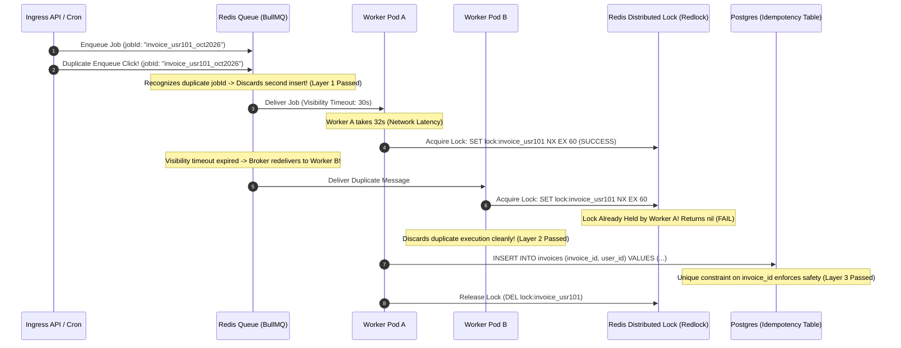

## Fast Revision (10-Second Recall)
- **The Core Distributed Reality:** In distributed queues (Kafka, SQS, RabbitMQ), message delivery guarantees are **At-Least-Once**, never "Exactly-Once." Network retries and worker crashes mean duplicate job executions *will* occur.
- **The 3-Layer Defense Against Duplicates:**
  1. *Layer 1 (Enqueueing):* **Deterministic Job IDs**. In BullMQ/Celery, set `jobId = hash(parameters)`. If two API servers push the identical job within 5 seconds, the queue broker drops the duplicate.
  2. *Layer 2 (Execution):* **Distributed Locking (Redis Redlock)**. Before processing, a worker acquires an atomic lock (`SET lock:job:<id> token NX EX 60`). Other workers attempting to process the same job are rejected.
  3. *Layer 3 (Database):* **Database Unique Constraints**. Enforce unique composite indexes on outcome tables (`UNIQUE (order_id, billing_period)`) to reject duplicate writes at the storage layer.
- **Always Make Workers Idempotent:** Processing the identical job payload twice must yield the exact same end state without double mutations.

## The 30-Second Spoken Script
> "Preventing duplicate job execution requires acknowledging that modern distributed message brokers provide **at-least-once delivery**. Duplicate deliveries will inevitably occur due to network retransmissions, worker heartbeat timeouts, or impatient users clicking a button twice.
>
> We eliminate duplicate execution through a three-layer defense in depth:
> First, **Deterministic Job Deduplication at the Gateway**: When adding jobs to the queue (such as BullMQ), we never use random UUIDs. Instead, we generate a deterministic `jobId` derived from the business parameters—for example, `invoice_tenant101_2026_10`. If five API servers attempt to enqueue this job simultaneously, Redis atomically accepts the first and silently ignores the duplicates.
> Second, **Distributed Locking via Redis Redlock**: When a worker dequeues a job, it acquires a distributed lock using `SET key token NX EX 300`. If a transient network glitch causes the queue broker to redeliver the message to a second worker, the second worker fails to acquire the lock and discards the duplicate.
> Third, **Database Level Idempotency**: All final mutations must be backed by database `UNIQUE` constraints and idempotency tables, ensuring that even if a lock expires prematurely, the database physically rejects duplicate records."

## Scenario / Problem Context
A SaaS subscription billing system processed monthly credit card charges in background workers. On the 1st of the month, a scheduled cron task triggered billing for 50,000 active customer subscriptions.

The job broker (SQS/RabbitMQ) suffered a 5-second network partition:
1. Worker A dequeued a job: `chargeSubscription(user_492, $99)`.
2. Worker A began contacting Stripe to execute the charge.
3. The queue broker didn't receive a heartbeat from Worker A within its visibility timeout (30 seconds) due to cross-AZ network latency, so it concluded Worker A had died.
4. The broker redelivered the exact same message to Worker B on another node.
5. Worker B picked up the message and charged the user's card $99.
6. Two seconds later, Worker A finished and also charged the user's card $99!

Customer `user_492` was billed twice ($198 total), resulting in a furious customer, credit card dispute fees, and a frantic database cleanup operation.

The engineering department needs a bulletproof deduplication framework that prevents duplicate execution across the entire distributed cluster.

## Architectural Workflow / Sequence


## Deep-Dive Analysis & Root Causes

### 1. The Fallacy of "Exactly-Once" Message Delivery
In distributed computing, the **Two Generals Problem** proves that truly guaranteed "Exactly-Once" delivery across networks is theoretically impossible:
- A message broker can guarantee **At-Most-Once** (send and pray; messages can be lost).
- Or it can guarantee **At-Least-Once** (retry until acknowledged; duplicates can occur).
- To achieve effective "Exactly-Once" processing, the **consumer must be idempotent**!

### 2. BullMQ Deterministic Job Deduplication
BullMQ provides built-in deduplication when you supply an explicit `jobId`:
```typescript
await queue.add('invoice', payload, { jobId: 'invoice_tenant_101_oct_2026' });
```
If a job with that ID already exists in `waiting`, `active`, or `delayed` states, BullMQ silently ignores the addition.

### 3. Distributed Lock Expiration Pitfall (Fencing Tokens)
What happens if Worker A acquires a lock with a 30-second TTL, but garbage collection freezes Worker A for 35 seconds?
- The lock expires in Redis.
- Worker B acquires the lock and starts executing.
- Worker A wakes up and also executes!
- **Solution (Fencing Tokens):** Every lock acquisition increments a monotonic counter ($token = 101$). When writing to the database, the query includes `WHERE lock_version < 101`. If a newer lock was issued, the database query fails.

## Practical Debugging Commands & Code

### Step 1: Enqueueing with Deterministic Deduplication IDs
```typescript
// src/queues/billingQueue.ts
import { Queue } from 'bullmq';
import crypto from 'node:crypto';

export const billingQueue = new Queue('billing-tasks', {
  connection: { host: process.env.REDIS_HOST, port: 6379 },
});

export async function scheduleInvoiceGeneration(tenantId: string, billingMonth: string) {
  // Generate deterministic ID derived from business domain parameters
  const deterministicJobId = `invoice_${tenantId}_${billingMonth}`;

  // If this job is already in queue or currently running, BullMQ will NOT create a duplicate!
  return billingQueue.add(
    'generate-invoice',
    { tenantId, billingMonth },
    {
      jobId: deterministicJobId,
      removeOnComplete: 86400, // Retain ID in Redis for 24h to prevent duplicate runs today
    }
  );
}
```

### Step 2: Distributed Locking in Worker with Redlock Pattern
```typescript
// src/workers/billingWorker.ts
import { Worker, Job } from 'bullmq';
import Redis from 'ioredis';
import { Pool } from 'pg';

const redis = new Redis(process.env.REDIS_URL || 'redis://localhost:6379');
const db = new Pool({ connectionString: process.env.DATABASE_URL });

export const billingWorker = new Worker(
  'billing-tasks',
  async (job: Job) => {
    const { tenantId, billingMonth } = job.data;
    const lockKey = `lock:billing:${tenantId}:${billingMonth}`;
    const lockValue = `${process.pid}_${Date.now()}`;
    const LOCK_TTL_SECONDS = 120; // 2 minutes

    // 1. Layer 2: Acquire atomic distributed lock in Redis
    // SET lockKey lockValue NX EX LOCK_TTL_SECONDS
    const acquired = await redis.set(lockKey, lockValue, 'EX', LOCK_TTL_SECONDS, 'NX');

    if (!acquired) {
      console.warn(`DUPLICATE DETECTED: Another worker is already processing ${job.id}. Skipping.`);
      return { status: 'SKIPPED_DUPLICATE' };
    }

    try {
      // 2. Layer 3: Database Idempotency Check
      const client = await db.connect();
      try {
        await client.query('BEGIN');

        // Check if invoice already exists for this billing period
        const check = await client.query(
          'SELECT id FROM invoices WHERE tenant_id = $1 AND billing_period = $2',
          [tenantId, billingMonth]
        );

        if (check.rows.length > 0) {
          console.warn(`Invoice already exists in DB for ${tenantId} ${billingMonth}. Skipping.`);
          await client.query('ROLLBACK');
          return { status: 'ALREADY_PROCESSED' };
        }

        // Execute payment and write invoice
        await client.query(
          'INSERT INTO invoices (tenant_id, billing_period, amount_cents, status) VALUES ($1, $2, $3, $4)',
          [tenantId, billingMonth, 9900, 'PAID']
        );

        await client.query('COMMIT');
        return { status: 'SUCCESS' };

      } finally {
        client.release();
      }

    } finally {
      // Release distributed lock using Lua script to verify lock ownership
      const releaseScript = `
        if redis.call("get", KEYS[1]) == ARGV[1] then
          return redis.call("del", KEYS[1])
        else
          return 0
        end
      `;
      await redis.eval(releaseScript, 1, lockKey, lockValue);
    }
  },
  {
    connection: { host: process.env.REDIS_HOST, port: 6379 },
    concurrency: 4,
  }
);
```

### Step 3: Database Idempotency Constraint Schema
```sql
-- PostgreSQL unique constraint guarantees physical impossibility of duplicate invoices
ALTER TABLE invoices 
ADD CONSTRAINT uq_invoices_tenant_period 
UNIQUE (tenant_id, billing_period);
```

## Prevention & Senior Best Practices
1. **Never Rely on Auto-Generated UUIDs for Job IDs:** Generate deterministic job IDs from business parameters (`${userId}_${action}_${date}`) to let the queue deduplicate automatically.
2. **Always Use Atomic `SET ... NX EX` for Locks:** Never call `EXISTS` followed by `SET` (a non-atomic race condition). Always use `SET key value NX EX seconds`.
3. **Release Locks with Lua Scripts:** Verify that the lock value matches the worker's unique token before deleting, preventing workers from deleting a lock that has already been re-acquired by another process.
4. **Enforce Database `UNIQUE` Constraints:** Always back up application-layer distributed locks with database unique constraints as the final non-negotiable safeguard.
5. **Retain Completed Job IDs in Redis:** Configure `removeOnComplete: 86400` so BullMQ remembers completed job IDs for 24 hours, preventing duplicate triggers throughout the day.

