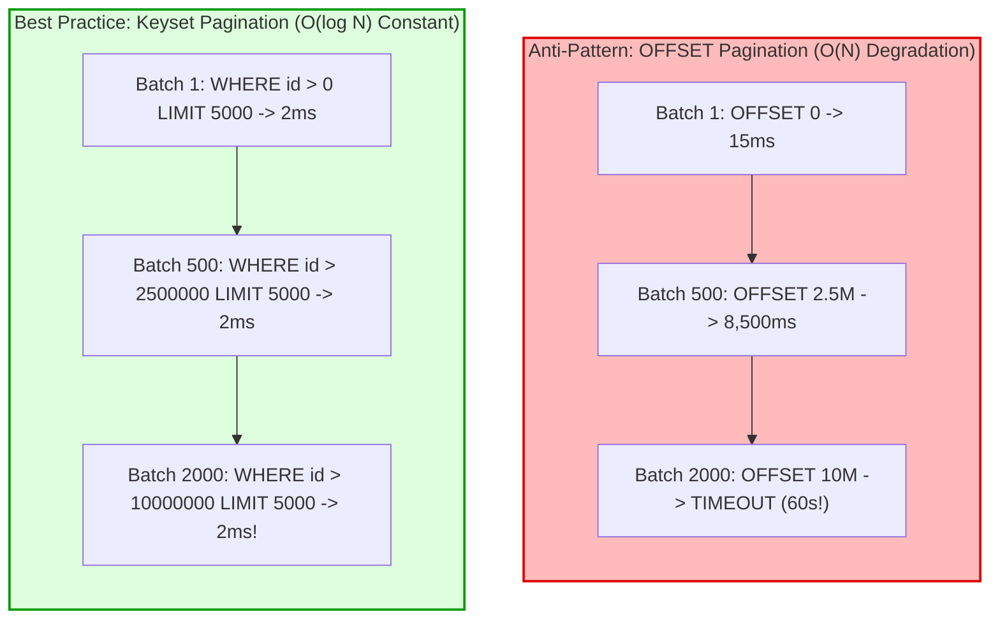

## Fast Revision (10-Second Recall)
- **The Offset Pagination Death Trap:** Running `SELECT * FROM table LIMIT 1000 OFFSET 5000000` forces the database to read and discard 5,000,000 rows on disk before returning 1,000 rows. At high offsets, queries take minutes and saturate database IOPS.
- **Keyset Pagination (Seek Method):** Filter by index order: `WHERE id > $last_seen_id ORDER BY id ASC LIMIT 1000`. This executes as an immediate index seek in under 2ms regardless of whether you are on row 10 or row 10,000,000.
- **Database Streaming Cursors:** For single-worker pipelines, use a server-side cursor (`DECLARE cursor FOR SELECT...`) to stream rows over the network socket without loading all rows into RAM.
- **Parallel Chunk Partitioning (Map-Reduce):** Split 10 million rows across 10 parallel worker pods by partitioning on ID ranges: `WHERE id BETWEEN 1 AND 1000000`, `WHERE id BETWEEN 1000001 AND 2000000`.
- **Batch Size Optimization:** Optimal batch size is usually between 1,000 and 5,000 rows. Smaller sizes introduce network round-trip overhead; larger sizes hold table row locks too long.

## The 30-Second Spoken Script
> "Processing millions of database records in batches requires avoiding the catastrophic performance pitfall of `OFFSET` pagination and memory buffering.
>
> In relational databases, running `LIMIT 1000 OFFSET 2000000` is an $O(N)$ operation. The database engine must scan and discard 2 million records on disk for every single batch, causing exponential slowdown and saturating disk IOPS.
>
> In production architectures, we apply three proven techniques:
> First, **Keyset Pagination (The Seek Method)**: We sort by an indexed primary key and seek directly: `SELECT * FROM users WHERE id > :last_seen_id ORDER BY id ASC LIMIT 5000`. This uses an $O(\log N)$ B-tree index seek, executing in under 2 milliseconds whether we are on the first row or the 10-millionth row.
> Second, **Server-Side Streaming Cursors**: If processing within a single worker, we use a server-side cursor (`pg-query-stream`), fetching chunks across an open stream without materializing large arrays in application RAM.
> Third, **Parallel Distributed Slicing**: When time to completion is critical, a coordinator calculates minimum and maximum primary keys and enqueues 20 range tasks (e.g. `WHERE id BETWEEN 100001 AND 200000`) into a message queue. A fleet of 10 worker pods processes the batches in parallel, reducing processing time from 8 hours to 20 minutes."

## Scenario / Problem Context
A fintech banking application needed to run an annual interest calculation and regulatory tax reconciliation across 12,000,000 customer accounts.

The initial batch script was written using traditional `LIMIT` and `OFFSET` loops:
```typescript
let offset = 0;
const limit = 5000;
while (true) {
  // Catastrophic: Query execution time grows linearly with offset!
  const rows = await db.query('SELECT * FROM accounts ORDER BY id ASC LIMIT $1 OFFSET $2', [limit, offset]);
  if (rows.length === 0) break;
  await processBatch(rows);
  offset += limit;
}
```

The script started out fast:
- Offset 0: 15ms.
- Offset 500,000: 1.8 seconds.
- Offset 3,000,000: 14.5 seconds per batch!
- Offset 7,000,000: Queries started timing out after 60 seconds.

By hour 5, the script was thrashing database buffer caches, forcing PostgreSQL to read millions of dead tuples from disk. The database CPU hit 100%, taking down customer login and ATM transactions. The script had to be killed after completing only 60% of the accounts.

The engineering team needs a high-performance batch processing architecture that scales to tens of millions of records with constant, sub-second query performance.

## Architectural Workflow / Sequence


## Deep-Dive Analysis & Root Causes

### 1. Why `OFFSET` Degrades Linearly
In SQL, the engine cannot jump directly to row 5,000,000 because database rows have variable lengths on disk pages and may be marked as deleted (MVCC dead tuples).
- The query planner must physically read the first 5,000,000 rows, count them in memory, and then discard them before returning the 5,000,001st row!
- At high offsets, the database reads gigabytes of table pages from disk into memory, evicting frequently accessed tables from the buffer cache.

### 2. Keyset Pagination (The Seek Method)
Because the `id` column is backed by a B-Tree index:
`SELECT * FROM accounts WHERE id > 4502100 ORDER BY id ASC LIMIT 5000;`
1. The database navigates the B-Tree index directly to `4502100` in $O(\log N)$ time (3-4 disk page lookups).
2. It scans forward 5,000 index entries and retrieves the rows.
3. Execution time is virtually identical whether querying row 0 or row 50,000,000!

### 3. Locking and Replication Lag
When processing millions of updates:
- Never wrap all 12 million updates in a single giant database transaction! This holds locks for hours, causes WAL log bloat, and blocks replication to read replicas.
- Commit each batch independently: read 5,000 $\rightarrow$ update 5,000 $\rightarrow$ `COMMIT`.
- Insert a small 50ms sleep between batches to allow read replicas to catch up on replication lag.

## Practical Debugging Commands & Code

### Step 1: Keyset Pagination Batch Processor in Node.js
```typescript
// src/scripts/batchAccountProcessor.ts
import { Pool } from 'pg';

const pool = new Pool({ connectionString: process.env.DATABASE_URL });

export async function processMillionRecordsKeyset(batchSize = 5000) {
  const client = await pool.connect();
  let lastSeenId = 0; // Tracks the highest ID from the previous batch
  let totalProcessed = 0;
  const startTime = Date.now();

  try {
    while (true) {
      const batchStart = Date.now();

      // Keyset seek method: Uses B-Tree index on primary key! Always sub-5ms!
      const result = await client.query(
        `SELECT id, balance, status 
         FROM accounts 
         WHERE id > $1 
         ORDER BY id ASC 
         LIMIT $2`,
        [lastSeenId, batchSize]
      );

      const rows = result.rows;
      if (rows.length === 0) {
        console.log('Batch processing complete: No more records.');
        break;
      }

      // Execute atomic transaction for this batch only
      await client.query('BEGIN');
      for (const account of rows) {
        // Business logic calculation...
        const updatedBalance = account.balance * 1.05; // 5% interest
        await client.query('UPDATE accounts SET balance = $1 WHERE id = $2', [updatedBalance, account.id]);
      }
      await client.query('COMMIT');

      // Update cursor for the next iteration
      lastSeenId = rows[rows.length - 1].id;
      totalProcessed += rows.length;

      const batchDuration = Date.now() - batchStart;
      console.log(`Processed ${totalProcessed} accounts | Last ID: ${lastSeenId} | Batch Time: ${batchDuration}ms`);

      // Gentle pause to allow database replication threads and IOPS to breathe
      await new Promise((r) => setTimeout(r, 25));
    }

    const totalMinutes = ((Date.now() - startTime) / 1000 / 60).toFixed(2);
    console.log(`SUCCESS: Processed ${totalProcessed} records in ${totalMinutes} minutes.`);

  } finally {
    client.release();
  }
}
```

### Step 2: Distributed Parallel Partitioning with BullMQ
When a single worker is too slow, split the range across worker pods:

```typescript
// src/scripts/enqueueBatchPartitions.ts
import { Queue } from 'bullmq';
import { Pool } from 'pg';

const pool = new Pool({ connectionString: process.env.DATABASE_URL });
const queue = new Queue('batch-partitions', { connection: { host: 'localhost', port: 6379 } });

export async function partitionAndEnqueueWorkers(partitionSize = 500000) {
  const client = await pool.connect();
  try {
    // 1. Get min and max ID
    const res = await client.query('SELECT MIN(id) as min_id, MAX(id) as max_id FROM accounts');
    const minId = res.rows[0].min_id;
    const maxId = res.rows[0].max_id;

    console.log(`Partitioning accounts table from ID ${minId} to ${maxId}...`);

    let currentStart = minId;
    let partitionIndex = 1;

    // 2. Slice ID space into independent parallel jobs
    while (currentStart <= maxId) {
      const currentEnd = currentStart + partitionSize - 1;

      await queue.add('process-range', {
        partitionIndex,
        startId: currentStart,
        endId: currentEnd,
      });

      console.log(`Enqueued Partition ${partitionIndex}: IDs ${currentStart} to ${currentEnd}`);
      currentStart += partitionSize;
      partitionIndex++;
    }

    console.log('All partitions enqueued. 10 worker pods will process in parallel.');
  } finally {
    client.release();
  }
}
```

### Step 3: Monitoring Replication Lag During Large Batch Updates
Run this query on read replicas during batch updates to prevent replicas from falling behind:

```sql
-- PostgreSQL: Monitor replication lag in seconds
SELECT 
    client_addr,
    application_name,
    state,
    sync_state,
    round(EXTRACT(EPOCH FROM (now() - pg_last_xact_replay_timestamp()))::numeric, 2) AS replication_lag_seconds
FROM pg_stat_replication;
```

## Prevention & Senior Best Practices
1. **Ban `OFFSET` for Large Batch Scripts:** Enforce linter rules or code reviews prohibiting `OFFSET` on queries iterating over more than 10,000 records; mandate Keyset pagination (`WHERE id > :lastId`).
2. **Commit in Controlled Batches (1,000 to 5,000 Rows):** Never execute millions of updates in a single open transaction; commit each batch independently to release table row locks.
3. **Include Inter-Batch Sleep Delays:** Add a 25ms-50ms pause between batches to allow read replicas to catch up on replication logs and give incoming web traffic priority.
4. **Partition by Primary Key for Parallel Processing:** Split massive tables into deterministic ID ranges (`WHERE id BETWEEN :start AND :end`) and distribute across multiple worker pods via job queues.
5. **Disable Unnecessary Triggers and Indexes During Bulk Data Migrations:** For one-time migrations of tens of millions of records, temporarily drop non-essential secondary indexes and rebuild them concurrently (`CREATE INDEX CONCURRENTLY`) after the migration finishes.

