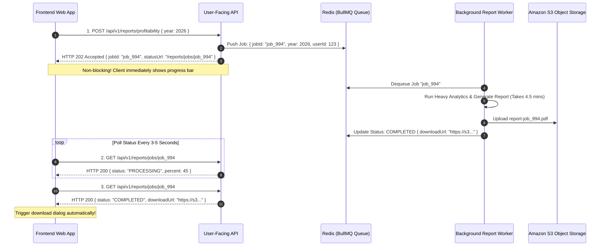

## Fast Revision (10-Second Recall)
- **The Core Anti-Pattern:** Holding open a synchronous HTTP connection for 5 minutes violates proxy timeouts (Cloudflare 100s, AWS ALB 60s, Nginx 60s) and ties up server worker threads.
- **The Modern Standard (Asynchronous Request-Reply Pattern):**
  1. Client sends `POST /reports` $\rightarrow$ API enqueues job in Redis/SQS $\rightarrow$ Returns `HTTP 202 Accepted` in under 20ms with a `jobId` and `Location: /reports/jobs/{id}`.
  2. Background worker consumes job from queue, generates report, and saves to S3.
  3. Client checks status via periodic polling (`GET /reports/jobs/{id}`) or receives a real-time event via WebSocket / Server-Sent Events (SSE).
- **Fast Status Query:** Status checks query lightweight Redis keys or database rows, taking under 2ms.
- **Resource Isolation:** Background workers run in an independent Kubernetes pod fleet, preventing heavy CPU/RAM report tasks from degrading the user-facing API fleet.

## The 30-Second Spoken Script
> "When a report generation API takes 5 minutes, it is impossible to service reliably over a synchronous HTTP connection. Web proxies—including Cloudflare, AWS Application Load Balancers, and Nginx—will terminate connections taking longer than 60 seconds with an HTTP 504 Gateway Timeout.
>
> We redesign this using the enterprise **Asynchronous Request-Reply pattern**:
> First, we decouple the API from execution. When a user requests a report, the API controller validates permissions, pushes a job payload into an asynchronous message queue (like BullMQ or SQS), and immediately responds with **HTTP 202 Accepted** in 15 milliseconds, returning a unique `jobId` and status URL.
>
> Second, a dedicated pool of background worker pods consumes jobs from the queue. These workers run in a separate autoscaling pool so intense CPU report generation never degrades our primary user-facing API pods. The worker generates the report, uploads the file to Amazon S3, and updates the job status to `COMPLETED` with an S3 presigned download URL.
>
> Finally, the frontend tracks progress using exponential backoff polling on `GET /reports/jobs/:id` or listens to a Server-Sent Events (SSE) notification channel."

## Scenario / Problem Context
A business intelligence platform allowed company CFOs to generate a comprehensive "Executive Profitability Analysis" PDF report. Calculating the report required executing 14 complex analytical SQL queries joining across 10 million transactions, taking roughly 4.5 minutes.

The original implementation handled this synchronously in an Express route:
```typescript
app.post('/api/v1/reports/profitability', async (req, res) => {
  // Synchronously holds connection for 4.5 minutes!
  const data = await runHeavyAnalyticsQueries(req.body.year);
  const pdfBuffer = await generatePdf(data);
  res.attachment('report.pdf').send(pdfBuffer);
});
```

During board meeting preparations, three executives clicked "Generate Report" simultaneously:
1. At 60 seconds, AWS ALB closed all three connections with `HTTP 504 Gateway Timeout`.
2. The browser displayed an error screen. Believing the request failed, the executives refreshed the page and clicked the button four more times.
3. The backend was now running 15 simultaneous 4.5-minute analytical queries, pegging PostgreSQL database CPU at 100% and bringing down the entire platform for all users.

The engineering team needs an asynchronous redesign that eliminates gateway timeouts, isolates heavy compute, and provides real-time progress feedback to users.

## Architectural Workflow / Sequence


## Deep-Dive Analysis & Root Causes

### 1. The Gateway Timeout Ceiling
- Cloudflare: Max 100 seconds timeout (Enterprise up to 6000s).
- AWS ALB: Default 60 seconds (Configurable to 4000s, but ties up load balancer connection slots).
- Nginx: Default 60 seconds (`proxy_read_timeout 60s`).
- Modern mobile networks: Cellular towers drop idle TCP connections after 30 to 60 seconds.
- **Rule:** Any operation that can exceed **3 seconds** of processing time belongs in an asynchronous background worker.

### 2. HTTP 202 Accepted Specification (RFC 9110)
`HTTP 202 Accepted` indicates that the request has been accepted for processing, but processing has not been completed.
- Mandatory response headers:
  - `Location: /api/v1/reports/jobs/:jobId` (URL where status can be checked).
  - `Retry-After: 10` (Suggested polling interval in seconds).

### 3. Polling vs WebSockets vs Server-Sent Events (SSE)
- **Short Polling:** Client sends `GET /jobs/:id` every 3 seconds. Simple, robust, works across all firewalls and CDN proxies.
- **Server-Sent Events (SSE):** Lightweight, one-way push from server to client over standard HTTP. Ideal for updating progress bars (`percent: 45%`).
- **WebSockets:** Full bidirectional communication. High server state overhead; usually overkill for simple report notifications.

## Practical Debugging Commands & Code

### Step 1: Ingress API Controller Returning HTTP 202 Accepted (Express & BullMQ)
```typescript
// src/routes/reportController.ts
import { Request, Response } from 'express';
import { Queue } from 'bullmq';
import { randomUUID } from 'node:crypto';

const reportQueue = new Queue('report-generation', {
  connection: { host: process.env.REDIS_HOST || 'localhost', port: 6379 },
});

export async function requestProfitabilityReport(req: Request, res: Response) {
  const { year } = req.body;
  const userId = (req as any).user.id;
  const jobId = `report_${randomUUID()}`;

  // 1. Enqueue job in BullMQ (Takes 5ms)
  await reportQueue.add(
    'generate-profitability-report',
    { jobId, year, userId },
    { jobId } // Use deterministic jobId to prevent duplicate submissions
  );

  // 2. Return HTTP 202 Accepted immediately!
  res.status(202)
    .setHeader('Location', `/api/v1/reports/jobs/${jobId}`)
    .setHeader('Retry-After', '5')
    .json({
      status: 'ACCEPTED',
      jobId,
      message: 'Report generation has started in the background.',
      checkStatusUrl: `/api/v1/reports/jobs/${jobId}`,
    });
}
```

### Step 2: Status Polling Endpoint
```typescript
// src/routes/reportStatusController.ts
import { Request, Response } from 'express';
import { Queue } from 'bullmq';

const reportQueue = new Queue('report-generation', {
  connection: { host: process.env.REDIS_HOST || 'localhost', port: 6379 },
});

export async function checkReportJobStatus(req: Request, res: Response) {
  const { jobId } = req.params;
  const job = await reportQueue.getJob(jobId);

  if (!job) {
    return res.status(404).json({ error: 'Report job not found or expired' });
  }

  const state = await job.getState(); // 'waiting' | 'active' | 'completed' | 'failed'
  const progress = job.progress;

  if (state === 'completed') {
    return res.json({
      status: 'COMPLETED',
      result: job.returnvalue, // Contains { downloadUrl: "https://s3..." }
    });
  }

  if (state === 'failed') {
    return res.status(500).json({
      status: 'FAILED',
      reason: job.failedReason,
    });
  }

  // Active or waiting
  return res.json({
    status: 'PROCESSING',
    progressPercent: progress || 0,
    estimatedSecondsRemaining: 180,
  });
}
```

### Step 3: Background Worker Processing the Heavy Report
```typescript
// src/workers/reportWorker.ts
import { Worker, Job } from 'bullmq';
import { S3Client, PutObjectCommand } from '@aws-sdk/client-s3';
import { getSignedUrl } from '@aws-sdk/s3-request-presigner';

const s3 = new S3Client({ region: 'us-east-1' });

export const reportWorker = new Worker(
  'report-generation',
  async (job: Job) => {
    const { jobId, year, userId } = job.data;

    // Step A: Run heavy analytics (Update progress to 30%)
    await job.updateProgress(30);
    const data = await executeHeavyAnalyticsQueries(year);

    // Step B: Generate PDF (Update progress to 70%)
    await job.updateProgress(70);
    const pdfBuffer = await generatePdfDocument(data);

    // Step C: Upload to S3 (Update progress to 95%)
    await job.updateProgress(95);
    const fileKey = `reports/${userId}/${jobId}.pdf`;
    await s3.send(new PutObjectCommand({
      Bucket: 'reports-storage-prod',
      Key: fileKey,
      Body: pdfBuffer,
      ContentType: 'application/pdf',
    }));

    // Step D: Generate Presigned Download URL valid for 24 hours
    const downloadUrl = await getSignedUrl(s3, new PutObjectCommand({
      Bucket: 'reports-storage-prod',
      Key: fileKey,
    }), { expiresIn: 86400 });

    await job.updateProgress(100);

    return { fileKey, downloadUrl };
  },
  {
    connection: { host: process.env.REDIS_HOST || 'localhost', port: 6379 },
    concurrency: 2, // Limit each worker container to 2 heavy reports at a time
  }
);
```

## Prevention & Senior Best Practices
1. **Never Execute Long-Running Work on Web Request Threads:** Mandate that any endpoint taking longer than 3 seconds must be architected as an asynchronous job returning `HTTP 202 Accepted`.
2. **Isolate Worker Pods from API Pods:** Run BullMQ or SQS workers in a dedicated Kubernetes deployment with its own resource requests/limits, ensuring heavy reports never starve public API pods of CPU.
3. **Use Deterministic Job IDs:** Use hash-based or deterministic job IDs (e.g. `report_{userId}_{year}_{month}`) to deduplicate concurrent button clicks by impatient users.
4. **Implement Polling Jitter and Backoff:** Ensure client-side polling implements exponential backoff (e.g. check at 2s, 4s, 8s, 15s) to prevent thousands of clients from hammering the status check endpoint.
5. **Set Job Timeouts and Cleanups:** Configure BullMQ jobs with strict timeouts (e.g., terminate after 15 minutes) and remove completed jobs from Redis after 24 hours to prevent memory bloat.

