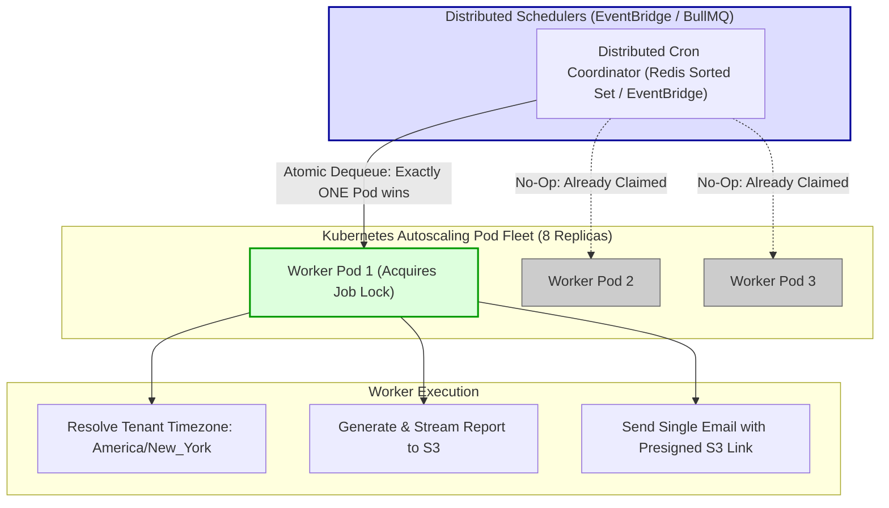

## Fast Revision (10-Second Recall)
- **The Multi-Pod Cron Trap:** If you use a simple in-process cron scheduler (like `node-cron` or `setInterval`) inside an app deployed across 10 Kubernetes pods, your daily midnight report will run **10 times simultaneously**!
- **The Modern Standard:** **Distributed Repeatable Jobs** managed by a centralized broker (BullMQ Repeatable Jobs) or cloud-native schedulers (AWS EventBridge, Temporal).
- **Leader Election Alternative:** If using in-memory schedulers, use Kubernetes Leader Election or Redis Redlock to elect a single active "Cron Master" pod; standby pods remain passive.
- **Dynamic Cron Storage:** Store user-configured schedules in PostgreSQL (`tenant_id`, `cron_expression: "0 8 * * MON"`, `next_run_at`, `timezone`).
- **Timezone Awareness:** Financial and business reports must execute relative to the **tenant's local timezone** (e.g., America/New_York vs Asia/Tokyo), not server UTC midnight.

## The 30-Second Spoken Script
> "Scheduling recurring reports in a distributed cloud architecture requires decoupling schedule coordination from application pod instances.
>
> In naive setups, engineers run an in-process library like `node-cron` inside their standard API containers. When Kubernetes scales the service to 8 replicas, every scheduled cron job executes 8 times at midnight, causing race conditions and sending duplicate emails to clients.
>
> In production architectures, we solve this using one of two resilient approaches:
> First, **BullMQ Repeatable Jobs in Redis**: BullMQ maintains a centralized sorted set of scheduled timestamps in Redis. Even if you have 20 worker containers running, Redis guarantees that only one worker can claim and execute the cron trigger at the scheduled millisecond.
> Second, **Cloud-Native Schedulers with AWS EventBridge**: For enterprise architectures, we use AWS EventBridge Scheduler. EventBridge handles the cron clock, automatic retries, and daylight saving time transitions with 99.99% availability, firing a webhook or publishing an event directly to an SQS queue when the report is due.
>
> Furthermore, we store schedules in our database alongside the **tenant's IANA timezone**, ensuring a '9:00 AM Monday' report arrives at 9:00 AM local time for users in London, New York, and Sydney alike."

## Scenario / Problem Context
A SaaS property management platform allowed landlords to schedule "Weekly Rent Collection Summaries" delivered every Monday at 8:00 AM.

The engineering team implemented the schedule using `node-cron` inside the main Node.js application container:
```typescript
// DANGEROUS: Runs in every container replica!
cron.schedule('0 8 * * 1', async () => {
  await dispatchWeeklyLandlordReports();
});
```

The application ran in a Kubernetes deployment with 6 pod replicas. On Monday at 8:00 AM:
1. All 6 pods triggered the cron job simultaneously.
2. 5,000 landlords received **6 identical copies** of their weekly summary email in their inbox within 10 seconds.
3. The database was hit with 30,000 simultaneous analytical queries, causing connection pool exhaustion and a 15-minute customer outage.

The organization needs a distributed scheduling architecture that guarantees exactly one execution per scheduled interval across a multi-pod cluster, with full support for dynamic user-defined timezones.

## Architectural Workflow / Sequence


## Deep-Dive Analysis & Root Causes

### 1. In-Process vs Centralized Schedulers
- **In-Process (`node-cron`, `@nestjs/schedule`):** State is stored in local process memory. Excellent for single-instance monoliths; catastrophic for multi-replica Kubernetes deployments.
- **Centralized Broker (BullMQ / Celery):** Schedules are registered as keys in Redis (`bull:reports:delayed`). Redis calculates the next run timestamp. When the timestamp arrives, Redis moves the job to the active queue. Because Redis operations are single-threaded and atomic, exactly one worker can acquire the job.
- **Serverless Cloud Scheduler (AWS EventBridge Scheduler / GCP Cloud Scheduler):** Fully managed, zero maintenance. Pushes events to HTTP endpoints or SQS queues.

### 2. Timezone & Daylight Saving Time (DST) Bugs
Many companies store cron as standard UTC expressions:
- A user in New York schedules a report for 9:00 AM EST (`14:00 UTC`).
- In March, Daylight Saving Time begins. New York switches to EDT (`UTC-4`).
- If your system runs on static UTC, the user's report suddenly arrives at 10:00 AM EDT!
- **Solution:** Always store the user's IANA timezone string (e.g. `America/New_York`, `Europe/London`) and use timezone-aware cron parsers (like `cron-parser` or BullMQ `{ tz: 'America/New_York' }`).

### 3. Dynamic Multi-Tenant Schedules
Enterprise SaaS platforms cannot hardcode cron schedules into source code because thousands of tenants define custom schedules:
- Tenant A wants a daily report at 7:00 AM.
- Tenant B wants a monthly report on the 1st at 11:00 PM.
- Store schedules in PostgreSQL. A lightweight poller queries:
  `SELECT * FROM scheduled_reports WHERE next_run_at <= NOW() AND is_active = true`

## Practical Debugging Commands & Code

### Step 1: Distributed Repeatable Jobs with BullMQ in Node.js
```typescript
// src/queues/recurringReportQueue.ts
import { Queue, Worker, Job } from 'bullmq';

const connection = { host: process.env.REDIS_HOST, port: 6379 };

export const recurringQueue = new Queue('recurring-reports', { connection });

// 1. Register a repeatable distributed cron job
export async function registerTenantRecurringReport(tenantId: string, cronPattern: string, timezone: string) {
  // Unique repeat key per tenant prevents duplicate schedule registrations
  const jobKey = `tenant_${tenantId}_weekly_summary`;

  await recurringQueue.add(
    'generate-tenant-summary',
    { tenantId, reportType: 'WEEKLY_SUMMARY' },
    {
      repeat: {
        pattern: cronPattern, // e.g. "0 8 * * 1" (Mondays at 8 AM)
        tz: timezone,         // e.g. "America/New_York" (Handles DST shifts automatically!)
      },
      jobId: jobKey,
    }
  );

  console.log(`Registered recurring schedule for tenant ${tenantId} (${timezone})`);
}

// 2. Worker Fleet (Can run across 20 pods safely: only ONE pod will execute per trigger!)
export const recurringWorker = new Worker(
  'recurring-reports',
  async (job: Job) => {
    const { tenantId, reportType } = job.data;
    console.log(`[Worker ${process.pid}] Executing ${reportType} for tenant ${tenantId} at ${new Date().toISOString()}`);

    // Generate report and deliver...
    return { status: 'DISPATCHED' };
  },
  { connection, concurrency: 2 }
);
```

### Step 2: Dynamic Database Poller Pattern (For Thousands of Dynamic Tenant Crons)
```typescript
// src/schedulers/databaseCronPoller.ts
import { Pool } from 'pg';
import { Queue } from 'bullmq';
import { CronExpressionParser } from 'cron-parser';

const db = new Pool({ connectionString: process.env.DATABASE_URL });
const reportQueue = new Queue('report-execution', { connection: { host: 'localhost', port: 6379 } });

// Runs once per minute across the cluster
export async function pollDueSchedules() {
  const client = await db.connect();
  try {
    await client.query('BEGIN');

    // Atomic fetch-and-lock: SELECT ... FOR UPDATE SKIP LOCKED
    // Guarantees multiple poller pods never pick up the same due report!
    const dueSchedules = await client.query(`
      SELECT id, tenant_id, cron_expression, timezone 
      FROM scheduled_reports 
      WHERE is_active = true AND next_run_at <= NOW()
      FOR UPDATE SKIP LOCKED
    `);

    for (const schedule of dueSchedules.rows) {
      // 1. Enqueue job for worker execution
      await reportQueue.add('generate-report', { scheduleId: schedule.id, tenantId: schedule.tenant_id });

      // 2. Calculate next execution timestamp based on tenant timezone
      const interval = CronExpressionParser.parse(schedule.cron_expression, {
        tz: schedule.timezone,
        currentDate: new Date(),
      });
      const nextRunAt = interval.next().toDate();

      // 3. Update next_run_at in database
      await client.query(
        'UPDATE scheduled_reports SET last_run_at = NOW(), next_run_at = $1 WHERE id = $2',
        [nextRunAt, schedule.id]
      );
    }

    await client.query('COMMIT');
  } catch (err) {
    await client.query('ROLLBACK');
    throw err;
  } finally {
    client.release();
  }
}
```

### Step 3: Inspecting Active Repeatable Jobs in BullMQ CLI
```bash
# Query active repeatable jobs registered in Redis
node -e '
  const { Queue } = require("bullmq");
  const q = new Queue("recurring-reports", { connection: { host: "localhost", port: 6379 } });
  q.getRepeatableJobs().then(jobs => {
    console.log(JSON.stringify(jobs, null, 2));
    process.exit(0);
  });
'
```

## Prevention & Senior Best Practices
1. **Never Run `node-cron` in Multi-Replica Deployments:** Ban in-process timers inside containers that scale beyond 1 replica. Use BullMQ Repeatable Jobs or AWS EventBridge.
2. **Always Specify IANA Timezones:** Never schedule customer-facing business reports in raw UTC; always record the tenant's IANA timezone (`America/Chicago`, `Europe/Paris`) to handle Daylight Saving Time automatically.
3. **Use `SELECT ... FOR UPDATE SKIP LOCKED` for DB Schedulers:** If scheduling via database tables, use PostgreSQL row locks with `SKIP LOCKED` so multiple scheduler pods process distinct rows concurrently without collisions.
4. **Enforce Idempotency on Scheduled Execution:** Ensure the job worker uses deterministic IDs (`report_${tenantId}_${scheduledTimestamp}`) so that even if a schedule triggers twice, the report is only processed once.
5. **Monitor Missed Scheduled Runs:** Set up an alert for schedules where `next_run_at < NOW() - interval '15 minutes'`, detecting when scheduler lag or database locks prevent jobs from triggering on time.

