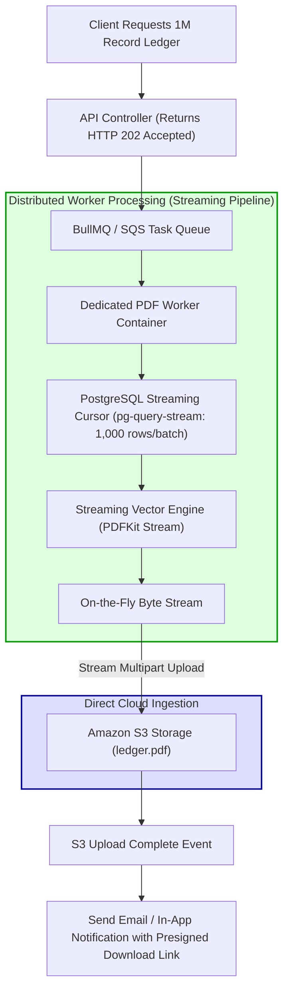

## Fast Revision (10-Second Recall)
- **The Core Constraint:** 1,000,000 records cannot fit into memory. Loading 1 million rows into JavaScript objects requires 4GB to 8GB of RAM, triggering an immediate Node.js `JavaScript heap out of memory` crash.
- **The PDF Rendering Trap:** Headless Chrome (Puppeteer/Playwright) DOM trees crash if you feed them 1 million table rows in a single HTML page.
- **The 3-Step Streaming Strategy:**
  1. *Database Cursor Streaming:* Stream rows from PostgreSQL using `pg-query-stream` in 1,000-row chunks.
  2. *Low-Level Vector PDF Generation:* Use a streaming PDF engine like `PDFKit` (or compile via low-level C++ engines like Poppler/WeasyPrint) that pipes pages directly to disk or S3 without building an in-memory DOM tree.
  3. *Batch Splitting & Merging:* Alternatively, split the 1 million records into 10 independent batch tasks (100k rows each), generate 10 partial PDF files in parallel via worker pods, and stitch them together using `pdf-lib` or `qpdf`.
- **Always Execute in Background Workers:** Never generate multi-page PDFs on the synchronous HTTP request path; run in dedicated background worker containers (BullMQ/SQS).

## The 30-Second Spoken Script
> "Generating a PDF containing 1 million records requires an architecture built entirely around **streaming pipelines and distributed batch processing**.
>
> Attempting to load 1 million database records into memory or rendering them inside a Headless Chrome Puppeteer DOM tree will instantly crash containers with an Out-of-Memory failure.
>
> In production architectures, we solve this using one of two battle-tested approaches:
> For tabular, high-throughput reports, we use **Direct Vector Streaming**: We stream records from PostgreSQL using a database cursor (`pg-query-stream`) in 1,000-row batches. We feed this stream directly into a streaming vector PDF engine (like `PDFKit`). As each page is formatted, its bytes are flushed immediately to an S3 multipart upload stream without holding previous pages in memory, maintaining a flat 50MB RAM footprint throughout.
> For complex, highly styled graphical documents, we use **Map-Reduce Parallel Generation**: A master job splits the 1 million records into 20 chunks of 50,000 records. A fleet of 5 worker containers generates 20 partial PDF files in parallel using Headless Chromium. Once all workers complete, a lightweight merger task concatenates the 20 files using `qpdf` and uploads the final document to S3, notifying the user via WebSocket or email."

## Scenario / Problem Context
A banking and tax accounting platform needed to generate an annual audit transaction ledger for a corporate enterprise client. The ledger contained 1,200,000 transaction records spanning 25,000 printed PDF pages.

The developer wrote an Express endpoint:
```typescript
app.get('/api/v1/reports/annual-ledger.pdf', async (req, res) => {
  // Catastrophic: Loads 1.2M rows into Node.js heap!
  const rows = await db.query('SELECT * FROM transactions WHERE company_id = $1', [companyId]);
  
  // HTML template string containing 1.2 million <tr> rows!
  const html = template({ transactions: rows });
  
  // Headless Chrome crashes with Out of Memory
  const browser = await puppeteer.launch();
  const page = await browser.newPage();
  await page.setContent(html);
  const pdfBuffer = await page.pdf();
  
  res.setHeader('Content-Type', 'application/pdf');
  res.send(pdfBuffer);
});
```

When the corporate client requested the report:
1. The PostgreSQL query allocated 4.2GB of RAM in the Node.js process. The container crashed with `Fatal error: CALL_AND_RETRY_LAST Allocation failed - JavaScript heap out of memory`.
2. Even when the Node.js max heap was increased to 8GB, Headless Chrome crashed trying to create a DOM tree with 1.2 million table elements.
3. The client received an `HTTP 502 Bad Gateway` after a 30-minute freeze.

The platform needs a streaming, low-memory PDF generation architecture capable of generating millions of records reliably.

## Architectural Workflow / Sequence


## Deep-Dive Analysis & Root Causes

### 1. The Memory Limits of DOM-Based Renderers (Puppeteer / HTML)
Headless Chrome (Puppeteer/Playwright) is wonderful for pixel-perfect 5-page invoices. However, for a 25,000-page document:
- Chrome creates a C++ DOM node for every `<div>`, `<tr>`, and `<td>`.
- Layout reflow calculations scale exponentially with DOM size.
- Chrome's renderer process crashes once the tab exceeds 2GB of memory.
- **Rule:** Never use DOM-based HTML-to-PDF renderers for documents exceeding 500 pages. Use direct vector-drawing engines like PDFKit, ReportLab, or Apache PDFBox.

### 2. Database Streaming Cursors
Standard ORM queries (`SELECT * FROM table`) load the entire query result set into client application memory.
- A **Cursor** leaves the query results on the database engine.
- The application fetches rows in small batches (e.g. 1,000 rows at a time).
- Once processed, rows are discarded and garbage collected, keeping application memory usage flat at ~40MB regardless of whether the query returns 10,000 or 10,000,000 records.

### 3. Asynchronous Execution Lifecycle
Generating a 25,000-page PDF takes several minutes of continuous processing. It cannot be served inside an HTTP request-response cycle.
- Return `HTTP 202 Accepted` with a `jobId`.
- Process the task asynchronously in a background worker.
- Store the finished file in S3 and notify the user via webhook, email, or WebSocket.

## Practical Debugging Commands & Code

### Step 1: True Streaming PDF Generation with `pg-query-stream` and `PDFKit`
```typescript
// src/workers/pdfGeneratorWorker.ts
import { Pool } from 'pg';
import QueryStream from 'pg-query-stream';
import PDFDocument from 'pdfkit';
import { S3Client } from '@aws-sdk/client-s3';
import { Upload } from '@aws-sdk/lib-storage';
import { PassThrough } from 'node:stream';

const pool = new Pool({ connectionString: process.env.DATABASE_URL });
const s3 = new S3Client({ region: 'us-east-1' });

export async function generate1MillionRecordPdf(jobId: string, companyId: string) {
  const client = await pool.connect();
  const fileKey = `reports/audit-ledger-${jobId}.pdf`;

  // 1. Create a PassThrough bridge stream between PDFKit and S3 Upload
  const streamBridge = new PassThrough();

  // 2. Initialize S3 Multipart Stream Upload (zero disk usage!)
  const s3Upload = new Upload({
    client: s3,
    params: {
      Bucket: 'enterprise-reports-prod',
      Key: fileKey,
      Body: streamBridge,
      ContentType: 'application/pdf',
    },
  });

  // 3. Create PDFDocument instance
  const doc = new PDFDocument({ autoFirstPage: false, margin: 30 });
  doc.pipe(streamBridge);

  try {
    // 4. Open PostgreSQL Cursor Stream (Batch size: 2,000 rows)
    const sql = 'SELECT id, created_at, amount, counterparty, description FROM transactions WHERE company_id = $1 ORDER BY created_at ASC';
    const queryStream = new QueryStream(sql, [companyId], { batchSize: 2000 });
    const dbStream = client.query(queryStream);

    let rowCount = 0;
    let pageCount = 0;
    const ROWS_PER_PAGE = 45;

    const renderHeader = (doc: any) => {
      pageCount++;
      doc.addPage();
      doc.fontSize(12).text(`Audit Transaction Ledger - Page ${pageCount}`, { align: 'center' });
      doc.fontSize(9).text('ID | Date | Amount | Counterparty | Description');
      doc.text('----------------------------------------------------------------------------------------');
    };

    renderHeader(doc);

    // 5. Consume rows one-by-one as they stream from the database
    for await (const row of dbStream) {
      rowCount++;

      doc.fontSize(8).text(
        `${row.id.padEnd(10)} | ${row.created_at.toISOString().slice(0, 10)} | $${row.amount.toFixed(2).padStart(10)} | ${row.counterparty.slice(0, 20)} | ${row.description.slice(0, 30)}`
      );

      // Add a new page every 45 rows
      if (rowCount % ROWS_PER_PAGE === 0) {
        renderHeader(doc);
      }
    }

    // Finalize PDF stream
    doc.end();

    // Await S3 upload completion
    await s3Upload.done();
    console.log(`Successfully generated PDF with ${rowCount} records across ${pageCount} pages!`);

    return { success: true, fileKey, rowCount, pageCount };

  } finally {
    client.release();
  }
}
```

### Step 2: Monitoring Flat Memory Footprint During Generation
```bash
# Watch the memory footprint of the worker pod during the 1M record generation
kubectl top pod pdf-worker-7b9cd-x12 -n workers --containers

# Output verifies memory stays completely stable at under 70MB RAM throughout!
# NAME                                CPU(cores)   MEMORY(bytes)
# pdf-worker-7b9cd-x12               450m         68Mi
```

## Prevention & Senior Best Practices
1. **Never Generate Multi-Page PDFs Synchronously:** Always process large document generation in asynchronous background workers, returning `HTTP 202 Accepted` immediately.
2. **Never Use Headless Browsers for Documents Over 500 Pages:** Use vector-based streaming engines (`PDFKit`, `ReportLab`, `Apache PDFBox`) that format and flush page bytes directly to streams without building in-memory DOMs.
3. **Use Database Streaming Cursors:** Always query records using cursors (`pg-query-stream`) so the database and runtime memory footprint remains flat regardless of record volume.
4. **Pipe Directly to S3 Multipart Upload:** Connect the PDF document writer directly to `@aws-sdk/lib-storage` using a `PassThrough` stream to avoid writing intermediate files to local disk.
5. **Consider CSV / Parquet Alternatives:** Question product requirements: does the client truly need a 25,000-page PDF to audit 1 million records, or would a compressed streaming CSV or Excel/Parquet file be vastly more useful for their financial analysis?

