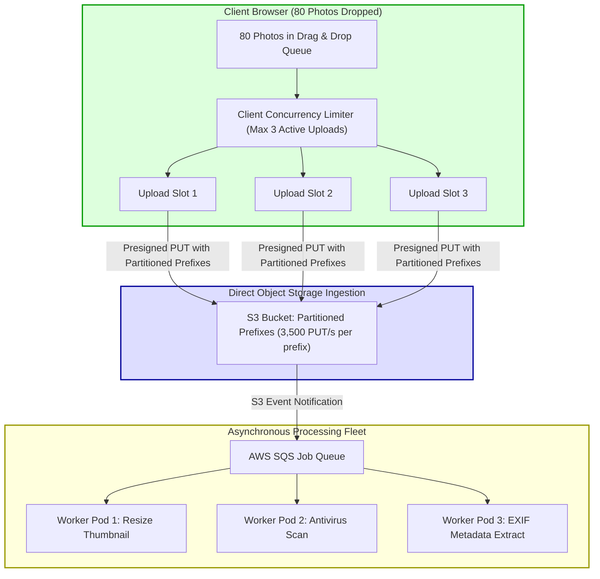

## Fast Revision (10-Second Recall)
- **The Browser Socket Ceiling:** Browsers enforce a maximum of 6 concurrent TCP connections per origin. Firing 50 simultaneous file uploads over native `fetch()` blocks other API calls (such as navigation or telemetry) and triggers network timeouts.
- **Client-Side Concurrency Throttling:** Implement a client-side worker queue (e.g., `p-limit` or custom concurrency pool) that uploads at most 3 to 4 files simultaneously, queueing the rest.
- **Server Ingress Safeguards:** Use rate-limiting, connection quotas, and reverse proxy upload buffers (Nginx `limit_conn`, Envoy connection limits) to prevent hundreds of simultaneous uploads from starving server threads.
- **S3 Partitioning / Prefix Salting:** When handling thousands of simultaneous writes to S3, distribute object keys across randomized prefixes (`s3://bucket/{hash}/...`) to prevent S3 503 SlowDown throttling (S3 handles 3,500 PUTs/sec per partition prefix).
- **Asynchronous Post-Processing:** Decouple upload ingestion from heavy processing (resizing, virus scanning) using background job queues (BullMQ, SQS).

## The 30-Second Spoken Script
> "Handling multiple simultaneous uploads requires controlling concurrency at both the client and server layers.
>
> On the **Client side**, when a user drops 100 images into a bulk-upload UI, firing 100 simultaneous HTTP requests causes browser connection starvation—saturating the browser's 6-socket-per-origin limit and causing upstream API requests to hang. We implement a client-side queue using a concurrency limiter (like `p-limit`), uploading 3 to 4 files concurrently with individual progress indicators and automatic retry logic for failed items.
>
> On the **Server side**, we bypass application compute entirely by issuing presigned S3 URLs. When thousands of users upload simultaneously, our application server only handles lightweight metadata requests (10ms each), while the massive multi-gigabyte binary throughput is absorbed directly by Amazon S3's globally distributed storage infrastructure.
>
> Finally, for **Background Processing**, we never process uploaded files synchronously on the web server. Instead, S3 emits `ObjectCreated` events to an SQS queue. A dedicated fleet of autoscaled worker pods consumes the queue, ensuring that bursts of simultaneous uploads do not exhaust CPU or memory on our primary customer-facing API fleet."

## Scenario / Problem Context
A real estate platform launched a bulk-photo upload feature allowing agents to upload high-resolution property photography (50 to 150 photos per listing, averaging 8MB each).

When an agent dropped 80 photos into the web uploader:
1. The frontend executed `photos.forEach(photo => upload(photo))`, firing 80 parallel `fetch()` POST requests to the backend.
2. The browser's 6 active HTTP sockets were saturated immediately. Other API calls (like fetching user notifications or clicking the navigation bar) hung indefinitely.
3. On the backend, 20 real estate agents uploading photos simultaneously spawned 1,600 concurrent HTTP upload streams. The Node.js application server ran out of memory and crashed.
4. When the backend tried to write all 1,600 files to S3 simultaneously under the same folder prefix (`/properties/photos/`), Amazon S3 returned `HTTP 503 SlowDown`, indicating request rate limit exhaustion.

The company needs an architecture capable of handling thousands of simultaneous file uploads smoothly without freezing user browsers or overloading servers.

## Architectural Workflow / Sequence


## Deep-Dive Analysis & Root Causes

### 1. Browser Connection Limits (HTTP/1.1 vs HTTP/2)
- Under HTTP/1.1, browsers enforce a strict ceiling of **6 concurrent TCP connections per origin**.
- Under HTTP/2, multiple requests multiplex over a single TCP connection. However, saturating that single connection with 80 simultaneous multi-megabyte binary uploads causes TCP head-of-line blocking and window buffer exhaustion.
- **Solution:** Always regulate client upload concurrency using a controlled queue (3-4 concurrent uploads).

### 2. S3 Rate Limits & Prefix Partitioning
Amazon S3 automatically scales to massive request rates, but partitions buckets by key prefix:
- S3 supports **3,500 PUT/POST/DELETE requests per second per prefix**.
- If all uploads write to `s3://bucket/uploads/2026-10-31/file.jpg`, they hit the same S3 storage partition. Under massive simultaneous bursts, S3 returns `503 SlowDown`.
- **Solution:** Salt the prefix with a hash or UUID:
  `s3://bucket/uploads/{hash3}/{userId}/{fileId}.jpg`
  This distributes writes across thousands of S3 storage partitions automatically.

### 3. Queue-Based Worker Throttling
Processing files (e.g. Sharp image resizing or FFmpeg video transcoding) consumes heavy CPU and memory.
- If 1,000 files are uploaded at once, attempting to transcode all 1,000 simultaneously will exhaust host CPU and crash worker nodes.
- Using SQS or BullMQ allows workers to pull jobs at a controlled, sustainable rate (e.g., 5 jobs per worker container), preventing CPU collapse.

## Practical Debugging Commands & Code

### Step 1: Client-Side Concurrency Queue with `p-limit`
Implement a controlled concurrency queue in the browser to handle 100+ simultaneous files:

```typescript
// frontend/src/bulkUploader.ts
import pLimit from 'p-limit';

export interface FileUploadTask {
  file: File;
  id: string;
  status: 'PENDING' | 'UPLOADING' | 'COMPLETED' | 'FAILED';
  progress: number;
}

export async function uploadMultipleFiles(
  files: File[], 
  maxConcurrent = 3,
  onTaskUpdate?: (task: FileUploadTask) => void
) {
  // Enforce maximum of 3 concurrent active uploads!
  const limit = pLimit(maxConcurrent);

  const tasks: FileUploadTask[] = files.map((file, i) => ({
    file,
    id: `file_${Date.now()}_${i}`,
    status: 'PENDING',
    progress: 0,
  }));

  const uploadSingle = async (task: FileUploadTask) => {
    task.status = 'UPLOADING';
    if (onTaskUpdate) onTaskUpdate(task);

    try {
      // 1. Get presigned URL from backend
      const res = await fetch('/api/v1/uploads/presigned-url', {
        method: 'POST',
        headers: { 'Content-Type': 'application/json' },
        body: JSON.stringify({ fileName: task.file.name, fileType: task.file.type }),
      });
      const { uploadUrl } = await res.json();

      // 2. Direct upload to S3
      const s3Res = await fetch(uploadUrl, {
        method: 'PUT',
        headers: { 'Content-Type': task.file.type },
        body: task.file,
      });

      if (!s3Res.ok) throw new Error('Failed to upload to object storage');

      task.status = 'COMPLETED';
      task.progress = 100;
    } catch (err) {
      task.status = 'FAILED';
    } finally {
      if (onTaskUpdate) onTaskUpdate(task);
    }
  };

  // Wrap all tasks in p-limit promises
  const uploadPromises = tasks.map((task) => limit(() => uploadSingle(task)));
  await Promise.all(uploadPromises);

  return tasks;
}
```

### Step 2: Backend Prefix Salting for S3 High-Throughput Partitioning
```typescript
// src/services/s3Service.ts
import { S3Client, PutObjectCommand } from '@aws-sdk/client-s3';
import { getSignedUrl } from '@aws-sdk/s3-request-presigner';
import crypto from 'node:crypto';

const s3 = new S3Client({ region: 'us-east-1' });

export async function generatePartitionedPresignedUrl(fileName: string, fileType: string, userId: string) {
  // Generate a random 4-hex salt prefix to distribute across S3 partitions
  const prefixSalt = crypto.randomBytes(2).toString('hex'); // e.g. "a9f1"
  
  // Key format: {salt}/{userId}/{timestamp}-{filename}
  const fileKey = `photos/${prefixSalt}/${userId}/${Date.now()}-${fileName}`;

  const command = new PutObjectCommand({
    Bucket: 'real-estate-media-prod',
    Key: fileKey,
    ContentType: fileType,
  });

  const uploadUrl = await getSignedUrl(s3, command, { expiresIn: 900 });
  return { uploadUrl, fileKey };
}
```

### Step 3: Nginx Rate Limiting and Connection Throttling
Protect the API from concurrent upload abuse:

```nginx
# /etc/nginx/nginx.conf
# Limit concurrent connections per IP
limit_conn_zone $binary_remote_addr zone=addr_uploads:10m;

# Limit rate of upload initiation requests per IP
limit_req_zone $binary_remote_addr zone=req_uploads:10m rate=5r/s;

server {
    location /api/v1/uploads/ {
        limit_conn addr_uploads 5; # Maximum 5 simultaneous active connections per IP
        limit_req zone=req_uploads burst=10 nodelay;
        
        proxy_pass http://backend_cluster;
    }
}
```

## Prevention & Senior Best Practices
1. **Regulate Client-Side Concurrency:** Always use a client-side queue (`p-limit`) to cap concurrent uploads at 3 to 4, preventing browser socket exhaustion.
2. **Salt S3 Key Prefixes:** Distribute high-volume simultaneous S3 writes across randomized or hashed key prefixes to prevent S3 503 SlowDown partition throttling.
3. **Decouple Ingestion from Processing:** Never process uploaded media on the API request path. Let S3 Event Notifications trigger asynchronous worker queues.
4. **Implement UI Cancellation:** Allow users to cancel individual uploads or abort the entire queue using `AbortController` to release browser network sockets cleanly.
5. **Enforce Rate Limits on Upload Initiation:** Restrict the number of presigned URLs a single user can request per minute to prevent malicious storage exhaustion attacks.

