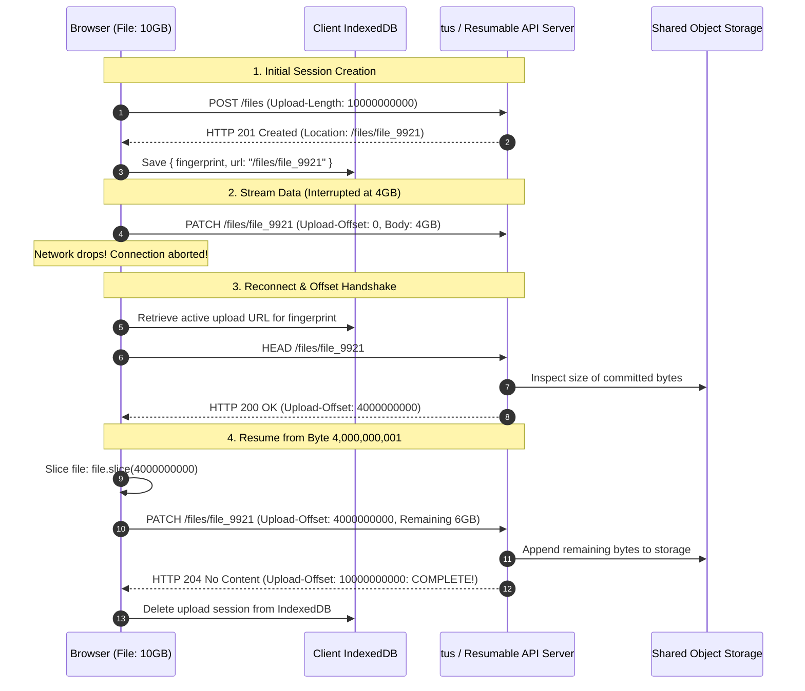

## Fast Revision (10-Second Recall)
- **The Core Goal:** If an upload of a 10GB file disconnects at 8.7GB, the client must resume transmission from byte 8,700,000,001 rather than starting over from byte 0.
- **The Open Standard (tus.io):** An open IETF-standardized protocol for resumable file uploads built on standard HTTP:
  - `POST`: Create the upload resource (returns `Location: /files/upload_abc`).
  - `HEAD`: Query current server progress (returns `Upload-Offset: 8700000000`).
  - `PATCH`: Stream bytes starting at the specified offset with header `Upload-Offset: 8700000000`.
- **Client-Side State Tracking:** Store the file fingerprint (`fileName + fileSize + lastModified`) and upload URL in `IndexedDB` or `localStorage` so resumes survive full browser restarts.
- **Locking & Concurrency:** Prevent race conditions by acquiring a lock on the upload session in Redis; reject simultaneous concurrent `PATCH` streams to the same file offset with `HTTP 409 Conflict`.
- **Zero-Storage Resume:** S3 Multipart uploads natively support resume by calling `ListParts` to query which parts S3 already holds.

## The 30-Second Spoken Script
> "To resume an interrupted file upload, we implement an offset-handshake protocol, modeled after the open **tus.io** standard.
>
> The process operates in three phases:
> First, **Session Fingerprinting**: When a user selects a file, the client creates a deterministic fingerprint based on the file name, byte size, and last-modified timestamp, checking `IndexedDB` to see if an active upload URL exists.
> Second, **Offset Query Handshake**: If the connection drops midway through an upload (for example, when a user drives through a cellular dead zone), the client initiates an HTTP `HEAD` request to the upload resource URL upon regaining connectivity. The server inspects its stored bytes and returns the `Upload-Offset` header—for example: `Upload-Offset: 450000000` (indicating 450MB have been safely written).
> Third, **Resumed Streaming via HTTP PATCH**: The client slices the source file from byte 450,000,001 to the end using `file.slice(450000000)` and streams the remaining bytes via an HTTP `PATCH` request with the `Upload-Offset: 450000000` header.
>
> If the backend stores files in Amazon S3, we achieve the same behavior by calling S3's `ListPartsCommand` to see which 10MB chunks S3 has already committed, resuming upload strictly for the missing chunks."

## Scenario / Problem Context
A broadcast video production platform allowed camera operators to upload raw 4K video rushes (typically 20GB to 50GB per file) from field trucks over bonded cellular links.

During field operations, cellular modems frequently dropped and reconnected as trucks moved between cell towers. The platform used standard HTTP PUT uploads. Every time the cell signal flickered, the upload aborted:
`net::ERR_INTERNET_DISCONNECTED`

A 35GB video upload that was at 92% completion failed, forcing the camera crew to wait another 4 hours to re-upload the entire file. Delivery deadlines for the evening news were missed, resulting in contractual penalties.

The engineering team needs a robust, resumable upload architecture that can withstand laptop reboots, browser crashes, and cellular drops with zero loss of previously uploaded bytes.

## Architectural Workflow / Sequence


## Deep-Dive Analysis & Root Causes

### 1. The Core Operations of the tus.io Protocol
The tus protocol is the industry standard for resumable uploads:
- **`POST /files`:** Initiates upload. Header `Upload-Length: <total-bytes>`. Response `Location: <upload-url>`.
- **`HEAD /files/<id>`:** Offset query. Response `Upload-Offset: <bytes-received>` and `Upload-Length: <total-bytes>`.
- **`PATCH /files/<id>`:** Appends bytes. Header `Upload-Offset: <current-offset>`. If the client sends an offset that doesn't match the server's current offset, the server rejects it with `HTTP 409 Conflict` (preventing data corruption).
- **`DELETE /files/<id>`:** Terminates and cleans up the upload session.

### 2. S3 Resumable Upload via `ListParts`
If you are using AWS S3 directly without running a tus server daemon:
1. When an upload is interrupted, the client asks the backend: `GET /api/uploads/:uploadId/parts`.
2. Backend calls S3 `ListPartsCommand({ Bucket, Key, UploadId })`.
3. S3 returns an array of all parts already uploaded (e.g., Parts 1 through 85 are uploaded; Part 86 failed).
4. The client resumes uploading from Part 86! Zero server storage needed.

### 3. Concurrency Protection & Offset Validation
What happens if two browser tabs try to resume the same upload simultaneously?
- Both send `PATCH` at `Upload-Offset: 4000000000`.
- Server uses Redis distributed locks (`SET lock:upload_9921 NX EX 30`).
- The second request is rejected with `HTTP 409 Conflict`, preventing interleaved corrupt writes.

## Practical Debugging Commands & Code

### Step 1: Resumable Upload Client Using Official `tus-js-client`
```typescript
// frontend/src/resumableUploader.ts
import * as tus from 'tus-js-client';

export function startResumableUpload(file: File, onProgress: (percent: number) => void) {
  // tus-js-client automatically handles IndexedDB fingerprint caching and auto-resumes!
  const upload = new tus.Upload(file, {
    endpoint: 'https://api.company.com/files/',
    retryDelays: [0, 1000, 3000, 5000, 10000], // Auto-retry on network drop
    chunkSize: 10 * 1024 * 1024, // 10MB chunks
    metadata: {
      filename: file.name,
      filetype: file.type,
    },
    onError: (error) => {
      console.error('Upload failed with error:', error);
    },
    onProgress: (bytesUploaded, bytesTotal) => {
      const percentage = Math.round((bytesUploaded / bytesTotal) * 100);
      onProgress(percentage);
    },
    onSuccess: () => {
      console.log('Download %s from %s', file.name, upload.url);
    },
  });

  // Check if there are any previous uncompleted uploads for this file in IndexedDB
  upload.findPreviousUploads().then((previousUploads) => {
    if (previousUploads.length > 0) {
      console.log('Resuming previous upload session from offset...');
      upload.resumeFromPreviousUpload(previousUploads[0]);
    }
    // Start or resume upload
    upload.start();
  });

  return upload;
}
```

### Step 2: S3 Native Resumable Handshake Backend (Express)
If using native S3 Multipart without the tus server:

```typescript
// src/routes/s3Resume.ts
import { Request, Response } from 'express';
import { S3Client, ListPartsCommand } from '@aws-sdk/client-s3';

const s3 = new S3Client({ region: 'us-east-1' });

export async function checkS3UploadProgress(req: Request, res: Response) {
  const { uploadId, fileKey } = req.params;

  try {
    // Query S3 for all parts successfully committed to storage
    const listCommand = new ListPartsCommand({
      Bucket: 'production-video-vault',
      Key: fileKey,
      UploadId: uploadId,
    });

    const response = await s3.send(listCommand);

    // Return list of already completed part numbers and ETags
    const completedParts = (response.Parts || []).map((part) => ({
      partNumber: part.PartNumber!,
      eTag: part.ETag!,
      size: part.Size!,
    }));

    res.json({
      uploadId,
      fileKey,
      completedParts,
      nextPartNumber: completedParts.length + 1,
    });
  } catch (error: any) {
    if (error.name === 'NoSuchUpload') {
      res.status(404).json({ error: 'Upload expired or already finalized' });
    } else {
      res.status(500).json({ error: error.message });
    }
  }
}
```

### Step 3: Fast CLI Diagnostic: Testing tus Endpoint via cURL
```bash
# 1. Query upload offset for an active tus upload
curl -I -X HEAD http://localhost:3000/files/file_9921

# Inspect output headers:
# Upload-Offset: 450000000
# Upload-Length: 1000000000
# Tus-Resumable: 1.0.0
```

## Prevention & Senior Best Practices
1. **Adopt Open Standards (tus.io):** Avoid inventing custom ad-hoc chunking protocols; standardize on the open tus.io specification, which has production-tested client SDKs for Web, iOS, and Android.
2. **Store Upload Fingerprints in IndexedDB:** Store the file fingerprint and upload URL in browser storage so uploads can resume even after a complete device reboot or browser crash.
3. **Always Validate Offsets on the Server:** Reject any incoming `PATCH` request whose `Upload-Offset` does not match the exact current size on the server with `HTTP 409 Conflict`.
4. **Acquire Distributed Locks per Upload Session:** Prevent race conditions from duplicate browser tabs by locking the upload session in Redis during write operations.
5. **Set Expiration Windows on Resumable Sessions:** Implement automated cleanup (e.g. 7 days TTL) so abandoned upload sessions and partial files do not permanently consume storage resources.

