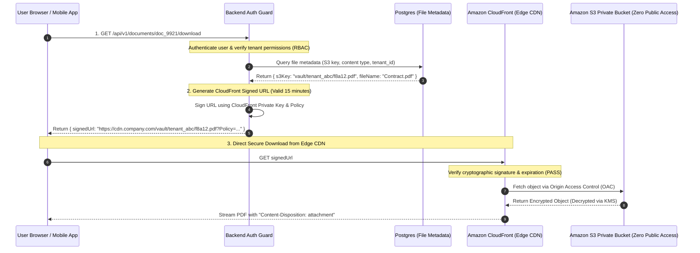

## Fast Revision (10-Second Recall)
- **Local Disk & NFS are Obsolete for Cloud Apps:** Storing uploads on local container filesystems or shared NFS mounts creates stateful servers, breaks autoscaling, and introduces single-point-of-failure bottlenecks.
- **The Modern Standard:** **Cloud Object Storage (S3, GCS, Azure Blob)** with immutable UUID keys and metadata stored in relational databases.
- **Private by Default:** Never make object storage buckets public! Every bucket must enforce `BlockPublicAcls` and `BlockPublicPolicy`.
- **Authorized File Access:** Serve private files via **Presigned URLs** (short TTL: 5-15 mins) or **CloudFront Signed Cookies** for secure streaming distribution.
- **Security Defense-in-Depth:**
  1. *Server-Side Encryption:* KMS CMK (Customer Managed Keys) or S3-managed AES-256 (`SSE-S3`).
  2. *MIME Sniffing Prevention:* Serve with `X-Content-Type-Options: nosniff` and `Content-Disposition: attachment` to prevent stored Cross-Site Scripting (XSS).
  3. *Antivirus Scanning:* Async scan via ClamAV Lambda container before making objects accessible.

## The 30-Second Spoken Script
> "When designing a secure and scalable file storage strategy, the foundational rule is: **never store user files on local server filesystems or shared network drives (NFS)**. Local files turn stateless containers into stateful bottlenecks that break Kubernetes autoscaling.
>
> In production architectures, we implement a **three-tier storage model**:
> First, **Object Storage as the Source of Truth**: Files are stored in Amazon S3 or Google Cloud Storage. Object keys are renamed to non-guessable UUIDs (`s3://bucket/{tenantId}/{uuid}`) to prevent path traversal and enumeration attacks. Original file names and MIME types are stored in our PostgreSQL database.
> Second, **Zero Public Buckets & Signed Access**: The bucket is 100% private. To allow authorized users to view or download a file, our backend generates an Amazon CloudFront **Signed URL** or S3 **Presigned GET URL** with a strict 10-minute expiration. This offloads 100% of download bandwidth from our API servers while enforcing strict multi-tenant authorization checks.
> Third, **Security Hardening**: All buckets enforce server-side encryption via AWS KMS, and an asynchronous Lambda scanner inspects every uploaded file for malware before it is marked active in the database."

## Scenario / Problem Context
A legal tech platform allowed law firms to store confidential court exhibits and evidence documents. 

The application stored uploads on a shared AWS Elastic File System (EFS) mount attached to EC2 instances:
`/mnt/shared_storage/firm_uploads/<firm_id>/<original_filename>.pdf`

As the platform scaled:
1. When traffic hit 2,000 active users, EFS hit its IOPS throughput ceiling, causing PDF downloads to hang for 45 seconds and crashing the web servers.
2. Worse, a malicious user discovered an Insecure Direct Object Reference (IDOR) and path traversal vulnerability. By manipulating the download endpoint:
   `GET /api/download?file=../../firm_42/secret_contract.pdf`
   the user was able to traverse the filesystem and download rival law firms' confidential documents.
3. Because the files were served with `Content-Type: text/html` if an attacker uploaded an HTML file, the browser executed arbitrary JavaScript inside the victim's session, leading to full session hijacking.

The company requires an enterprise-grade, secure, multi-tenant file storage architecture based on object storage and signed CDN distribution.

## Architectural Workflow / Sequence


## Deep-Dive Analysis & Root Causes

### 1. Object Storage vs Local Filesystem / NFS

| Dimension | Local Container Disk | Shared NFS (EFS) | Object Storage (S3 / GCS) |
| :--- | :--- | :--- | :--- |
| **Autoscaling** | Impossible (Files locked to 1 pod) | Possible, but high mount latency | **Native** (Completely stateless pods) |
| **Durability** | Low (Lost on container restart) | Moderate (99.99%) | **Extreme (99.999999999% - 11 Nines)** |
| **Throughput** | Bound to node SSD IOPS | Bottlenecked by network IOPS | **Virtually Infinite (Saturates CDN)** |
| **Cost** | High ($0.10 - $0.20/GB EBS) | High ($0.30/GB EFS) | **Low ($0.023/GB S3 Standard, lower on Glacier)** |
| **Security** | Susceptible to path traversal | Susceptible to path traversal | **IAM Role & Presigned Tokens** |

### 2. Preventing Stored XSS via File Uploads
Attackers often upload SVG or HTML files disguised as images (`malicious.svg` containing `<script>alert(document.cookie)</script>`).
- If served directly with `inline` disposition, the browser executes the script in your domain's security origin!
- **Mandatory Defenses:**
  - Strip executable file extensions (`.html`, `.svg`, `.exe`).
  - Serve files with header: `Content-Disposition: attachment; filename="clean.pdf"`.
  - Always enforce: `X-Content-Type-Options: nosniff`.
  - Serve all user-generated content from a separate sandbox domain (e.g., `usercontent.company.com`) so scripts cannot read authentication cookies from `app.company.com`.

### 3. Presigned URLs vs CloudFront Signed URLs
- **S3 Presigned URLs:** Great for low-frequency direct downloads or uploads directly from S3.
- **CloudFront Signed URLs / Cookies:** Best for high-traffic assets, media streaming (HLS/DASH video), and global downloads. Cached at edge locations worldwide, slashing egress bandwidth costs by 50%.

## Practical Debugging Commands & Code

### Step 1: Securely Generating Presigned Download URLs with Filename Override
```typescript
// src/services/fileDownloadService.ts
import { S3Client, GetObjectCommand } from '@aws-sdk/client-s3';
import { getSignedUrl } from '@aws-sdk/s3-request-presigner';

const s3 = new S3Client({ region: 'us-east-1' });

export async function generateSecureDownloadUrl(s3Key: string, originalFileName: string, userTenantId: string) {
  // 1. Verify tenant isolation in S3 Key
  if (!s3Key.startsWith(`vault/${userTenantId}/`)) {
    throw new Error('Unauthorized tenant file access attempt!');
  }

  // 2. Configure safe Content-Disposition headers in S3 response
  const sanitizedFileName = originalFileName.replace(/[^a-zA-Z0-9._-]/g, '_');

  const command = new GetObjectCommand({
    Bucket: 'enterprise-vault-production',
    Key: s3Key,
    // Forces browser to download as file, preventing stored XSS execution in browser!
    ResponseContentDisposition: `attachment; filename="${sanitizedFileName}"`,
    ResponseContentType: 'application/octet-stream',
  });

  // 3. Generate presigned URL expiring in 15 minutes
  return getSignedUrl(s3, command, { expiresIn: 900 });
}
```

### Step 2: S3 Bucket Policy Enforcing Strict Encryption and Origin Access Control
Terraform definition for a zero-public-access S3 bucket accessible only via CloudFront:

```hcl
# S3 Bucket with 100% Public Access Block
resource "aws_s3_bucket" "secure_vault" {
  bucket = "enterprise-vault-production"
}

resource "aws_s3_bucket_public_access_block" "block_public" {
  bucket = aws_s3_bucket.secure_vault.id

  block_public_acls       = true
  block_public_policy     = true
  ignore_public_acls      = true
  restrict_public_buckets = true
}

# Enforce Server-Side KMS Encryption
resource "aws_s3_bucket_server_side_encryption_configuration" "vault_crypto" {
  bucket = aws_s3_bucket.secure_vault.id

  rule {
    apply_server_side_encryption_by_default {
      sse_algorithm     = "aws:kms"
      kms_master_key_id = "arn:aws:kms:us-east-1:123456789012:key/my-key-id"
    }
  }
}
```

### Step 3: Fast CLI Check to Verify Bucket is Private
```bash
# Verify S3 bucket public access block is fully active
aws s3api get-public-access-block --bucket enterprise-vault-production

# Attempt unauthenticated fetch (Must return HTTP 403 Access Denied)
curl -I https://enterprise-vault-production.s3.amazonaws.com/test.pdf
```

## Prevention & Senior Best Practices
1. **Never Make S3 Buckets Public:** Enforce AWS Organization Service Control Policies (SCPs) that globally block the creation of public S3 buckets across all cloud accounts.
2. **Rename Uploaded Files to Random UUIDs:** Never store files under the user-supplied filename; rename to UUIDv4 (`{uuid}.bin`) and store the human filename in the database.
3. **Serve Downloads from a Sandbox Domain:** Isolate user-generated content on a dedicated origin (`files.company-usercontent.com`) to prevent compromised files from stealing session tokens.
4. **Always Enforce `Content-Disposition: attachment`:** Prevent browsers from rendering untrusted HTML or SVG files inline; force download dialogs to neutralize stored XSS.
5. **Implement Lifecycle Storage Tiering:** Automatically transition files older than 90 days to S3 Infrequent Access (IA), and older than 365 days to S3 Glacier Flexible Archive, slashing storage bills by up to 80%.

