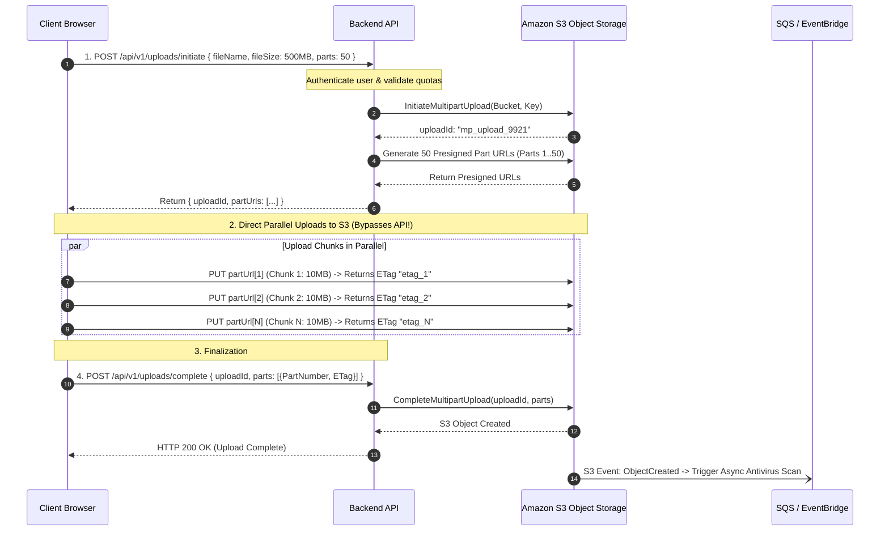

## Fast Revision (10-Second Recall)
- **The Core Architectural Anti-Pattern:** Routing multi-hundred-megabyte binary payloads through application servers (Node.js/Express, Spring, Django) ties up worker threads, bloats process heap memory, and triggers 60-second gateway timeouts on Nginx, Cloudflare, and AWS ALB.
- **The Modern Standard:** **Direct-to-Object-Storage Uploads via Presigned URLs**. The client requests an authorized signed URL from the backend in 10ms, then uploads directly to AWS S3 / Google Cloud Storage.
- **S3 Multipart Upload Threshold:** For files larger than 100MB, S3 recommends **Multipart Uploads** (split into 5MB to 10MB chunks), allowing parallel transfers and individual chunk retries.
- **Reverse Proxy File Size Limits:** Default Nginx blocks uploads over 1MB (`client_max_body_size 1M`); Cloudflare Free/Pro blocks uploads over 100MB.
- **Zero-Compute Ingestion:** The application server never handles the 500MB byte stream; it only validates metadata and signs IAM upload tokens.

## The 30-Second Spoken Script
> "When a user uploads a 500MB file and the API times out, the root problem is almost always that the binary byte stream is traversing the application backend. Intermediate proxies—like Cloudflare, AWS Application Load Balancers, or Nginx—enforce strict request timeouts (usually 30 to 60 seconds) and maximum body size limits. A 500MB file over standard home broadband takes several minutes, guaranteeing a timeout.
>
> In production architectures, we solve this using **Direct-to-S3 Multipart Uploads via Presigned URLs**:
> 1. The client sends a lightweight JSON metadata request to our API: file name, content type, and byte size.
> 2. The backend authenticates the user, validates permissions, and initiates an S3 Multipart Upload, generating signed presigned URLs for each 10MB chunk.
> 3. The client browser uploads the chunks directly to Amazon S3 in parallel over HTTPS, completely bypassing our API servers and load balancers.
> 4. Once all chunks complete, the client notifies our API to complete the multipart upload. S3 stitches the file together and emits an S3 Event Notification to trigger asynchronous virus scanning and background transcoding."

## Scenario / Problem Context
A medical imaging SaaS application allowed clinics to upload patient MRI scan archives (typically 300MB to 800MB in size).

The legacy backend used a standard Express endpoint with `multer`:
```typescript
app.post('/api/v1/scans/upload', upload.single('scanFile'), async (req, res) => {
  // Buffers 500MB in memory, then writes to local disk or S3
  await s3.upload({ Bucket: 'scans', Key: req.file.filename, Body: req.file.buffer }).promise();
  res.json({ success: true });
});
```

During clinic morning hours, three doctors uploaded MRI scans simultaneously:
1. Each 500MB upload occupied an entire Node.js memory buffer (1.5GB total), triggering a Linux kernel OOMKill.
2. Even when memory was increased, clinic uploads over cellular or slow Wi-Fi took 3 minutes. The AWS Application Load Balancer closed the connection after its 60-second `idle_timeout`, returning `HTTP 504 Gateway Timeout`.
3. If an upload reached 95% completion and dropped a TCP packet, the entire 500MB had to be re-uploaded from scratch.

The company needs an enterprise architecture that eliminates API timeouts, supports parallel chunking, and offloads file transfer traffic from the application fleet.

## Architectural Workflow / Sequence


## Deep-Dive Analysis & Root Causes

### 1. Why App Servers Should Never Handle Large Uploads
- **Process Memory Bloat:** Buffering files in memory (`req.file.buffer`) exhausts server RAM and triggers garbage collection stalls or OOMKilled crashes.
- **Worker Thread Starvation:** A single large file upload locks an HTTP socket for minutes. In thread-per-request servers (Tomcat/Django/Rails), 20 concurrent uploads exhaust the entire thread pool.
- **Proxy and Edge Timeouts:** Nginx defaults to 60-second timeouts; Cloudflare terminates connections taking over 100 seconds; AWS ALB times out at 60 seconds.

### 2. S3 Multipart Upload Architecture
Amazon S3 requires multipart uploads for files larger than 100MB (and allows up to 5TB):
- Minimum part size: 5MB (except the last part).
- Maximum parts: 10,000.
- **Resilience:** If Part 38 fails due to a network glitch, the client only retries Part 38 (10MB), not the entire 500MB file!
- **Concurrency:** The client can upload 4 to 6 chunks in parallel over separate HTTP connections, saturating user bandwidth and cutting transfer time by 4x.

### 3. S3 Bucket CORS and Lifecycle Rules
Direct uploads require configuring Cross-Origin Resource Sharing (CORS) on the S3 bucket to allow `PUT` requests from the web app domain, as well as an S3 Lifecycle rule to abort uncompleted multipart uploads after 7 days to prevent orphan chunk storage charges.

## Practical Debugging Commands & Code

### Step 1: Backend Endpoint to Initiate S3 Multipart Upload and Generate Presigned URLs
```typescript
// src/services/uploadService.ts
import { S3Client, CreateMultipartUploadCommand, UploadPartCommand, CompleteMultipartUploadCommand } from '@aws-sdk/client-s3';
import { getSignedUrl } from '@aws-sdk/s3-request-presigner';

const s3 = new S3Client({ region: 'us-east-1' });
const BUCKET_NAME = process.env.S3_BUCKET_NAME || 'medical-scans-production';

export async function initiateMultipartUpload(fileName: string, totalParts: number) {
  const fileKey = `scans/${Date.now()}-${fileName}`;

  // 1. Tell S3 to start a multipart session
  const initCommand = new CreateMultipartUploadCommand({
    Bucket: BUCKET_NAME,
    Key: fileKey,
    ContentType: 'application/octet-stream',
  });
  const initResponse = await s3.send(initCommand);
  const uploadId = initResponse.UploadId!;

  // 2. Generate presigned URLs for each individual chunk (part)
  const partUrls: { partNumber: number; url: string }[] = [];
  for (let partNumber = 1; partNumber <= totalParts; partNumber++) {
    const partCommand = new UploadPartCommand({
      Bucket: BUCKET_NAME,
      Key: fileKey,
      UploadId: uploadId,
      PartNumber: partNumber,
    });

    // URL is valid for 1 hour
    const presignedUrl = await getSignedUrl(s3, partCommand, { expiresIn: 3600 });
    partUrls.push({ partNumber, url: presignedUrl });
  }

  return { uploadId, fileKey, partUrls };
}

export async function completeMultipartUpload(fileKey: string, uploadId: string, parts: { PartNumber: number; ETag: string }[]) {
  const completeCommand = new CompleteMultipartUploadCommand({
    Bucket: BUCKET_NAME,
    Key: fileKey,
    UploadId: uploadId,
    MultipartUpload: {
      Parts: parts.sort((a, b) => a.PartNumber - b.PartNumber),
    },
  });

  return s3.send(completeCommand);
}
```

### Step 2: Client-Side Chunking and Parallel S3 Direct Upload in Browser
```typescript
// frontend/src/uploader.ts
export async function upload500MBFile(file: File) {
  const CHUNK_SIZE = 10 * 1024 * 1024; // 10MB chunks
  const totalParts = Math.ceil(file.size / CHUNK_SIZE);

  // 1. Initiate upload with API server (Takes 15ms)
  const initRes = await fetch('/api/v1/uploads/initiate', {
    method: 'POST',
    headers: { 'Content-Type': 'application/json' },
    body: JSON.stringify({ fileName: file.name, totalParts }),
  });
  const { uploadId, fileKey, partUrls } = await initRes.json();

  // 2. Upload chunks directly to S3 with concurrency limit of 4
  const completedParts: { PartNumber: number; ETag: string }[] = [];
  const queue = [...partUrls];

  const worker = async () => {
    while (queue.length > 0) {
      const part = queue.shift()!;
      const start = (part.partNumber - 1) * CHUNK_SIZE;
      const end = Math.min(start + CHUNK_SIZE, file.size);
      const chunkBlob = file.slice(start, end);

      // Direct PUT to S3! Bypasses API server completely
      const s3Res = await fetch(part.url, {
        method: 'PUT',
        body: chunkBlob,
      });

      if (!s3Res.ok) throw new Error(`Failed to upload part ${part.partNumber}`);

      // Capture S3 ETag header (must be enclosed in quotes by S3)
      const eTag = s3Res.headers.get('ETag')!;
      completedParts.push({ PartNumber: part.partNumber, ETag: eTag });
    }
  };

  // Run 4 workers in parallel
  await Promise.all([worker(), worker(), worker(), worker()]);

  // 3. Finalize upload with API server
  await fetch('/api/v1/uploads/complete', {
    method: 'POST',
    headers: { 'Content-Type': 'application/json' },
    body: JSON.stringify({ fileKey, uploadId, parts: completedParts }),
  });

  console.log('500MB upload completed successfully!');
}
```

### Step 3: S3 Lifecycle Rule to Abort Incomplete Multipart Uploads
Prevent abandoned uploads from silently accumulating storage bills:

```json
{
  "Rules": [
    {
      "ID": "AbortIncompleteMultipartUploads",
      "Status": "Enabled",
      "Filter": { "Prefix": "scans/" },
      "AbortIncompleteMultipartUpload": {
        "DaysAfterInitiation": 7
      }
    }
  ]
}
```

## Prevention & Senior Best Practices
1. **Never Route Large Files Through Web Servers:** Always use presigned URLs to upload directly from client devices to object storage (Amazon S3, Google Cloud Storage, Azure Blob).
2. **Chunk Files into 5MB to 10MB Parts:** S3 Multipart Uploads allow parallel chunk transfers and isolate network failures to individual chunks rather than restarting the entire file.
3. **Configure S3 Multipart Lifecycle Rules:** Always set `AbortIncompleteMultipartUpload` to 7 days on your S3 bucket to automatically clean up orphaned chunks from abandoned uploads.
4. **Validate Metadata Before Issuing Signed URLs:** Check user permissions, file extensions, and account storage quotas before generating presigned upload tokens.
5. **Decouple Processing from Uploads:** Use S3 Event Notifications (`s3:ObjectCreated:*`) to trigger asynchronous processing (virus scanning, thumbnail generation) via AWS Lambda or SQS rather than executing synchronously in the upload request.

