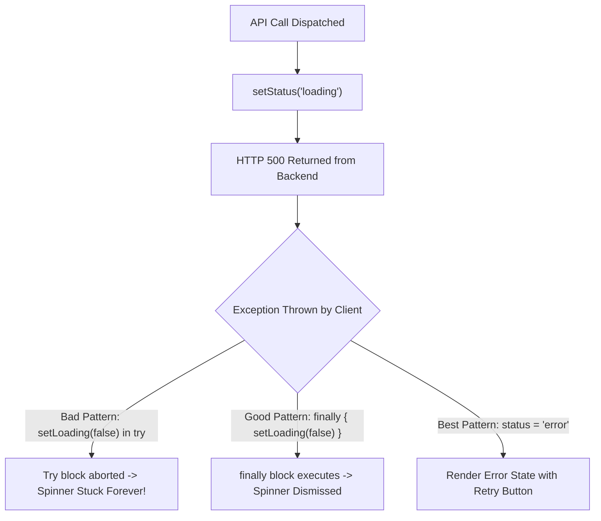

## Scenario

> **Your API returns 500, but the UI keeps showing a loading spinner. How would you fix it?**

A disastrous user experience: the server crashes with a 500 Internal Server Error, but the user is trapped staring at a spinning wheel forever. The interviewer tests error handling discipline in asynchronous lifecycles.

## Fast Revision (10-Second Recall)

- **First Move:** Inspect the component async function: is `setLoading(false)` inside the `try` block instead of `finally`?
- **Root Cause:** When the fetch/axios promise rejects on HTTP 500, execution jumps directly to `catch`. If `setLoading(false)` was placed after `await` inside `try`, it never executes.
- **The Universal Fix:** Always set loading states to false in a `finally` block, or model async state as an explicit state machine (`status: "idle" | "loading" | "success" | "error"`).
- **Senior Standard:** Use React Error Boundaries or TanStack Query, which manage loading and error states automatically.

## The 30-Second Spoken Script

If asked this in an interview, deliver this structured response:

> *This bug happens when loading state reset logic is trapped behind an unhandled error path. *
>
> *Specifically, developers often place setLoading(false) at the bottom of a try block. When the API returns a 500, axios or fetch throws an error, execution jumps immediately to the catch block, completely skipping the setLoading(false) line. If the catch block only has a console.error, the loading state remains true forever.*
>
> *To fix it immediately, I ensure setLoading(false) is placed inside the finally block, which is guaranteed to execute regardless of success or failure.*
>
> *At an architectural level, I avoid managing separate boolean flags like isLoading and isError, which allow illegal states where both are true. Instead, I model status as an explicit enum or state machine: idle, loading, success, or error. Even better, using TanStack Query completely eliminates this class of bug by automatically transitioning query status on HTTP errors.*

## Diagnostic Lifecycle



## Root Causes & Solutions Matrix

| Suspected Layer | Symptoms & Evidence | Immediate Resolution |
| :--- | :--- | :--- |
| **Missing Finally Block** | `setLoading(false)` located after `await` in `try`; never reached on error. | Move state reset to `finally { setLoading(false); }`. |
| **Boolean State Desync** | Component has `isLoading = true` and `hasError = true` simultaneously. | Replace separate booleans with a single status union: `"idle" | "loading" | "success" | "error"`. |
| **Axios Interceptor Swallowing** | Response interceptor catches 500 but returns `undefined` without rejecting. | Always return `Promise.reject(error)` at the end of response error interceptors. |
| **Native Fetch Gotcha** | `fetch()` does NOT reject on HTTP 500; it resolves with `res.ok === false`. | Check `if (!res.ok) throw new Error(...)` immediately after `await fetch()`. |

## Practical Debugging Commands & Code

### Bulletproof Async State Pattern: Fetch vs TanStack Query
```typescript
import React, { useState } from 'react';

type AsyncStatus = 'idle' | 'loading' | 'success' | 'error';

export function SafeDataLoader() {
  const [status, setStatus] = useState<AsyncStatus>('idle');
  const [errorMessage, setErrorMessage] = useState<string | null>(null);

  const loadData = async () => {
    setStatus('loading');
    setErrorMessage(null);

    try {
      const res = await fetch('/api/user/profile');
      
      // CRITICAL: Native fetch does NOT throw on 500!
      if (!res.ok) {
        throw new Error(`Server returned ${res.status}: ${res.statusText}`);
      }

      const data = await res.json();
      setStatus('success');
    } catch (err: any) {
      setStatus('error');
      setErrorMessage(err.message || 'An unexpected error occurred');
    }
    // No manual setLoading(false) needed because status cannot be 'loading' AND 'error'!
  };

  if (status === 'loading') {
    return <div className="spinner">Loading profile...</div>;
  }

  if (status === 'error') {
    return (
      <div className="error-banner">
        <p>{errorMessage}</p>
        <button onClick={loadData}>Retry</button>
      </div>
    );
  }

  return <button onClick={loadData}>Load Profile</button>;
}
```

## Prevention & Senior Best Practices

1. **Axios Interceptor Contract:** Verify global HTTP interceptors never return unresolved promises or swallow rejections.
2. **Global Error Boundaries:** Wrap component trees in React Error Boundaries to catch unhandled rendering exceptions and display fallbacks.
3. **UI Timeouts:** Add a 10-second safety timeout on loading spinners that automatically triggers a "Request took too long" error state.
