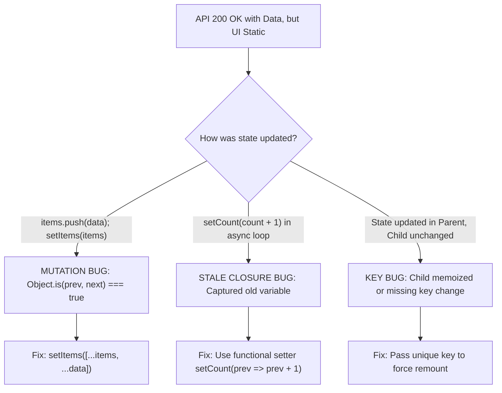

## Scenario

> **Your API returns data, but the UI doesn't update. What would you check?**

The network tab shows 200 OK with correct JSON, console.log confirms data arrived, but the screen refuses to change. The interviewer evaluates your grasp of JavaScript reference identity and reactivity mechanics.

## Fast Revision (10-Second Recall)

- **First Move:** Check if state was **mutated directly** (e.g., `items.push(newItem); setItems(items);`). React uses `Object.is()` shallow comparison; same reference = no re-render!
- **Primary Suspects:**
- 1. **Direct Object/Array Mutation:** Mutating object in place instead of creating a shallow clone (`[...items]`, `{ ...user }`).
- 2. **Stale Closure:** Stale state captured inside an asynchronous callback or event listener.
- 3. **Missing React `key` Prop:** Subtree not remounting when switching between items with identical keys.
- 4. **Nested Property Mutation:** Modifying `user.profile.name` directly in Redux/state without spreading nested tiers.

## The 30-Second Spoken Script

If asked this in an interview, deliver this structured response:

> *When the network tab confirms 200 OK and data arrives in memory but the UI doesn't update, 95% of the time the issue is state mutation violating React's immutability model.*
>
> *React determines whether to re-render a component by performing an Object.is shallow reference comparison between previous and next state. If a developer pushes an item into an existing array or modifies a property on an existing object and passes that same reference into setState, React concludes that nothing changed and skips the render phase.*
>
> *My checklist is:
First, verify that the setter creates a new reference using spread syntax or structuredClone.*
>
> *Second, check for stale closures inside async useEffect callbacks, where a functional state update like setList(prev => [...prev, ...data]) should be used instead of referencing state from outer scope.*
>
> *Third, verify that the component is actually reading from state and not an un-synced useRef or local variable.*
>
> *Finally, in list views, check if a missing or duplicate key prop is causing React to skip DOM reconciliations.*

## Diagnostic Lifecycle



## Root Causes & Solutions Matrix

| Suspected Layer | Symptoms & Evidence | Immediate Resolution |
| :--- | :--- | :--- |
| **Direct Array/Object Mutation** | `arr.push()` used before `setArr(arr)`; reference does not change. | Return new shallow copy: `setArr([...arr, newItem])` or `{ ...obj, field: val }`. |
| **Stale Async Closure** | `setItems([...items, res.data])` inside delayed callback appends to stale initial state. | Use functional updater: `setItems(prev => [...prev, res.data])`. |
| **Local Variable vs State** | Data assigned to `let myData = res.data` instead of React `useState`. | Store dynamic UI data in `useState`, `useReducer`, or external store. |
| **Component Key Recycling** | Child component manages internal state that does not reset when props change. | Add `key={data.id}` to child component so React remounts it on ID changes. |

## Practical Debugging Commands & Code

### Direct Mutation vs Immutability & Functional State Updates
```typescript
import React, { useState } from 'react';

interface User {
  id: string;
  name: string;
  roles: string[];
}

export function UserRoleManager() {
  const [user, setUser] = useState<User>({
    id: 'u1',
    name: 'Alice',
    roles: ['editor'],
  });

  // ❌ BROKEN: Direct mutation - React skips re-render!
  const badAddRole = () => {
    user.roles.push('admin'); // Mutates array in place
    setUser(user);            // Object.is(prev, next) is TRUE! No UI update!
  };

  // ✅ FIXED: Pure Immutable Update with Spread
  const goodAddRole = () => {
    setUser((prevUser) => ({
      ...prevUser,
      roles: [...prevUser.roles, 'admin'], // Brand new object & array references
    }));
  };

  // ✅ ALTERNATIVE: Using Immer for deep mutations
  // import { produce } from 'immer';
  // setUser(produce(draft => { draft.roles.push('admin'); }));

  return (
    <div>
      <h3>{user.name}</h3>
      <p>Roles: {user.roles.join(', ')}</p>
      <button onClick={goodAddRole}>Add Admin Role</button>
    </div>
  );
}
```

## Prevention & Senior Best Practices

1. **Use Immer or Zustand:** Libraries with built-in proxy-based immutability eliminate reference mutation bugs completely.
2. **Adopt TypeScript Readonly:** Mark state types as `Readonly<T>` or `readonly string[]` so direct mutations trigger compile-time errors.
3. **Always Use Functional Setters in Async:** When updating state after an `await`, use `setState(prev => ...)` to guarantee working with latest state.
