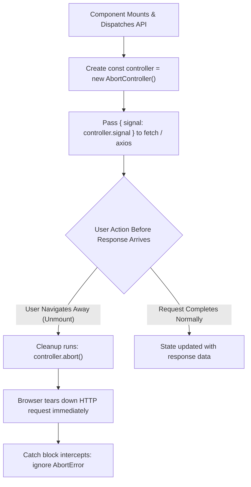

## Scenario

> **How would you cancel an API request when a component unmounts?**

When a user navigates away before an API call finishes, letting the request continue wastes mobile data and risks React "Can't perform a React state update on an unmounted component" errors. The interviewer checks AbortController mastery.

## Fast Revision (10-Second Recall)

- **First Move:** Use standard web API **`AbortController`** inside `useEffect` and invoke `controller.abort()` in the cleanup return.
- **Axios Integration:** Modern Axios (v0.22+) supports native `{ signal: controller.signal }`.
- **Error Handling:** Catch and ignore `AbortError` / `CanceledError`; aborting is an intentional lifecycle action, not a network failure!
- **TanStack Query / RTK Query:** Both automatically wire `AbortSignal` into query functions and cancel in-flight requests on unmount.

## The 30-Second Spoken Script

If asked this in an interview, deliver this structured response:

> *To cancel an in-flight API request when a component unmounts, I use the standard browser AbortController API.*
>
> *Inside useEffect, I instantiate a new AbortController and extract its signal property. I pass this signal to the native fetch() options or Axios request config.*
>
> *In the useEffect cleanup return function, I call controller.abort(). If the user navigates away while the request is in flight, the browser immediately tears down the TCP request, conserving bandwidth and memory.*
>
> *Critically, when an aborted promise rejects, it throws an AbortError in fetch or CanceledError in Axios. In the catch block, I verify if the error was due to an abort and suppress it so it doesn't log false alarms to Sentry or trigger error banners.*
>
> *If we use TanStack Query, it injects an abort signal directly into the queryFn context, handling cancellation automatically out of the box.*

## Diagnostic Lifecycle



## Root Causes & Solutions Matrix

| Suspected Layer | Symptoms & Evidence | Immediate Resolution |
| :--- | :--- | :--- |
| **Memory Leak / State Warning** | Console warning: "Cannot perform state update on an unmounted component". | Abort request on unmount so response callback never attempts `setState`. |
| **Wasted Bandwidth** | Heavy 5MB file download continues in background after user closed tab modal. | Call `controller.abort()`; terminates network stream at socket level. |
| **Unhandled Abort Error** | Navigating away pops up a toast: "Error: Request aborted by user". | Check `if (err.name === "AbortError" || axios.isCancel(err)) return;`. |
| **Stale Out-of-Order Race** | Slow request from previous tab overwrites fresh data in new tab. | Aborting prior tab queries guarantees only latest active query writes to state. |

## Practical Debugging Commands & Code

### Clean Request Cancellation with Fetch & Axios
```typescript
import React, { useState, useEffect } from 'react';
import axios from 'axios';

export function UserDetails({ userId }: { userId: string }) {
  const [user, setUser] = useState<any>(null);
  const [loading, setLoading] = useState(true);

  useEffect(() => {
    const controller = new AbortController();
    setLoading(true);

    // Using Axios with native AbortSignal
    axios
      .get(`/api/users/${userId}`, { signal: controller.signal })
      .then((res) => {
        setUser(res.data);
        setLoading(false);
      })
      .catch((err) => {
        // Crucial: Suppress intentional aborts
        if (axios.isCancel(err) || err.name === 'CanceledError') {
          console.log('Request cancelled gracefully on unmount');
          return;
        }
        console.error('Real network error:', err);
        setLoading(false);
      });

    // Cleanup executes when userId changes OR component unmounts
    return () => {
      controller.abort();
    };
  }, [userId]);

  if (loading) return <div>Loading user...</div>;
  return <div>{user?.name}</div>;
}
```

## Prevention & Senior Best Practices

1. **Use TanStack Query Context Signal:** `queryFn: ({ signal }) => fetch(url, { signal })` handles unmount cancellation without manual `useEffect` wiring.
2. **Never Update State After Unmount:** Even without cancellation, use an `isMounted` flag or AbortController as a defensive guard.
3. **Cancel Fast On Search Keystrokes:** Abort prior search queries when the user types a new character to prevent race conditions.
