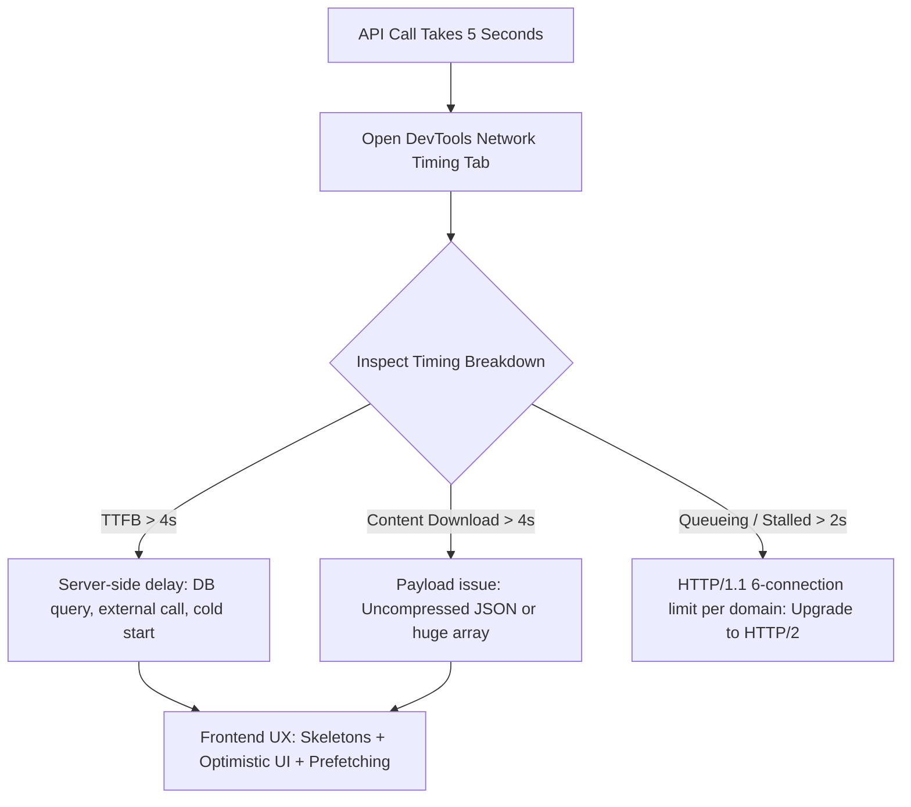

## Scenario

> **Your frontend API call takes 5 seconds. What would you do?**

When an API takes 5 seconds, the user experience collapses unless the frontend employs perceived performance strategies (skeletons, optimistic UI, background prefetching) while investigating network timing.

## Fast Revision (10-Second Recall)

- **First Move:** Open Chrome DevTools **Network tab** $\rightarrow$ Inspect **Timing breakdown** (Queueing, DNS, TLS, TTFB vs Content Download).
- **Diagnostic Split:**
- 1. **If TTFB is 4.8s:** Bottleneck is backend processing, slow DB query, or cold start.
- 2. **If Content Download is 4.5s:** Bottleneck is massive payload transfer (uncompressed 10MB JSON over mobile bandwidth).
- **Frontend Mitigations:** Optimistic UI updates, skeleton loaders, TanStack Query stale-while-revalidate caching, and prefetching on link hover.
- **Backend Coordination:** Ask backend team for payload projection (`?fields=id,name`), pagination, and gzip/brotli compression.

## The 30-Second Spoken Script

If asked this in an interview, deliver this structured response:

> *When a frontend API call takes 5 seconds, I first determine whether the problem is on the wire, in payload size, or in backend processing by checking the Network Timing breakdown.*
>
> *If Time to First Byte (TTFB) is 4.8 seconds, the delay is entirely server-side computation or database query execution. In that case, I collaborate with backend to add query indexing, caching, or asynchronous job processing.*
>
> *If TTFB is fast but Content Download takes 4.5 seconds, the client is downloading an uncompressed or unpaginated multi-megabyte JSON payload. The fix is enforcing Brotli compression and cursor pagination.*
>
> *From a pure frontend perspective, I never let a 5-second API block the user. I implement optimistic UI updates so user interactions feel instantaneous, show contextual skeleton screens instead of blocking spinners, and prefetch the data on button or link hover before the user even clicks.*

## Diagnostic Lifecycle



## Root Causes & Solutions Matrix

| Suspected Layer | Symptoms & Evidence | Immediate Resolution |
| :--- | :--- | :--- |
| **High TTFB (Backend)** | Network tab shows 4.7s waiting for server response. | Implement optimistic updates on client; backend adds Redis cache or async worker. |
| **Huge Content Download** | Transfer size is 8MB; download bar takes 4s over 4G. | Add field filtering (`?fields=id,title`), gzip/brotli compression, and limit results to 20 items. |
| **Connection Queueing** | Request is "Stalled" for 3s waiting for an available TCP socket. | Upgrade server to HTTP/2 or HTTP/3 multiplexing; consolidate batched API requests. |
| **Perceived Latency** | User stares at frozen screen or full-page blank spinner for 5s. | Render skeleton layouts instantly and show progress bar for heavy operations. |

## Practical Debugging Commands & Code

### Optimistic UI Updates with TanStack Query
```typescript
import { useMutation, useQueryClient } from '@tanstack/react-query';
import axios from 'axios';

interface Todo {
  id: string;
  title: string;
  completed: boolean;
}

export function useOptimisticToggleTodo() {
  const queryClient = useQueryClient();

  return useMutation({
    mutationFn: async (updatedTodo: Todo) => {
      // Even if this call takes 5 seconds...
      const { data } = await axios.patch(`/api/todos/${updatedTodo.id}`, updatedTodo);
      return data;
    },
    // When mutate is called:
    onMutate: async (updatedTodo) => {
      // 1. Cancel in-flight queries
      await queryClient.cancelQueries({ queryKey: ['todos'] });

      // 2. Snapshot previous value for rollback
      const previousTodos = queryClient.getQueryData<Todo[]>(['todos']);

      // 3. Optimistically update client cache IMMEDIATELY (0ms delay for user)
      queryClient.setQueryData<Todo[]>(['todos'], (old = []) =>
        old.map((todo) => (todo.id === updatedTodo.id ? updatedTodo : todo))
      );

      return { previousTodos };
    },
    // If mutation fails, rollback to snapshot
    onError: (err, newTodo, context) => {
      if (context?.previousTodos) {
        queryClient.setQueryData(['todos'], context.previousTodos);
      }
    },
    // Always refetch to sync server state
    onSettled: () => {
      queryClient.invalidateQueries({ queryKey: ['todos'] });
    },
  });
}
```

## Prevention & Senior Best Practices

1. **Prefetch on Hover:** Trigger `queryClient.prefetchQuery()` when the user hovers over a menu item or card.
2. **Implement Request Timeouts:** Abort requests that exceed 8 seconds with `AbortController` and offer a retry button.
3. **Use Stale-While-Revalidate:** Display cached data immediately while fetching fresh data in the background.
