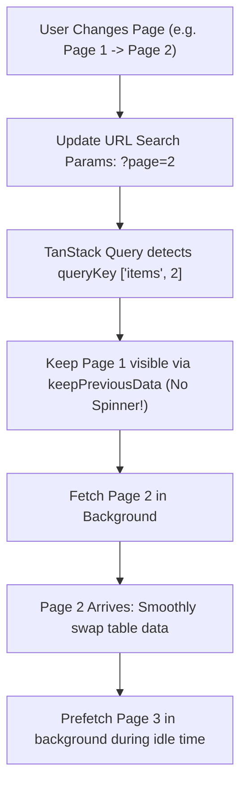

## Scenario

> **How would you handle API pagination?**

Data-intensive applications require robust pagination. The interviewer evaluates your ability to handle URL query parameter synchronization, cursor pagination, and instant navigation.

## Fast Revision (10-Second Recall)

- **First Move:** Determine pagination pattern: **Numbered Pages** (tables/search) vs **Infinite Scroll / Load More** (feeds).
- **The 3 Golden Rules of Frontend Pagination:**
- 1. **Sync to URL Query Params (`?page=2&limit=25`):** Enables sharing links, browser bookmarks, and back/forward navigation.
- 2. **Prefetch Next Page:** When user is on page N, prefetch page N+1 in the background for zero-latency clicks.
- 3. **Keep Previous Data:** Use `placeholderData: keepPreviousData` in TanStack Query to prevent layout blinking while fetching the next page.

## The 30-Second Spoken Script

If asked this in an interview, deliver this structured response:

> *I handle frontend API pagination based on whether the use case calls for Numbered Table Pagination or Infinite Feed Scrolling.*
>
> *For table and search interfaces, I use numbered pagination synchronized directly to URL search parameters (such as ?page=2&limit=20). Syncing pagination to the URL guarantees that users can bookmark pages, share links, and use the browser's native Back and Forward buttons without losing their place.*
>
> *To deliver a snappy user experience, I configure TanStack Query with placeholderData: keepPreviousData. This keeps the current table rows visible while the next page is downloading in the background, eliminating jarring blank loading spinners. Additionally, I prefetch the next page whenever the current page finishes rendering.*
>
> *For feeds, I advocate for cursor-based pagination over SQL offset pagination to avoid skipping or duplicating items when new records are inserted in real time, implementing it via useInfiniteQuery.*

## Diagnostic Lifecycle



## Root Causes & Solutions Matrix

| Suspected Layer | Symptoms & Evidence | Immediate Resolution |
| :--- | :--- | :--- |
| **Jarring Table Blinking** | Table unmounts and displays full-page spinner between every page click. | Enable `placeholderData: keepPreviousData` in TanStack Query. |
| **Broken Back/Forward Navigation** | User clicks Next Page, clicks a row, clicks Back button, and is reset to Page 1. | Sync pagination state to URL search params (`useSearchParams`). |
| **Duplicate Items in Real-Time Feeds** | New items inserted at top shift records down; offset pagination shows duplicates. | Switch to cursor-based pagination (`cursor=item_id_xyz`). |
| **Out-of-Bounds Page Navigation** | User manually enters `?page=99999` and gets empty screen. | Redirect to max page or display friendly "Page not found" banner with reset button. |

## Practical Debugging Commands & Code

### URL-Synchronized Numbered Pagination with Prefetching
```typescript
import React, { useEffect } from 'react';
import { useSearchParams } from 'react-router-dom';
import { useQuery, useQueryClient, keepPreviousData } from '@tanstack/react-query';

interface PaginatedResponse {
  items: Array<{ id: string; name: string }>;
  totalPages: number;
}

async function fetchProducts(page: number): Promise<PaginatedResponse> {
  const res = await fetch(`/api/products?page=${page}&limit=10`);
  return res.json();
}

export function ProductTable() {
  const [searchParams, setSearchParams] = useSearchParams();
  const queryClient = useQueryClient();

  // Read page from URL, default to 1
  const currentPage = Number(searchParams.get('page')) || 1;

  const { data, isPlaceholderData, isLoading } = useQuery({
    queryKey: ['products', currentPage],
    queryFn: () => fetchProducts(currentPage),
    placeholderData: keepPreviousData, // Keeps old page visible while fetching new!
    staleTime: 30000,
  });

  // Prefetch Page N + 1 for instant clicks!
  useEffect(() => {
    if (!isPlaceholderData && data && currentPage < data.totalPages) {
      queryClient.prefetchQuery({
        queryKey: ['products', currentPage + 1],
        queryFn: () => fetchProducts(currentPage + 1),
      });
    }
  }, [data, isPlaceholderData, currentPage, queryClient]);

  const handlePageChange = (newPage: number) => {
    setSearchParams({ page: String(newPage) });
  };

  if (isLoading) return <div>Loading initial page...</div>;

  return (
    <div>
      <table className={isPlaceholderData ? 'opacity-50' : 'opacity-100'}>
        <tbody>
          {data?.items.map((item) => (
            <tr key={item.id}><td>{item.name}</td></tr>
          ))}
        </tbody>
      </table>

      <div className="flex gap-2 mt-4">
        <button
          onClick={() => handlePageChange(currentPage - 1)}
          disabled={currentPage === 1}
        >
          Previous
        </button>
        <span>Page {currentPage} of {data?.totalPages}</span>
        <button
          onClick={() => handlePageChange(currentPage + 1)}
          disabled={currentPage >= (data?.totalPages || 1)}
        >
          Next
        </button>
      </div>
    </div>
  );
}
```

## Prevention & Senior Best Practices

1. **Always Default to URL Params:** Never store pagination in transient `useState` if users might want to share or reload the page.
2. **Set Safe Page Size Caps:** Restrict client-requested page size to maximum 100 items to protect backend memory.
3. **Reset Page on Filter Change:** When user changes a search filter or dropdown, always reset page to 1 (`?page=1`).
