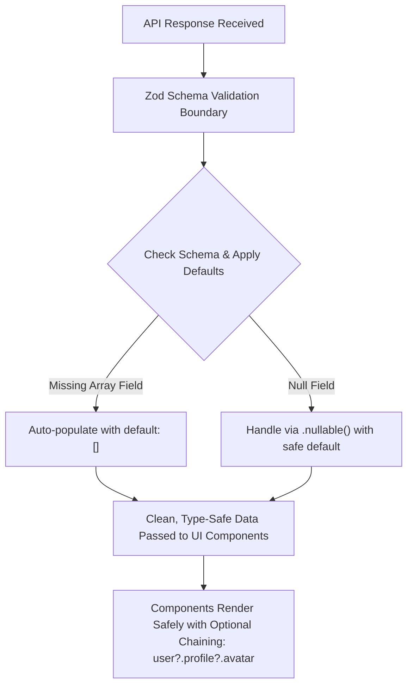

## Scenario

> **How would you handle an API response with null or missing fields?**

The number one runtime error on frontend web apps is attempting to access nested properties on null or undefined objects. The interviewer expects deep knowledge of defensive programming and runtime schema validation.

## Fast Revision (10-Second Recall)

- **First Move:** Apply **Optional Chaining (`?.`)** and **Nullish Coalescing (`??`)** for defensive access.
- **Primary Traps:**
- 1. Rendering `.map()` on an array field that the backend returned as `null` or omitted.
- 2. Falsy coercion: Using `||` instead of `??`, which incorrectly overrides valid values like `0` or `""`.
- **Senior Standard:** Validate incoming API responses with **Zod** at the network boundary so missing fields are caught and given default values before reaching UI components.

## The 30-Second Spoken Script

If asked this in an interview, deliver this structured response:

> *Handling null or missing fields in API responses requires defense-in-depth across the component render tier and the data parsing tier.*
>
> *At the syntax level, I use optional chaining and nullish coalescing. When rendering lists, I default nullable array fields to empty arrays (e.g. data?.items ?? []) to prevent fatal 'Cannot read properties of undefined (reading map)' exceptions. I strictly use double question marks (nullish coalescing) rather than logical OR to ensure valid falsy values like zero or empty strings are not wiped out.*
>
> *At the architecture level, senior engineering means preventing unvalidated data from spreading through component props. I use Zod schemas at the API client boundary. With Zod, I can declare schemas with .default([]) or .nullable(), which automatically parses, validates, and fills in missing defaults the moment the JSON arrives. If the backend schema violates the contract, it is caught at the API layer with clear telemetry rather than crashing downstream UI components.*

## Diagnostic Lifecycle



## Root Causes & Solutions Matrix

| Suspected Layer | Symptoms & Evidence | Immediate Resolution |
| :--- | :--- | :--- |
| **Unchecked `.map()` Call** | `TypeError: items.map is not a function` when backend returns `{ items: null }`. | Use `(data?.items ?? []).map(...)`. |
| **Falsy OR (`||`) Bug** | A user with `0` credits is displayed as "Default: 10 credits". | Replace `credits || 10` with `credits ?? 10`. |
| **Deep Nested Property Access** | Crash on `user.address.geo.lat` when `address` is null. | Use optional chaining: `user?.address?.geo?.lat ?? 0`. |
| **Unannounced Backend Change** | Backend renamed `first_name` to `firstName`, breaking 20 components. | Parse response through a Zod transform layer to normalize API contracts. |

## Practical Debugging Commands & Code

### Defensive Component Rendering & Zod Schema Parsing
```typescript
import React from 'react';
import { z } from 'zod';

// 1. Zod Schema: Guarantees fallback defaults at the network layer!
export const UserResponseSchema = z.object({
  id: z.string(),
  name: z.string().default('Anonymous User'),
  // Even if backend omits 'orders' or sends null, frontend gets []
  orders: z.array(z.string()).nullish().transform((val) => val ?? []),
  settings: z
    .object({
      notificationsEnabled: z.boolean().default(true),
      theme: z.enum(['light', 'dark']).default('light'),
    })
    .default({ notificationsEnabled: true, theme: 'light' }),
});

export type UserResponse = z.infer<typeof UserResponseSchema>;

// 2. Fetcher that validates against schema
export async function fetchUserProfile(userId: string): Promise<UserResponse> {
  const res = await fetch(`/api/users/${userId}`);
  const rawJson = await res.json();
  
  // Safe parsing ensures runtime safety
  return UserResponseSchema.parse(rawJson);
}

// 3. Defensive Component Usage
export function OrderList({ user }: { user: UserResponse }) {
  return (
    <div>
      <h2>{user.name}</h2>
      {/* 100% Safe: orders is guaranteed to be an array */}
      {user.orders.length === 0 ? (
        <p>No orders found.</p>
      ) : (
        <ul>
          {user.orders.map((orderId) => (
            <li key={orderId}>Order #{orderId}</li>
          ))}
        </ul>
      )}
    </div>
  );
}
```

## Prevention & Senior Best Practices

1. **Never Trust Backend Payloads Directly:** Treat external JSON as untyped `unknown` until validated by Zod or ArkType.
2. **Configure Strict TypeScript:** Enable `"strict": true` and `"noUncheckedIndexedAccess": true` in `tsconfig.json` to force null checking at build time.
3. **Use React Error Boundaries:** Place Error Boundaries around widget subtrees so an unexpected null value isolates crashes to a single card.
