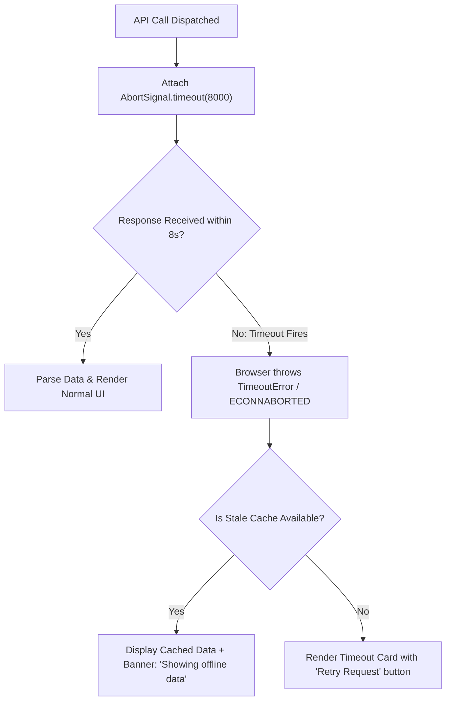

## Scenario

> **How would you handle API timeout errors?**

Default browser HTTP requests can wait 60 to 120 seconds before giving up. Senior frontend developers never make users wait more than 5-10 seconds without actionable feedback.

## Fast Revision (10-Second Recall)

- **First Move:** Enforce a strict client-side timeout using **`AbortSignal.timeout(ms)`** or Axios `timeout: 8000`.
- **Why Native Fetch Sits Indefinitely:** Standard `fetch()` has no default timeout; without configuration, it hangs until browser socket timeout (usually 2 minutes).
- **Detection:** Check `error.name === "TimeoutError"` (native) or `error.code === "ECONNABORTED"` (Axios).
- **UX Action:** Show contextual warning ("Server is taking longer than usual"), offer a "Retry" button, or fall back to cached data.

## The 30-Second Spoken Script

If asked this in an interview, deliver this structured response:

> *By default, native fetch() has no timeout, meaning a hanging server can leave a user waiting for up to 2 minutes.*
>
> *To handle API timeouts properly:*
>
> *First, I enforce strict client-side timeouts. For fast queries, I set a 5-to-8-second timeout, while for heavy reports, I allow up to 15 seconds. In modern browsers, this is cleanly implemented using `AbortSignal.timeout(8000)` passed directly into fetch, or `axios.create({ timeout: 8000 })`.*
>
> *Second, I catch the timeout error specifically. In native fetch, it throws a DOMException named TimeoutError; in Axios, it returns ECONNABORTED.*
>
> *Third, I provide clear, empathetic UX. Instead of a generic 'Network Error' banner, the UI indicates: 'The server is taking longer than expected to respond.' I provide an immediate 'Retry' button, and if available, fall back to cached stale data from localStorage or IndexedDB so the user isn't blocked.*

## Diagnostic Lifecycle



## Root Causes & Solutions Matrix

| Suspected Layer | Symptoms & Evidence | Immediate Resolution |
| :--- | :--- | :--- |
| **Indefinite Spinner Hang** | API server deadlocks; user stares at spinner for 90 seconds. | Configure client-side timeout: `AbortSignal.timeout(8000)`. |
| **Cryptic Error Messaging** | User shown "Uncaught TypeError: Failed to fetch". | Catch `TimeoutError` and display human-readable guidance: "Server timed out". |
| **Blind Retries on Write** | Retrying timed-out POST request creates duplicate charges on backend. | Never auto-retry non-idempotent mutations without confirmation. |
| **Flaky Mobile Connections** | Transient packet loss on mobile triggers timeout prematurely. | Implement exponential backoff retry for idempotent GET requests only. |

## Practical Debugging Commands & Code

### Modern Timeout Handling with AbortSignal.timeout()
```typescript
// 1. Native Fetch with AbortSignal.timeout (Modern Standard)
export async function fetchWithTimeout(url: string, timeoutMs = 8000) {
  try {
    const response = await fetch(url, {
      signal: AbortSignal.timeout(timeoutMs), // Native browser 8s timer!
    });

    if (!response.ok) throw new Error(`HTTP error ${response.status}`);
    return await response.json();
  } catch (error: any) {
    if (error.name === 'TimeoutError') {
      console.warn(`Request to ${url} timed out after ${timeoutMs}ms`);
      throw new Error('The request timed out. Please check your connection and try again.');
    }
    throw error;
  }
}

// 2. React Hook with Fallback to Stale Cache
import React, { useState, useEffect } from 'react';

export function UserProfileWidget() {
  const [data, setData] = useState<any>(null);
  const [isTimedOut, setIsTimedOut] = useState(false);

  const loadProfile = async () => {
    setIsTimedOut(false);
    try {
      const result = await fetchWithTimeout('/api/profile', 5000);
      setData(result);
      localStorage.setItem('cached_profile', JSON.stringify(result));
    } catch (err: any) {
      if (err.message.includes('timed out')) {
        setIsTimedOut(true);
        // Fall back to local cache if available
        const cached = localStorage.getItem('cached_profile');
        if (cached) setData(JSON.parse(cached));
      }
    }
  };

  useEffect(() => { loadProfile(); }, []);

  return (
    <div>
      {isTimedOut && (
        <div className="bg-yellow-100 p-2 text-sm text-yellow-800">
          Server took too long to respond. {data ? 'Displaying cached data.' : ''}
          <button onClick={loadProfile} className="ml-2 underline font-semibold">Retry</button>
        </div>
      )}
      {data && <div>Welcome, {data.name}</div>}
    </div>
  );
}
```

## Prevention & Senior Best Practices

1. **Differentiate Reads vs Writes:** Safe GET requests can automatically retry on timeout; mutating POST requests must prompt the user or send idempotency tokens.
2. **Align Client and Gateway Timeouts:** If Cloudflare edge timeout is 15s, set frontend timeout to 12s so the client can fail gracefully before Cloudflare emits a raw 524 HTML error page.
3. **Telemetry on Timeouts:** Report client timeout frequency to Datadog/Sentry to identify edge latency spikes before total server outages occur.
