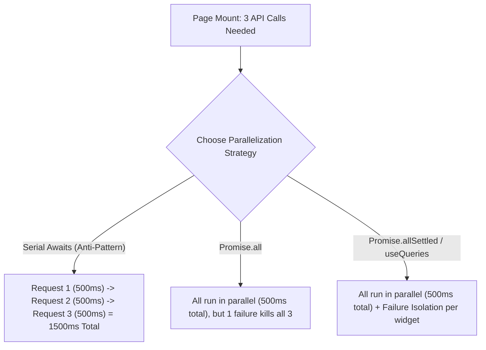

## Scenario

> **How would you handle multiple API calls on page load?**

A complex dashboard frequently needs 4-6 distinct data sources on mount (User, Notifications, Metrics, Recent Activity). The interviewer evaluates parallel execution vs serial waterfalls and failure isolation.

## Fast Revision (10-Second Recall)

- **First Move:** Never fetch in serial `await` sequence (`await fetchA(); await fetchB();`); execute in parallel!
- **Promise Strategy:**
- 1. **`Promise.all`:** Fast, but fails fast if a single non-critical endpoint 500s.
- 2. **`Promise.allSettled`:** Senior standard for independent dashboard widgets—failed endpoints display error widgets while successful ones render.
- **Modern Architecture:** Use TanStack Query `useQueries` or route loaders (Next.js/Remix) to execute parallel fetching before component render.
- **Backend Solution:** If 6 calls are always coupled, consider GraphQL or a Backend-for-Frontend (BFF) aggregator endpoint.

## The 30-Second Spoken Script

If asked this in an interview, deliver this structured response:

> *When a page requires multiple API calls on load, my core objective is eliminating serial waterfalls while ensuring that one non-critical endpoint failure does not crash the entire page.*
>
> *First, I avoid sequential await calls in useEffect, which turn three 500ms requests into a 1.5-second waterfall. Instead, I trigger them in parallel.*
>
> *Second, regarding execution strategy: If all calls are strictly interdependent—such as a user ID needed for all subsequent calls—I use a BFF endpoint or sequence only the dependent call. *
>
> *For independent dashboard widgets, I prefer Promise.allSettled over Promise.all. With Promise.all, if non-essential notifications return a 500, the entire dashboard rejects. Promise.allSettled allows the metrics and profile cards to render successfully while only the notification widget shows a discrete retry state.*
>
> *In modern applications, I utilize TanStack Query's useQueries hook, which parallelizes requests automatically, caches them independently, and handles background revalidation per query key.*

## Diagnostic Lifecycle



## Root Causes & Solutions Matrix

| Suspected Layer | Symptoms & Evidence | Immediate Resolution |
| :--- | :--- | :--- |
| **Serial Waterfall** | Each `await fetch()` waits for previous to finish; page takes 3s to load. | Run calls concurrently using `Promise.all` or `Promise.allSettled`. |
| **Single Point of Failure** | A minor analytics endpoint crashes with 500, preventing the main feed from rendering. | Use `Promise.allSettled` so rejected calls do not abort fulfilled ones. |
| **Coupled Data Overhead** | Frontend fires 7 small calls, hitting browser HTTP/1.1 socket concurrency limits. | Create a BFF (Backend-For-Frontend) endpoint `/api/dashboard/overview`. |
| **Fragmented Layout Shifts** | Each card pops in at random times as requests finish at different speeds. | Use unified skeleton screens or coordinate rendering with `Suspense`. |

## Practical Debugging Commands & Code

### Parallel Resilient Loading with Promise.allSettled & TanStack useQueries
```typescript
// 1. Resilient Vanilla Parallel Fetch with Promise.allSettled
export async function loadDashboardData() {
  const [profileResult, statsResult, feedResult] = await Promise.allSettled([
    fetch('/api/user/profile').then(r => r.json()),
    fetch('/api/user/stats').then(r => r.json()),
    fetch('/api/user/feed').then(r => r.json()),
  ]);

  return {
    profile: profileResult.status === 'fulfilled' ? profileResult.value : null,
    stats: statsResult.status === 'fulfilled' ? statsResult.value : null,
    feed: feedResult.status === 'fulfilled' ? feedResult.value : null,
    errors: {
      profile: profileResult.status === 'rejected' ? profileResult.reason : null,
      stats: statsResult.status === 'rejected' ? statsResult.reason : null,
      feed: feedResult.status === 'rejected' ? feedResult.reason : null,
    }
  };
}

// 2. Modern React with TanStack useQueries
import { useQueries } from '@tanstack/react-query';

export function Dashboard() {
  const [profileQuery, statsQuery, feedQuery] = useQueries({
    queries: [
      { queryKey: ['profile'], queryFn: fetchProfile, staleTime: 60000 },
      { queryKey: ['stats'], queryFn: fetchStats, staleTime: 30000 },
      { queryKey: ['feed'], queryFn: fetchFeed, staleTime: 10000 },
    ],
  });

  const isLoading = profileQuery.isLoading || statsQuery.isLoading;

  return (
    <div>
      {profileQuery.data && <ProfileCard user={profileQuery.data} />}
      {statsQuery.isError ? <StatsErrorRetry /> : <StatsCard stats={statsQuery.data} />}
      {feedQuery.data && <FeedList items={feedQuery.data} />}
    </div>
  );
}
```

## Prevention & Senior Best Practices

1. **Backend-For-Frontend (BFF):** Consolidate multiple noisy dashboard queries into a single purpose-built aggregation endpoint.
2. **Stagger Non-Critical Queries:** Fetch primary above-the-fold content immediately; defer secondary analytics using `requestIdleCallback`.
3. **HTTP/2 Multiplexing:** Ensure CDN and API servers support HTTP/2 to prevent domain connection socket queuing.
