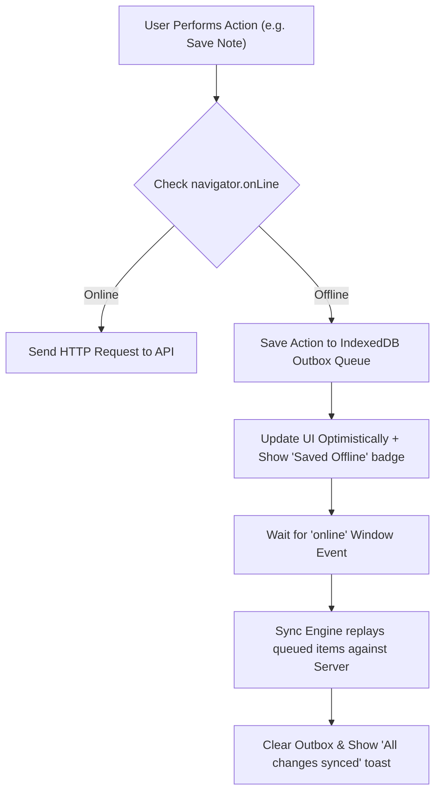

## Scenario

> **How would you handle offline network conditions?**

Users lose internet in subways, elevators, or flaky rural connections. The interviewer tests your knowledge of Progressive Web Apps (PWAs), offline indicators, and background synchronization.

## Fast Revision (10-Second Recall)

- **First Move:** Listen to `window.addEventListener("online")` and `window.addEventListener("offline")` events.
- **The 4 Pillars of Offline-First:**
- 1. **UX Indicators:** Show a non-intrusive top banner ("You are currently offline. Changes will sync when reconnected").
- 2. **Static Asset Caching:** Service Worker with Cache Storage API (Workbox) to serve app shell offline.
- 3. **Data Persistence:** Store drafts and pending actions in **IndexedDB** or `localStorage`.
- 4. **Background Sync:** Queue mutations in IndexedDB; replay them automatically when the `online` event fires.

## The 30-Second Spoken Script

If asked this in an interview, deliver this structured response:

> *To handle offline network conditions effectively, I implement an offline-first architecture focusing on transparency, local persistence, and background synchronization.*
>
> *First, I monitor network availability by tracking navigator.onLine and listening to global 'online' and 'offline' window events. When the user disconnects, I display a persistent, non-intrusive status banner indicating they are working offline.*
>
> *Second, I ensure the application shell loads without internet by registering a Service Worker using Workbox. It caches our static HTML, JS, CSS, and primary fonts using a Stale-While-Revalidate or Cache-First strategy.*
>
> *Third, for write operations—such as saving a draft or creating an item—I store the mutation in an IndexedDB outbox queue and update the UI optimistically.*
>
> *Finally, when the browser fires the 'online' event, our sync manager replays the queued mutations against the server with idempotency keys, reconciling local changes with server state and updating the UI seamlessly.*

## Diagnostic Lifecycle



## Root Causes & Solutions Matrix

| Suspected Layer | Symptoms & Evidence | Immediate Resolution |
| :--- | :--- | :--- |
| **Missing Offline Notice** | User clicks Save; nothing happens and error is silently thrown in console. | Listen to `online`/`offline` events and render an offline status banner. |
| **Total Blank Screen Offline** | Reloading the page offline results in Chrome dinosaur page. | Implement Service Worker (Workbox) caching the core App Shell. |
| **Lost User Drafts** | User fills out a 500-word form offline, submits, and loses everything. | Persist form drafts in `localStorage` or `IndexedDB` on every input change. |
| **Duplicate Replay on Reconnect** | Reconnecting sends 5 duplicate requests for the same offline draft. | Assign UUID idempotency keys to queued outbox entries. |

## Practical Debugging Commands & Code

### Network Status Hook and Offline Outbox Queue
```typescript
import { useState, useEffect } from 'react';

// 1. Reusable useNetworkStatus Hook
export function useNetworkStatus() {
  const [isOnline, setIsOnline] = useState(
    typeof navigator !== 'undefined' ? navigator.onLine : true
  );

  useEffect(() => {
    const handleOnline = () => setIsOnline(true);
    const handleOffline = () => setIsOnline(false);

    window.addEventListener('online', handleOnline);
    window.addEventListener('offline', handleOffline);

    return () => {
      window.removeEventListener('online', handleOnline);
      window.removeEventListener('offline', handleOffline);
    };
  }, []);

  return isOnline;
}

// 2. Offline Banner & Outbox Sync Trigger
export function AppShell() {
  const isOnline = useNetworkStatus();

  useEffect(() => {
    if (isOnline) {
      // Replay outbox queue when internet restores!
      syncOfflineQueue();
    }
  }, [isOnline]);

  return (
    <div>
      {!isOnline && (
        <div className="bg-amber-500 text-white text-center py-1 font-medium text-sm">
          ⚡ You are currently offline. Working with local cached data.
        </div>
      )}
      <main>{/* Application Content */}</main>
    </div>
  );
}

// 3. Simple Outbox Replay Function
async function syncOfflineQueue() {
  const queue = JSON.parse(localStorage.getItem('offline_outbox') || '[]');
  if (queue.length === 0) return;

  console.log(`Syncing ${queue.length} offline mutations...`);
  for (const item of queue) {
    try {
      await fetch(item.url, {
        method: item.method,
        body: JSON.stringify(item.body),
        headers: { 'Content-Type': 'application/json' },
      });
    } catch (err) {
      console.error('Failed to sync item, will retry on next reconnect');
      return;
    }
  }

  // Clear outbox after successful replay
  localStorage.removeItem('offline_outbox');
}
```

## Prevention & Senior Best Practices

1. **Use Workbox for Service Workers:** Don't write raw service workers from scratch; use Workbox for pre-caching and runtime routing.
2. **Use Dexie.js for IndexedDB:** Dexie provides a clean Promise-based wrapper around IndexedDB for reliable offline storage.
3. **Conflict Resolution:** Plan for conflicts when multiple devices modify the same record offline (Last-Write-Wins vs manual merge prompt).
