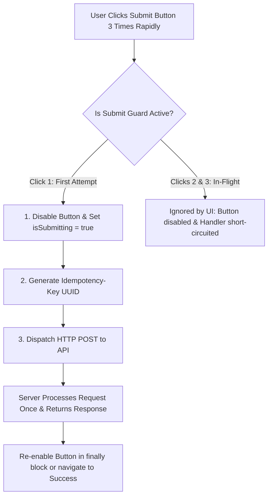

## Scenario

> **What happens if a user clicks the submit button multiple times?**

Users habitually double-click buttons or click repeatedly when network latency makes an app feel sluggish. The interviewer tests your understanding of both client-side and backend ramifications (duplicate transactions).

## Fast Revision (10-Second Recall)

- **What Happens Without Protection:**
- 1. **Multiple Concurrent HTTP POSTs:** Browser fires 3-5 identical requests in parallel.
- 2. **Duplicate Records / Charges:** If backend is not idempotent, user is charged multiple times or creates 5 duplicate database rows.
- 3. **UI Glitches & Race Conditions:** Multiple asynchronous responses resolve out of order, corrupting state.
- **The 3-Layer Defense:**
- 1. **UI Layer:** Disable button and show loading state on first click (`disabled={isSubmitting}`).
- 2. **Client Request Layer:** Debounce or ignore subsequent clicks until in-flight request settles.
- 3. **Backend Safety Layer:** Send unique `Idempotency-Key` header with every mutating request.

## The 30-Second Spoken Script

If asked this in an interview, deliver this structured response:

> *If a user clicks a submit button multiple times without protection, the browser fires concurrent HTTP POST requests to the backend.*
>
> *If the endpoint creates records or processes payments and lacks server-side idempotency, this results in disastrous duplicate orders, multiple credit card charges, or duplicate database records. On the frontend, multiple responses returning out of order can trigger race conditions and corrupted UI state.*
>
> *I solve this using a defense-in-depth approach across three layers:
First, at the UI layer, I immediately disable the submit button and show a spinner upon the first click, preventing standard mouse clicks.*
>
> *Second, at the component state layer, I guard the submit handler with an in-flight boolean flag or state machine, ignoring any synthetic or keyboard events until the current mutation resolves.*
>
> *Third, and most importantly, I generate a unique Idempotency-Key UUID for that form session and send it in the request headers. This guarantees that even if a network retry or rapid click sends duplicate packets, the backend processes the transaction exactly once.*

## Diagnostic Lifecycle



## Root Causes & Solutions Matrix

| Suspected Layer | Symptoms & Evidence | Immediate Resolution |
| :--- | :--- | :--- |
| **Duplicate Charges** | Customer charged twice on slow mobile connection. | Send `Idempotency-Key: <uuid>` header on all payment POST requests. |
| **Form Button Double Click** | Fast double-click dispatches two identical POST requests 50ms apart. | Disable button immediately upon click: `<button disabled={isSubmitting}>`. |
| **Keyboard Enter Smash** | User presses Enter repeatedly inside input field, bypassing button click listener. | Track `isSubmitting` in form `onSubmit` handler to prevent re-entry. |
| **Ghost Submission After Error** | Button stays disabled forever after a network error. | Always reset submission flag inside `finally` block or react-hook-form state. |

## Practical Debugging Commands & Code

### Idempotent Submission Handler with UI Locking
```typescript
import React, { useState, useRef } from 'react';
import axios from 'axios';

export function CheckoutForm() {
  const [isSubmitting, setIsSubmitting] = useState(false);
  // Persistent idempotency key per checkout form session
  const idempotencyKeyRef = useRef(crypto.randomUUID());

  const handleSubmit = async (e: React.FormEvent) => {
    e.preventDefault();

    // Guard: Prevent re-entry if already in flight
    if (isSubmitting) return;

    setIsSubmitting(true);

    try {
      const response = await axios.post(
        '/api/checkout',
        { items: ['item_1', 'item_2'] },
        {
          headers: {
            'Idempotency-Key': idempotencyKeyRef.current,
          },
        }
      );

      console.log('Order processed successfully:', response.data);
      // Generate new key only after successful completion
      idempotencyKeyRef.current = crypto.randomUUID();
    } catch (error) {
      console.error('Checkout failed:', error);
      // Keep same idempotency key on failure so safe retries don't double charge
    } finally {
      setIsSubmitting(false);
    }
  };

  return (
    <form onSubmit={handleSubmit}>
      <button 
        type="submit" 
        disabled={isSubmitting}
        className={isSubmitting ? 'opacity-50 cursor-not-allowed' : 'bg-blue-600'}
      >
        {isSubmitting ? 'Processing Order...' : 'Pay $99'}
      </button>
    </form>
  );
}
```

## Prevention & Senior Best Practices

1. **Backend Idempotency is Mandatory:** Client-side disabling can be bypassed via DevTools or network replay; the backend must enforce idempotency via Redis keys.
2. **Disable Enter Key Double Submit:** Attach submission guard to `<form onSubmit={...}>`, not just the button `<button onClick={...}>`.
3. **Provide Visual Feedback:** Show a spinner and change button text to "Processing..." to deter users from clicking repeatedly.
