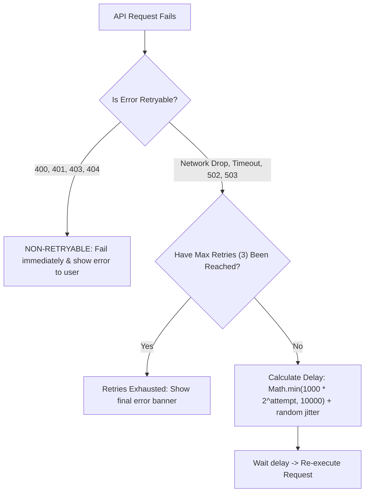

## Scenario

> **How would you implement API retry logic on the frontend?**

Mobile devices switch between Wi-Fi and cellular, causing transient packet drops. Automatically retrying intermittent failures dramatically improves app reliability—if done correctly without slamming the backend.

## Fast Revision (10-Second Recall)

- **First Move:** Apply **Exponential Backoff with Full Jitter** to prevent the "Thundering Herd" problem.
- **Retry Rules:**
- 1. **Retry ONLY Transient Errors:** Network disconnects, timeouts, 429 (Rate Limit with `Retry-After`), and 502/503/504 (Gateway errors).
- 2. **NEVER Retry Client Errors:** 400 Bad Request, 401 Unauthorized, 403 Forbidden, 404 Not Found (retrying will never fix these!).
- 3. **Cap Max Retries:** Maximum 3 retries (e.g. 1s $\rightarrow$ 2s $\rightarrow$ 4s).
- **Key Tool:** TanStack Query handles retries out of the box (`retry: 3, retryDelay: attemptIndex => Math.min(1000 * 2 ** attemptIndex, 30000)`).

## The 30-Second Spoken Script

If asked this in an interview, deliver this structured response:

> *I implement frontend API retry logic using exponential backoff with full jitter, strictly restricted to transient, retryable errors.*
>
> *First, I distinguish retryable from non-retryable errors. I never retry 4xx client errors like 400 Bad Request, 401 Unauthorized, or 404 Not Found, because repeated attempts with the same payload are guaranteed to fail. I only retry network errors, timeouts, and transient 5xx gateway errors like 502 Bad Gateway and 503 Service Unavailable. For 429 Too Many Requests, I honor the server's Retry-After header.*
>
> *Second, I enforce exponential backoff with jitter—for example, waiting 1 second, then 2 seconds, then 4 seconds, plus a random variance. The random jitter prevents thousands of mobile clients from retrying at the exact same millisecond and crushing an already struggling backend.*
>
> *Finally, for read operations, I rely on TanStack Query's built-in retry configuration. For mutating requests like payments, I avoid automatic retries unless guarded by backend idempotency keys.*

## Diagnostic Lifecycle



## Root Causes & Solutions Matrix

| Suspected Layer | Symptoms & Evidence | Immediate Resolution |
| :--- | :--- | :--- |
| **Blind Retrying 400/404** | Frontend spams API 3 times with bad parameters before giving up. | Check `error.status >= 500 || !error.status`; abort immediately on 4xx. |
| **Thundering Herd on Server Recovery** | Server recovers from brief blip; 50,000 clients retry at identical 1.00s interval, crashing it again. | Add random jitter to retry delay: `delay * Math.random()`. |
| **Rate Limit (429) Handling** | Client immediately retries rate-limited endpoint, getting IP banned. | Read `res.headers.get("Retry-After")` and pause execution for that duration. |
| **Infinite Retry Loops** | Component loops retrying forever on permanent 500 error. | Cap attempts to a maximum of 3 retries. |

## Practical Debugging Commands & Code

### Exponential Backoff with Full Jitter Implementation
```typescript
interface RetryOptions {
  maxRetries?: number;
  baseDelayMs?: number;
  maxDelayMs?: number;
}

export async function fetchWithRetry<T>(
  fn: () => Promise<T>,
  options: RetryOptions = {}
): Promise<T> {
  const { maxRetries = 3, baseDelayMs = 1000, maxDelayMs = 10000 } = options;

  let attempt = 0;

  while (true) {
    try {
      return await fn();
    } catch (error: any) {
      attempt++;

      // 1. Check if error is non-retryable (4xx client errors)
      const status = error?.response?.status || error?.status;
      const isClientError = status >= 400 && status < 500 && status !== 429;

      if (attempt > maxRetries || isClientError) {
        throw error;
      }

      // 2. Compute Exponential Backoff with Full Jitter
      const exponentialDelay = Math.min(baseDelayMs * Math.pow(2, attempt - 1), maxDelayMs);
      const jitteredDelay = Math.floor(Math.random() * exponentialDelay);

      console.warn(`Attempt ${attempt} failed. Retrying in ${jitteredDelay}ms...`);
      await new Promise((resolve) => setTimeout(resolve, jitteredDelay));
    }
  }
}
```

## Prevention & Senior Best Practices

1. **Use TanStack Query Default Retries:** Let React Query manage retries for data fetching queries (`retry: (count, err) => count < 3 && err.status >= 500`).
2. **Listen to Online/Offline Events:** Pause retries when `navigator.onLine === false`; resume immediately when the `online` event fires.
3. **Notify User on Long Retries:** Show a subtle toast ("Reconnecting...") so the user understands why the UI is pausing.
