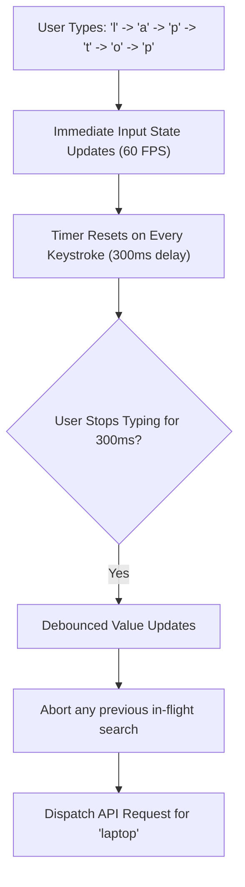

## Scenario

> **How would you implement search with debouncing?**

Typing "laptop" in an un-debounced search input sends 6 HTTP requests to the backend within 500ms. Interviewers test your understanding of timers, closures, cancellation, and UX responsiveness.

## Fast Revision (10-Second Recall)

- **First Move:** Wrap the search input state in a **Debounce delay (typically 300-500ms)** so the API is called only after the user stops typing.
- **Debounce vs Throttle:**
- 1. **Debounce:** Waits for a pause in events (ideal for type-ahead search inputs).
- 2. **Throttle:** Executes at most once every interval (ideal for scroll/resize tracking).
- **Crucial Pairing:** Debouncing must be combined with **`AbortController`** so any prior in-flight search is cancelled when the next search starts.
- **Immediate Local Feedback:** Keep the text input responsive with local state; debounce only the API query.

## The 30-Second Spoken Script

If asked this in an interview, deliver this structured response:

> *To implement search with debouncing, I separate the immediate input state from the delayed search query.*
>
> *If you trigger an API call on every keystroke, a user typing a 10-character word fires 10 concurrent requests, flooding the backend and creating race conditions.*
>
> *I maintain an immediate searchTerm state for the input field so the user experiences zero typing lag. I pass that value through a useDebounce hook with a 300ms delay. The actual API query only fires when the debounced value changes.*
>
> *Furthermore, debouncing alone is not enough: if the user types 'mac', pauses 300ms, and then types 'book', the first search might take 800ms while the second takes 200ms. Without cancellation, the older 'mac' results could arrive last and overwrite the newer 'macbook' results. Therefore, I couple debouncing with an AbortController or TanStack Query, cancelling any prior in-flight request when a new query is initiated.*

## Diagnostic Lifecycle



## Root Causes & Solutions Matrix

| Suspected Layer | Symptoms & Evidence | Immediate Resolution |
| :--- | :--- | :--- |
| **Missing Debounce** | Backend receives 6 search requests for a single word typed by user. | Delay API dispatch with a 300ms debounce timer. |
| **Typing Latency (Bad UX)** | Delaying the `<input>` value itself causes visible keystroke lag. | Keep input value immediate; debounce only the downstream effect/API query. |
| **Out-of-Order Race Condition** | Old search for "car" resolves after newer search for "cars", showing wrong results. | Abort previous in-flight request with `AbortController`. |
| **Memory Leak on Unmount** | Unmounted component attempts to fire debounce callback after user navigates away. | Clear timer in `useEffect` cleanup: `clearTimeout(timerId)`. |

## Practical Debugging Commands & Code

### Custom useDebounce Hook with Request Cancellation
```typescript
import React, { useState, useEffect } from 'react';

// 1. Reusable useDebounce Hook
export function useDebounce<T>(value: T, delayMs = 300): T {
  const [debouncedValue, setDebouncedValue] = useState<T>(value);

  useEffect(() => {
    const timer = setTimeout(() => {
      setDebouncedValue(value);
    }, delayMs);

    // Reset timer on every keystroke
    return () => clearTimeout(timer);
  }, [value, delayMs]);

  return debouncedValue;
}

// 2. Search Component with Cancellation
export function SearchBar() {
  const [searchTerm, setSearchTerm] = useState('');
  const [results, setResults] = useState<string[]>([]);
  const [isSearching, setIsSearching] = useState(false);

  // Debounced query updates only after 350ms of typing inactivity
  const debouncedQuery = useDebounce(searchTerm, 350);

  useEffect(() => {
    if (!debouncedQuery.trim()) {
      setResults([]);
      return;
    }

    const controller = new AbortController();
    setIsSearching(true);

    fetch(`/api/search?q=${encodeURIComponent(debouncedQuery)}`, {
      signal: controller.signal,
    })
      .then((res) => res.json())
      .then((data) => {
        setResults(data.items);
        setIsSearching(false);
      })
      .catch((err) => {
        if (err.name === 'AbortError') return; // Ignore cancelled requests
        setIsSearching(false);
      });

    // Aborts prior in-flight request if debouncedQuery changes again
    return () => controller.abort();
  }, [debouncedQuery]);

  return (
    <div>
      <input
        type="text"
        value={searchTerm}
        onChange={(e) => setSearchTerm(e.target.value)}
        placeholder="Search products..."
        className="border p-2 rounded w-full"
      />
      {isSearching && <p className="text-sm text-gray-500">Searching...</p>}
      <ul>
        {results.map((item, idx) => (
          <li key={idx}>{item}</li>
        ))}
      </ul>
    </div>
  );
}
```

## Prevention & Senior Best Practices

1. **Use Standard Delays:** 300ms is the sweet spot for search type-ahead; shorter causes excessive queries, longer feels sluggish.
2. **Trim Whitespace:** Always check `.trim()` to prevent firing redundant searches on spacebar clicks.
3. **Cache Recent Queries:** Cache recent search query results in memory so backspacing to a previous word loads instantly from cache.
