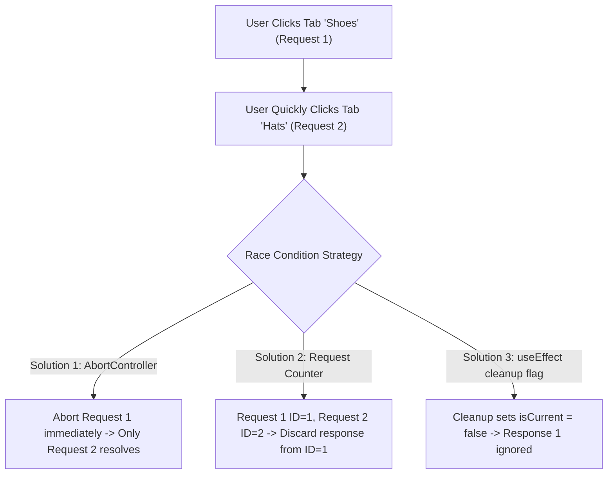

## Scenario

> **What would you do if API responses arrive in a different order than requests?**

A classic async interview scenario: user selects Tab "Shoes" (takes 800ms), then quickly selects Tab "Hats" (takes 200ms). "Hats" finishes first, but 600ms later "Shoes" finishes and overwrites the screen. How do you prevent this?

## Fast Revision (10-Second Recall)

- **First Move:** Understand that **Network Latency is Non-Deterministic**—Request #1 can easily finish after Request #2.
- **The 3 Core Solutions:**
- 1. **AbortController (Preferred):** Cancel the prior in-flight request the moment a new one is dispatched.
- 2. **Sequential Request ID / Timestamp Counter:** Ignore responses whose request ID is older than the latest active ID.
- 3. **Boolean `isCurrent` / Cleanup Flag in `useEffect`:** Invalidate previous closure on next render.
- **Modern Fix:** TanStack Query handles this by associating requests with `queryKey`; older queries are superseded automatically.

## The 30-Second Spoken Script

If asked this in an interview, deliver this structured response:

> *This is the classic frontend race condition caused by non-deterministic network latency. If a user clicks Filter A (which takes 1 second) and immediately clicks Filter B (which takes 200 milliseconds), Filter B's response arrives first. 800 milliseconds later, Filter A's response arrives and overwrites the state, leaving the user with Filter B selected in the UI but Filter A's data displayed on screen.*
>
> *I solve this using three primary techniques:*
>
> *First, the cleanest modern approach is request cancellation via AbortController. In the useEffect return or dispatch handler, I abort the previous controller before creating a new one. The browser terminates the prior connection, ensuring only the latest response can ever resolve.*
>
> *Second, if cancellation is not supported by the transport, I use an active request counter or timestamp ref. Before updating state, I verify if the response's request ID matches the latest dispatched ID; if it is stale, I silently discard it.*
>
> *Third, in React useEffect, using a local boolean flag like 'let isCurrent = true' and setting it to false in the cleanup callback guarantees that an unmounted or superseded effect closure never commits data to state.*

## Diagnostic Lifecycle



## Root Causes & Solutions Matrix

| Suspected Layer | Symptoms & Evidence | Immediate Resolution |
| :--- | :--- | :--- |
| **Overwritten State** | UI shows active tab "Hats", but table displays "Shoes" data. | Cancel prior request with `AbortController` or ignore stale request ID. |
| **Flaky Search Suggestions** | Typing "cat" shows results for "ca" because "ca" query finished late. | Abort previous search on every keystroke. |
| **Fast Filter Switching** | User rapidly toggles status dropdowns; results flicker back and forth. | Tie query to TanStack Query `queryKey: ["items", activeFilter]`. |
| **Zombie Unmounted Updates** | Navigating away from page causes late response to throw state warnings. | Set cleanup flag `isCancelled = true` in `useEffect` return. |

## Practical Debugging Commands & Code

### Three Patterns to Eliminate API Race Conditions
```typescript
// Pattern 1: AbortController (Best - saves network bandwidth)
import React, { useState, useEffect, useRef } from 'react';

export function TabSelectorPattern1({ selectedCategory }: { selectedCategory: string }) {
  const [data, setData] = useState([]);

  useEffect(() => {
    const controller = new AbortController();

    fetch(`/api/items?cat=${selectedCategory}`, { signal: controller.signal })
      .then((r) => r.json())
      .then((items) => setData(items))
      .catch((err) => {
        if (err.name !== 'AbortError') console.error(err);
      });

    // Cancels Request 1 if selectedCategory changes to Request 2!
    return () => controller.abort();
  }, [selectedCategory]);

  return <div>{/* Render items */}</div>;
}

// Pattern 2: Request Counter (When request cancellation is not available)
export function TabSelectorPattern2({ selectedCategory }: { selectedCategory: string }) {
  const [data, setData] = useState([]);
  const latestRequestId = useRef(0);

  useEffect(() => {
    const currentId = ++latestRequestId.current;

    fetch(`/api/items?cat=${selectedCategory}`)
      .then((r) => r.json())
      .then((items) => {
        // Discard response if a newer request was dispatched while this was in flight!
        if (currentId === latestRequestId.current) {
          setData(items);
        }
      });
  }, [selectedCategory]);

  return <div>{/* Render items */}</div>;
}
```

## Prevention & Senior Best Practices

1. **Adopt TanStack Query:** React Query automatically handles query cancellation and out-of-order race conditions based on unique `queryKey` tuples.
2. **Never Share Mutable Promises:** Keep promise instances local to the effect execution.
3. **Disable Rapid Toggle If Critical:** If operations are destructive (e.g. state toggles), disable controls until the mutation completes.
