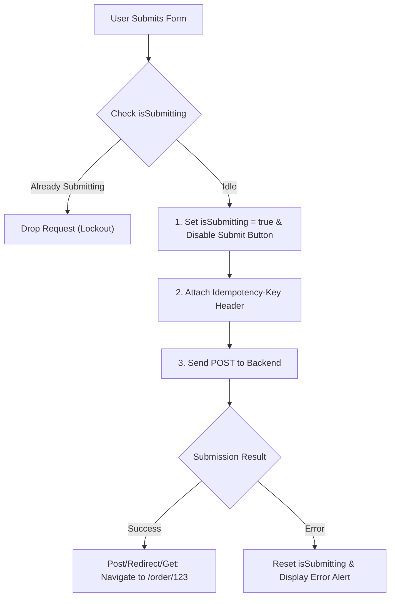

## Scenario

> **How would you prevent duplicate form submissions?**

A deeper architectural follow-up to rapid clicks. Interviewers want to see how you design bulletproof form lifecycles using modern libraries (React Hook Form, TanStack Mutation) and HTTP standards.

## Fast Revision (10-Second Recall)

- **First Move:** Lock the UI by checking form state (`isSubmitting`) provided by form libraries like React Hook Form.
- **Architectural Strategy:**
- 1. **Client-side Lock:** Disable submit button + block `onSubmit` re-entry while promise is pending.
- 2. **Debounce / Throttle:** Prevent rapid burst submissions from double clicks or hardware bouncing.
- 3. **Idempotency Token:** Pass unique `X-Idempotency-Key: UUID` generated on form mount.
- 4. **Post/Redirect/Get (PRG):** Navigate to a confirmation page immediately upon success to prevent duplicate submission on browser refresh.

## The 30-Second Spoken Script

If asked this in an interview, deliver this structured response:

> *To prevent duplicate form submissions, I apply a full-stack design pattern combining client-side locking, debounce guards, idempotency keys, and Post/Redirect/Get.*
>
> *First, using React Hook Form or standard state, I track formState.isSubmitting. The submit button is immediately disabled, and the form onSubmit handler short-circuits if an execution is already pending.*
>
> *Second, I generate a unique Idempotency Key (UUIDv4) when the form mounts and attach it as an HTTP header to the mutation request. If network lag causes duplicate packets or the user triggers a submission retry, the backend uses Redis to recognize the identical idempotency key and return the original cached response without re-executing the transaction.*
>
> *Third, once the submission succeeds, I immediately redirect the user to a success or details page using React Router. This enforces the Post/Redirect/Get pattern, ensuring that if the user refreshes the page, they reload a GET view instead of re-submitting the POST form.*

## Diagnostic Lifecycle



## Root Causes & Solutions Matrix

| Suspected Layer | Symptoms & Evidence | Immediate Resolution |
| :--- | :--- | :--- |
| **Accidental Double Click** | Two submissions created 80ms apart from an impatient double-tap. | Disable submit button and check `isSubmitting` flag in handler. |
| **Page Refresh After Submit** | User refreshes confirmation page; browser prompts "Resubmit form?". | Implement Post/Redirect/Get: `navigate("/order-success")` after submit. |
| **Unstable Mobile Network Retry** | Network drops during response; browser auto-retry posts twice. | Backend checks `Idempotency-Key` in Redis cache before processing. |
| **Hardware Mouse Bounce** | Faulty mouse switch registers two clicks on single physical press. | Throttle submit handler with a 500ms leading-edge guard. |

## Practical Debugging Commands & Code

### React Hook Form with Submission Lock & PRG Redirect
```typescript
import React, { useRef } from 'react';
import { useForm } from 'react-hook-form';
import { useNavigate } from 'react-router-dom';
import axios from 'axios';

interface FormInputs {
  email: string;
  amount: number;
}

export function TransferFundsForm() {
  const navigate = useNavigate();
  const idempotencyKeyRef = useRef(crypto.randomUUID());

  const {
    register,
    handleSubmit,
    formState: { isSubmitting, errors },
  } = useForm<FormInputs>();

  const onSubmit = async (data: FormInputs) => {
    const response = await axios.post('/api/transfer', data, {
      headers: { 'X-Idempotency-Key': idempotencyKeyRef.current },
    });

    // Post/Redirect/Get pattern: Redirect away immediately upon success
    navigate(`/transfer/confirmation/${response.data.transactionId}`, { replace: true });
  };

  return (
    <form onSubmit={handleSubmit(onSubmit)} className="space-y-4">
      <div>
        <label>Email</label>
        <input {...register('email', { required: true })} />
      </div>

      <div>
        <label>Amount</label>
        <input type="number" {...register('amount', { required: true, min: 1 })} />
      </div>

      <button
        type="submit"
        disabled={isSubmitting}
        className="px-4 py-2 bg-green-600 text-white rounded disabled:opacity-50"
      >
        {isSubmitting ? 'Transferring...' : 'Send Transfer'}
      </button>
    </form>
  );
}
```

## Prevention & Senior Best Practices

1. **Always Use Post/Redirect/Get:** Never render the success state on the same POST URL; always navigate to a dedicated GET route.
2. **Form Library Primitives:** Rely on battle-tested libraries (`react-hook-form`, `formik`) that manage `isSubmitting` natively across async lifecycles.
3. **Rate Limiting:** Enforce API gateway rate limits (e.g. 5 requests/min per IP on payment endpoints).
