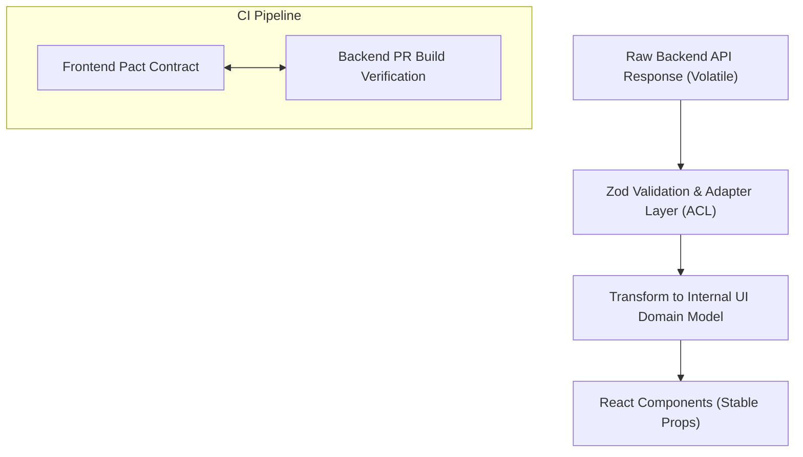

## Scenario

> **Your API response structure changes. How would you prevent UI failures?**

Backend teams frequently rename fields, nest properties, or deprecate endpoints. The interviewer wants to know how you decouple frontend architecture from volatile backend schema changes.

## Fast Revision (10-Second Recall)

- **First Move:** Implement an **Anti-Corruption Layer (Adapter Pattern / Mapper)** between raw API responses and internal UI models.
- **The 4 Pillars of Schema Resilience:**
- 1. **Adapter / Mapper Pattern:** Never bind raw API shapes directly into JSX; transform raw DTOs into domain models.
- 2. **Runtime Contract Validation:** Use Zod/TypeScript to parse and validate schema at API boundary.
- 3. **Consumer-Driven Contracts (Pact):** Automated CI tests where backend tests against frontend contract expectations.
- 4. **API Versioning:** Enforce URL versioning (`/v1/`, `/v2/`) or Header versioning before breaking changes occur.

## The 30-Second Spoken Script

If asked this in an interview, deliver this structured response:

> *To prevent UI failures when an API response structure changes, I implement an Anti-Corruption Layer (ACL) using the Adapter pattern, backed by consumer-driven contract testing.*
>
> *Instead of binding raw backend JSON directly into our React component props, our API service maps raw DTOs into stable, frontend-owned domain models. If the backend changes a field from 'user_name' to 'fullName' or moves 'email' inside a nested 'contact' object, I only need to update a single adapter function in one place. All 50 downstream UI components remain completely untouched and stable.*
>
> *To catch breaking changes before they hit staging, I advocate for Consumer-Driven Contract testing with tools like Pact. The frontend team defines its contract expectations, and the backend CI pipeline runs against that contract. If a backend engineer makes a breaking schema change, their PR build fails automatically.*
>
> *Finally, at runtime, I use Zod schemas to validate incoming payloads and log contract divergence directly to Sentry.*

## Diagnostic Lifecycle



## Root Causes & Solutions Matrix

| Suspected Layer | Symptoms & Evidence | Immediate Resolution |
| :--- | :--- | :--- |
| **Direct Prop Coupling** | Backend renames `address` to `shipping_address`; 30 components crash. | Use an adapter/mapper function to map raw API responses to frontend models. |
| **Unannounced API Deprecations** | Breaking changes deployed to production without frontend notice. | Implement Consumer-Driven Contract testing (Pact) in the backend CI pipeline. |
| **Unversioned Breaking Changes** | Backend mutates response shape in-place on existing endpoints. | Enforce semantic API versioning (`/v1/`, `/v2/`) with deprecation headers. |
| **Silent Type Drifts** | Backend changes ID from integer to UUID string without error. | Use automated OpenAPI/Swagger TypeScript code generation (`openapi-typescript`). |

## Practical Debugging Commands & Code

### The Adapter Pattern (Anti-Corruption Layer) Implementation
```typescript
// 1. Raw Volatile Backend DTO (Subject to change)
interface RawUserDTO {
  user_id: number;
  user_full_name: string;
  contact_info?: {
    primary_email: string;
  };
}

// 2. Stable Frontend Domain Model (Owned by UI team)
export interface UserModel {
  id: string;
  name: string;
  email: string;
}

// 3. Adapter / Mapper Function (The Anti-Corruption Layer)
export function mapUserDTOToModel(dto: RawUserDTO): UserModel {
  return {
    id: String(dto.user_id),
    name: dto.user_full_name || 'Anonymous',
    email: dto.contact_info?.primary_email || '',
  };
}

// 4. API Client uses the Adapter
export async function getUser(id: string): Promise<UserModel> {
  const res = await fetch(`/api/users/${id}`);
  const rawDto: RawUserDTO = await res.json();
  
  // Only the adapter changes if the backend schema evolves!
  return mapUserDTOToModel(rawDto);
}

// 5. UI Component: Completely decoupled from backend naming conventions
export function UserBadge({ user }: { user: UserModel }) {
  return (
    <div>
      <h4>{user.name}</h4>
      <p>{user.email}</p>
    </div>
  );
}
```

## Prevention & Senior Best Practices

1. **OpenAPI / Type Generation:** Use `openapi-typescript-codegen` to automatically regenerate TypeScript types from Swagger/OpenAPI specs on every build.
2. **Pact Contract Tests:** Run automated Pact tests in CI to block backend PRs that break frontend expectations.
3. **Semantic Versioning:** Mandate that breaking changes require a new API version path (`/api/v2/`).
