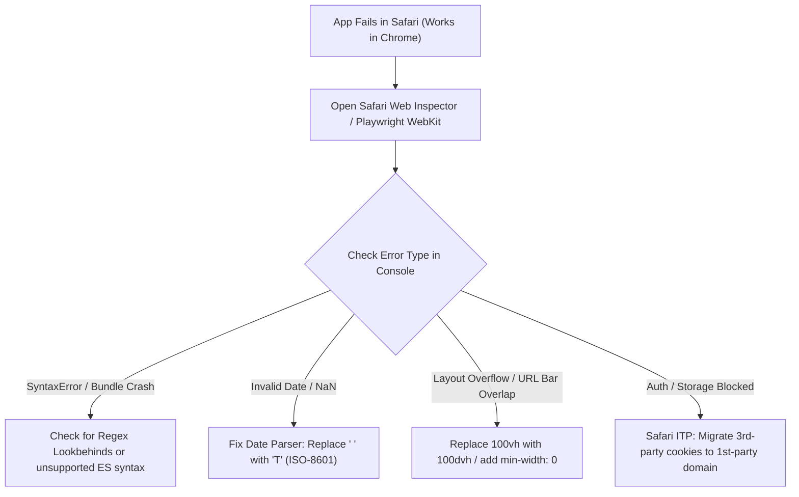

## Scenario

> **Your application works in Chrome but fails in Safari. How would you debug it?**

Every frontend engineer encounters the dreaded "It works in Chrome, but broken in Safari" bug. The interviewer wants to know if you understand WebKit engine specifics, date parsing traps, and modern CSS viewport units.

## Fast Revision (10-Second Recall)

- **First Move:** Connect Safari Web Inspector (or use Playwright WebKit / BrowserStack) to inspect the console for unhandled JS exceptions.
- **Top 5 Safari Gotchas:**
- 1. **Date Parsing:** `new Date("2026-10-31 10:00:00")` throws `Invalid Date` in Safari (requires ISO 8601: `2026-10-31T10:00:00Z` or replace space with `T`).
- 2. **Regex Lookbehind:** `(?<=...)` was unsupported in older Safari versions and crashes the entire script bundle during parsing.
- 3. **100vh Viewport Jump:** `100vh` ignores mobile Safari bottom URL address bar $\rightarrow$ Use `100dvh` (dynamic viewport height).
- 4. **Third-Party Cookie Blocking (ITP):** Safari Intelligent Tracking Prevention blocks cross-site auth cookies/iframes.
- 5. **Flexbox / Grid Quirks:** Flex child overflow with `min-width: auto` default causing horizontal blowout.

## The 30-Second Spoken Script

If asked this in an interview, deliver this structured response:

> *When an application works in Chrome but fails in Safari, I immediately look for WebKit engine divergences, strict date parsing differences, and viewport quirks.*
>
> *My diagnostic workflow:
First, I inspect the console using Safari Web Inspector via macOS or Playwright's WebKit runtime. *
>
> *Second, I check for JavaScript syntax crashes that cause the entire bundle to fail before mounting. The classic example is RegExp lookbehind assertions or unsupported modern JS features if polyfills or browserslist targets are too aggressive.*
>
> *Third, I examine date formatting. Safari's Date parser strictly rejects dates separated with spaces or dashes like '2026-10-31 10:00', returning Invalid Date where V8 in Chrome silently parses them. Replacing space with 'T' or using ISO-8601 strings resolves this immediately.*
>
> *Fourth, on the CSS side, Safari handles mobile viewport height differently: 100vh causes bottom navigation elements to be covered by the browser address bar. I replace 100vh with modern CSS dynamic viewport units like 100dvh.*
>
> *Finally, if authentication fails, Safari's Intelligent Tracking Prevention (ITP) often blocks third-party cookies or cross-domain authentication tokens.*

## Diagnostic Lifecycle



## Root Causes & Solutions Matrix

| Suspected Layer | Symptoms & Evidence | Immediate Resolution |
| :--- | :--- | :--- |
| **Strict Date Parsing** | `new Date("2026-05-10 12:00")` returns `Invalid Date` in Safari, but works in Chrome. | Format string to ISO 8601: `.replace(" ", "T")` or use `date-fns`. |
| **RegExp Lookbehind Crash** | Blank white screen; console throws `SyntaxError: Invalid regular expression`. | Transpile regex through Babel or rewrite without lookbehind `(?<=...)`. |
| **Mobile 100vh Overlap** | Buttons at bottom of screen hidden behind Safari address bar. | Use modern CSS dynamic viewport units: `height: 100dvh;`. |
| **Flexbox Min-Width Blowout** | Flex child with long text overflows container instead of truncating. | Add `min-width: 0;` to the flex child element. |

## Practical Debugging Commands & Code

### Safari WebKit Compatibility Fixes (Date & Viewport)
```typescript
// 1. Cross-Browser Date Parser (Safari Compatible)
export function safeParseDate(dateStr: string): Date {
  // Safari fails on "YYYY-MM-DD HH:mm:ss" -> Convert to ISO 8601 "YYYY-MM-DDTHH:mm:ss"
  const isoFormatted = dateStr.includes(' ') && !dateStr.includes('T')
    ? dateStr.replace(' ', 'T')
    : dateStr;

  const parsed = new Date(isoFormatted);
  if (isNaN(parsed.getTime())) {
    throw new Error(`Unable to parse date in Safari: ${dateStr}`);
  }
  return parsed;
}

// 2. CSS Viewport Fix (Mobile Safari URL bar safe)
/* 
❌ BAD: Overflows under Safari address bar
.hero-screen {
  height: 100vh;
}

✅ GOOD: Dynamic viewport unit adapts when Safari address bar collapses/expands
.hero-screen {
  height: 100vh; /* Fallback for older browsers */
  height: 100dvh; /* Dynamic Viewport Height for modern Safari & Chrome */
}

✅ GOOD: Prevent Flexbox text truncation blowout in Safari
.flex-child-truncated {
  min-width: 0; /* Mandatory in Safari for text-overflow: ellipsis to work */
  overflow: hidden;
  text-overflow: ellipsis;
  white-space: nowrap;
}
*/
```

## Prevention & Senior Best Practices

1. **Run Playwright WebKit in CI:** Add automated end-to-end tests targeting WebKit alongside Chromium to catch Safari bugs before staging.
2. **Conservative Browserslist:** Update `.browserslistrc` to include `safari >= 15` so build tools transpile unsupported syntax.
3. **Avoid Non-Standard Date Strings:** Always serialize backend dates as ISO 8601 strings (`2026-10-31T05:59:40.000Z`).
