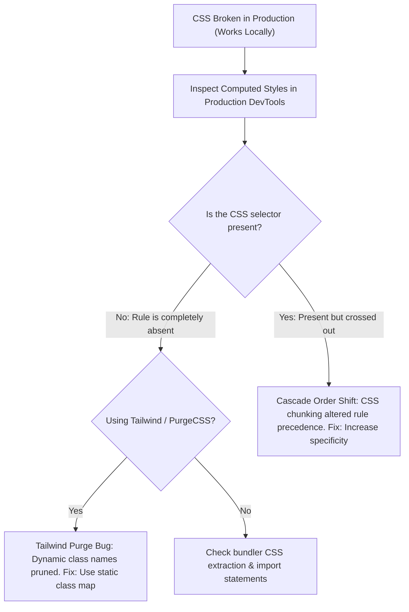

## Scenario

> **Your CSS works locally but breaks after deployment. What would you check?**

A nightmare scenario: developer runs `npm run dev` and UI looks beautiful; production build is deployed and layouts are ruined or styles disappear. The interviewer evaluates your knowledge of production build transformations.

## Fast Revision (10-Second Recall)

- **First Move:** Inspect the computed styles in production DevTools to see if the rule is **missing completely (purged)** or **overridden by higher specificity**.
- **Top 4 Production CSS Failure Causes:**
- 1. **Tailwind Purge / Content Glob Missing:** Tailwind pruned utility classes because dynamic class names (e.g. `text-\${color}-500`) were not statically detected in `tailwind.config.js`.
- 2. **Bundle Chunk Order & Specificity Shift:** In development, CSS is injected via `<style>` tags in arbitrary order; in production, mini-css-extract-plugin merges CSS files into one, altering cascade order.
- 3. **CSS Minification / PostCSS Bug:** PostCSS or cssnano stripped vendor prefixes or collapsed valid syntax.
- 4. **CDN Cache Holding Old CSS:** HTML points to old hashed CSS or CDN cached stale stylesheet.

## The 30-Second Spoken Script

If asked this in an interview, deliver this structured response:

> *When CSS works in local development but breaks in production, the issue is almost always introduced by the production build pipeline: bundling, purging, minification, or cascade order shifts.*
>
> *My diagnostic checklist:*
>
> *First, in production Chrome DevTools, I inspect the broken element. I check whether the CSS rule is completely missing from the stylesheet or present but overridden.*
>
> *If the rule is missing completely and the project uses Tailwind, 90% of the time it is caused by dynamic string interpolation like `bg-\${color}-500`. Tailwind's purge scanner uses regex on source code and cannot evaluate runtime expressions, purging the class. I replace dynamic interpolation with static class maps or add safelist entries.*
>
> *If the rule exists but is crossed out, it is a specificity or cascade order issue. In development (Vite/Webpack), CSS is injected via multiple dynamic style tags based on component import order. In production, tools concatenate all CSS into a single file, which can reverse rule precedence if two selectors share the same specificity.*
>
> *Finally, I check if PostCSS or cssnano aggressively stripped browser vendor prefixes or if an aggressive CDN cache is serving an outdated CSS bundle.*

## Diagnostic Lifecycle



## Root Causes & Solutions Matrix

| Suspected Layer | Symptoms & Evidence | Immediate Resolution |
| :--- | :--- | :--- |
| **Tailwind Purge Dynamic String** | Classes like `text-red-500` missing because written as `text-\${color}-500`. | Use complete static class names or add to `safelist` in `tailwind.config.js`. |
| **CSS Cascade Order Inversion** | Styles overridden because global CSS was bundled after component CSS. | Ensure reset/global CSS is imported first at the app entrypoint; avoid equal specificity. |
| **PostCSS / cssnano Over-Minification** | CSS Grid or calc expressions mangled during minification. | Audit `postcss.config.js`; configure `cssnano: { preset: ["default", { calc: false }] }`. |
| **CDN Asset Hash Stale Cache** | HTML references old CSS hash or CDN edge serves 404 for new chunks. | Ensure HTML `Cache-Control: no-cache` while assets use `max-age=31536000, immutable`. |

## Practical Debugging Commands & Code

### Tailwind Dynamic String Trap & Safe Mapping
```typescript
// ❌ BROKEN IN PRODUCTION: Tailwind scanner cannot evaluate runtime variables!
// Works in dev only if the class happened to be used elsewhere!
export function BadBadge({ color }: { color: 'red' | 'green' | 'blue' }) {
  return (
    <span className={`bg-${color}-100 text-${color}-800`}>
      Status
    </span>
  );
}

// ✅ FIXED: Static Lookup Record (Guarantees Tailwind scanner detects full strings)
const BADGE_COLOR_MAP: Record<'red' | 'green' | 'blue', string> = {
  red: 'bg-red-100 text-red-800 border-red-200',
  green: 'bg-green-100 text-green-800 border-green-200',
  blue: 'bg-blue-100 text-blue-800 border-blue-200',
};

export function GoodBadge({ color }: { color: 'red' | 'green' | 'blue' }) {
  return (
    <span className={`border px-2 py-0.5 rounded text-xs ${BADGE_COLOR_MAP[color]}`}>
      Status
    </span>
  );
}

// Or configure tailwind.config.js safelist for dynamic patterns:
// module.exports = {
//   safelist: [
//     { pattern: /(bg|text|border)-(red|green|blue)-(100|800)/ },
//   ],
// };
```

## Prevention & Senior Best Practices

1. **Always Test Production Builds Locally:** Run `npm run build && npm run preview` before pushing pull requests.
2. **Never Dynamically Construct Tailwind Classes:** Always write complete utility class names in template strings.
3. **Import CSS in Strict Hierarchical Order:** Import reset $\rightarrow$ design system tokens $\rightarrow$ global utilities $\rightarrow$ component styles.
