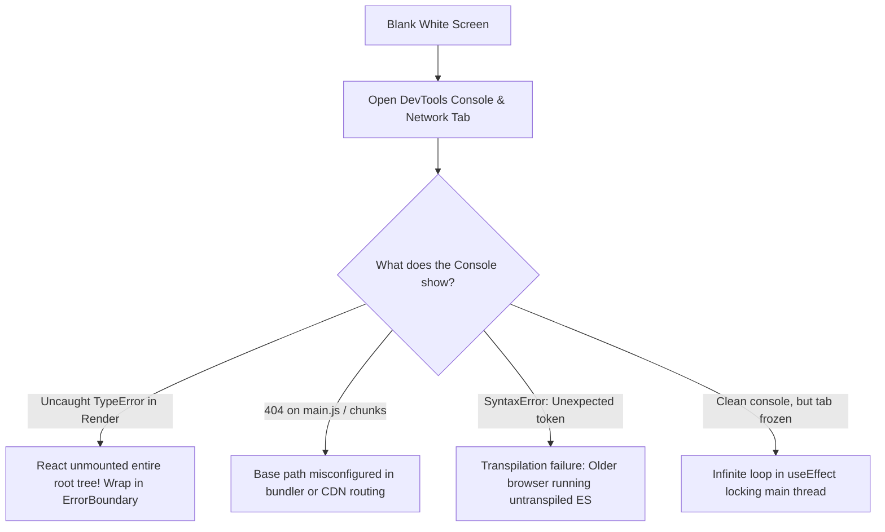

## Scenario

> **How would you debug a blank white screen?**

The ultimate frontend failure: a user visits your web app and sees nothing but a blank white screen. The interviewer wants to test your calm, systematic diagnostic process from HTML source to JS runtime crashes.

## Fast Revision (10-Second Recall)

- **First Move:** Open **DevTools Console** to check for unhandled JS exceptions, and inspect the **DOM Tree** (`<div id="root"></div>` empty vs missing).
- **The 4 Culprits of Blank Screens:**
- 1. **Uncaught React Rendering Exception:** In React 16+, an uncaught error inside `render()` unmounts the entire component tree.
- 2. **Broken Asset Path (404 on Scripts):** `base` path misconfigured in Vite (`base: "./"` vs `base: "/"`), causing 404 on script tags.
- 3. **Syntax Error in Older Browser:** Modern syntax (e.g. top-level await or optional chaining) breaking older WebView/Safari.
- 4. **Infinite Loop / Memory Crash:** `useEffect` setting state without dependencies locking the main thread.

## The 30-Second Spoken Script

If asked this in an interview, deliver this structured response:

> *When faced with a blank white screen, I follow a systematic triage from the network layer down to the React reconciliation tree.*
>
> *First, I inspect the DOM: Is `<div id="root">` completely empty, or did it fail to load altogether?*
>
> *If the DOM is empty, I check the DevTools Console. In React, any uncaught error thrown during the render phase causes React to completely unmount the root component tree, resulting in a blank white screen. The console will pinpoint the exact component and call stack—typically a TypeError like 'Cannot read properties of undefined'.*
>
> *Second, if the console shows 404 errors for script chunks, the build or CDN base path was misconfigured—such as deploying to a subfolder without configuring Vite's 'base' property.*
>
> *Third, if there are no console errors and the page is unresponsive, I check for infinite render loops in useEffect that freeze the browser's main thread.*
>
> *To prevent blank screens entirely in production, I wrap the application in hierarchical React Error Boundaries, ensuring errors are caught locally and replaced with friendly fallback screens while preserving navigation.*

## Diagnostic Lifecycle



## Root Causes & Solutions Matrix

| Suspected Layer | Symptoms & Evidence | Immediate Resolution |
| :--- | :--- | :--- |
| **Uncaught Render Error** | Console shows `Uncaught TypeError`; `<div id="root">` is empty. | Wrap component tree in a top-level `ErrorBoundary` with fallback UI. |
| **Base Path 404** | Network tab shows 404 Not Found for `/assets/index.js`. | Set correct `base: "/"` in `vite.config.ts` or configure rewrite rules. |
| **Infinite Render Loop** | Browser CPU hits 100%; console logs thousands of renders per second. | Fix `useEffect` dependency array; remove state setter that triggers itself. |
| **Missing Fallback on Suspense** | `React.lazy` component hangs indefinitely on slow network. | Provide skeleton in `<Suspense fallback={<Skeleton />}>`. |

## Practical Debugging Commands & Code

### Fail-Safe Root Mount with Defensive Error Boundary
```typescript
import React from 'react';
import ReactDOM from 'react-dom/client';
import { GlobalErrorBoundary } from './components/GlobalErrorBoundary';
import { App } from './App';

const rootElement = document.getElementById('root');

if (!rootElement) {
  // Defensive check: DOM element missing
  document.body.innerHTML = '<h1>Critical Error: Root mount point missing</h1>';
  throw new Error('Root element not found in HTML document');
}

// Wrap root immediately in Error Boundary so NO uncaught exception can cause a white screen
ReactDOM.createRoot(rootElement).render(
  <React.StrictMode>
    <GlobalErrorBoundary
      fallback={
        <div style={{ padding: '40px', textAlign: 'center', fontFamily: 'sans-serif' }}>
          <h2>Application temporarily unavailable</h2>
          <p>Please refresh the page or contact support if the issue persists.</p>
          <button onClick={() => window.location.reload()}>Reload Page</button>
        </div>
      }
    >
      <App />
    </GlobalErrorBoundary>
  </React.StrictMode>
);
```

## Prevention & Senior Best Practices

1. **Never Deploy Without a Root Error Boundary:** An Error Boundary at the root guarantees that users never see a raw blank white screen.
2. **Automated Smoke Test in CI:** Run headless Chromium after build to verify `<div id="root">` successfully mounts and produces DOM children.
3. **Static HTML Loading Fallback:** Place a static SVG spinner inside `<div id="root"><div class="spinner"></div></div>` in `index.html`; if JS crashes, the spinner indicates loading rather than a blank white canvas.
