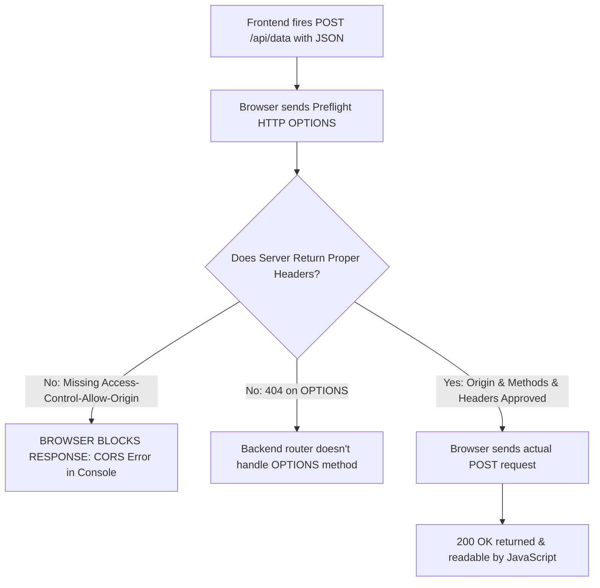

## Scenario

> **How would you debug a CORS error?**

Frontend developers frequently cry "CORS error!" and try adding headers like `mode: "no-cors"` or custom headers, which only make it worse. The interviewer tests whether you truly understand HTTP preflight mechanics and CORS headers.

## Fast Revision (10-Second Recall)

- **First Axiom:** **CORS is enforced by the BROWSER, not the server**—the browser blocks the frontend JavaScript from reading the response when CORS headers are missing.
- **The 3 Crucial Checks:**
- 1. **Preflight OPTIONS Request:** Check Network tab for the `OPTIONS` request. Did it return 200/204? Did it include `Access-Control-Allow-Origin` and `Access-Control-Allow-Methods`?
- 2. **Credentials / Cookies (`withCredentials: true`):** If sending cookies/auth headers, origin CANNOT be wildcard `*` (must be exact: `https://frontend.com`) and must include `Access-Control-Allow-Credentials: true`.
- 3. **Local Dev Workaround:** Use Vite/Webpack dev server proxy (`/api` $\rightarrow$ `http://localhost:8080`) to bypass CORS during local development.
- **Warning:** Never use `mode: "no-cors"` in fetch; it turns the response into an opaque object where JavaScript cannot read the JSON body!

## The 30-Second Spoken Script

If asked this in an interview, deliver this structured response:

> *When debugging a CORS error, my first move is explaining that CORS is a browser-enforced security mechanism, not a backend crash. The backend usually executed the query successfully, but the browser refused to expose the response to JavaScript because the proper Access-Control headers were missing.*
>
> *My systematic triage:
First, I inspect the Chrome DevTools Network tab. For non-simple requests—such as requests sending JSON (Content-Type: application/json) or custom Authorization headers—the browser automatically sends an HTTP OPTIONS preflight request. I check if the OPTIONS request succeeded. If the server returned 404 or 405 on OPTIONS, the server framework is not handling preflights.*
>
> *Second, I check the response headers:
1. Access-Control-Allow-Origin must match our frontend origin.
2. If our request sends credentials or cookies (withCredentials: true), the origin CANNOT be an asterisk wildcard; it must be our exact domain, and Access-Control-Allow-Credentials must be true.
3. Access-Control-Allow-Headers must explicitly list any custom headers we sent, like Authorization or X-Correlation-ID.*
>
> *Finally, for local development where frontend runs on localhost:3000 and backend on localhost:8080, I configure a Vite dev server proxy to route requests through the same origin, eliminating local CORS issues entirely.*

## Diagnostic Lifecycle



## Root Causes & Solutions Matrix

| Suspected Layer | Symptoms & Evidence | Immediate Resolution |
| :--- | :--- | :--- |
| **Preflight OPTIONS 404** | OPTIONS request fails with 404 or 405 Method Not Allowed. | Configure backend router/gateway to respond 200/204 to all `OPTIONS` requests. |
| **Wildcard with Credentials** | Error: "Cannot use wildcard when credentials flag is true". | Backend must echo exact request origin (`https://app.com`) instead of `*`. |
| **Missing Allowed Header** | Error: "Request header field Authorization is not allowed by Access-Control-Allow-Headers". | Add `Authorization` to backend `Access-Control-Allow-Headers` list. |
| **Misguided `no-cors` Fix** | Developer sets `mode: "no-cors"`; response is opaque and `.json()` fails. | Remove `no-cors`; configure proper CORS headers on backend or dev proxy. |

## Practical Debugging Commands & Code

### Vite Dev Server Proxy (Eliminate Localhost CORS)
```typescript
// vite.config.ts
import { defineConfig } from 'vite';

export default defineConfig({
  server: {
    proxy: {
      // Proxy all /api requests to backend during local development
      '/api': {
        target: 'http://localhost:8080',
        changeOrigin: true,
        secure: false,
        rewrite: (path) => path.replace(/^\/api/, ''),
      },
    },
  },
});

// In Frontend Code:
// Requests go to relative URL "/api/users" -> Browser sees same origin (no CORS!)
// Vite dev server forwards to "http://localhost:8080/users" behind the scenes.
export async function getLocalUsers() {
  const res = await fetch('/api/users');
  return res.json();
}
```

## Prevention & Senior Best Practices

1. **Never Suggest `no-cors` as a Solution:** Educate teams that `no-cors` is meant for opaque CDN scripts/images, not JSON APIs.
2. **Centralize CORS at API Gateway:** Configure CORS headers on Cloudflare / Kong / AWS API Gateway once rather than per microservice.
3. **Use Reverse Proxies in Production:** Serve frontend and backend from the same top-level domain (e.g. `app.example.com` and `app.example.com/api`) using Nginx or Cloudflare routes.
