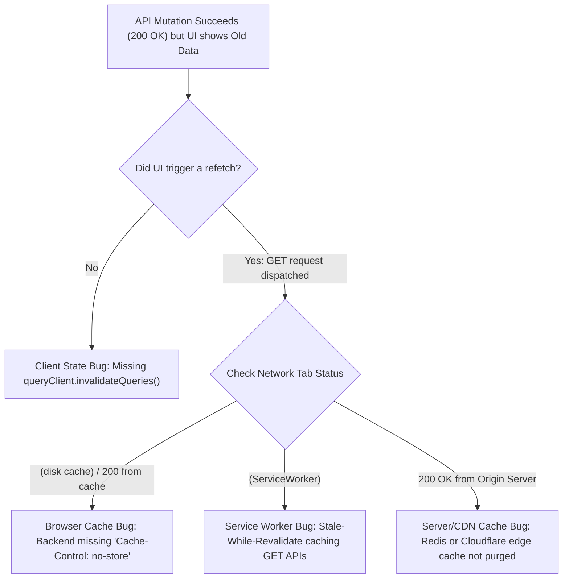

## Scenario

> **Your frontend shows old data even after a successful API update. What would you check?**

User edits their profile name from "Alice" to "Alicia", receives 200 OK, but the profile header still shows "Alice". The interviewer evaluates your understanding of caching layers.

## Fast Revision (10-Second Recall)

- **First Move:** Identify which of the **4 Caching Layers** is retaining the old value:
- 1. **Client State Cache:** Did you forget `queryClient.invalidateQueries({ queryKey: ["user"] })` after mutation?
- 2. **Browser HTTP Cache:** Did backend send `Cache-Control: public, max-age=3600` on the `GET /user` endpoint, causing browser to serve cached response without hitting server?
- 3. **Service Worker:** Is a Service Worker intercepting the GET request and serving from `caches.match()`?
- 4. **Edge CDN Cache:** Is Cloudflare caching API responses at the edge without cache-busting?

## The 30-Second Spoken Script

If asked this in an interview, deliver this structured response:

> *When the frontend shows stale data after a successful API update, the issue lies in one of four caching tiers: in-memory state, browser HTTP cache, service workers, or edge CDN cache.*
>
> *First, I check our client-side state cache. If we use TanStack Query or RTK Query, did the mutation's onSuccess handler explicitly call queryClient.invalidateQueries() for that resource? Without cache invalidation, React Query continues serving cached data until staleTime expires.*
>
> *Second, I inspect the Network tab for the subsequent GET request. If it shows '(disk cache)' or '(from memory cache)' with Status 200, the browser HTTP cache is to blame. The backend GET endpoint is improperly emitting caching headers like 'Cache-Control: max-age=3600'. Dynamic API endpoints must always return 'Cache-Control: no-cache, no-store, must-revalidate'.*
>
> *Third, if the request shows '(ServiceWorker)', the active service worker is serving stale responses from the Cache Storage API without revalidating.*
>
> *Fourth, if the GET request reaches the network but still returns old data, an edge CDN or backend Redis cache was not invalidated upon the write.*

## Diagnostic Lifecycle



## Root Causes & Solutions Matrix

| Suspected Layer | Symptoms & Evidence | Immediate Resolution |
| :--- | :--- | :--- |
| **Missing Cache Invalidation** | TanStack Query does not refetch because `staleTime` is set to 5 minutes. | Call `queryClient.invalidateQueries({ queryKey: ["profile"] })` on mutation success. |
| **Browser HTTP 304 / Disk Cache** | Network tab shows `Status: 200 (from disk cache)` for API query. | Backend must send `Cache-Control: no-store, private` on dynamic GET endpoints. |
| **Service Worker Cache** | Service Worker returns cached API response from `caches.open("api-cache")`. | Exclude dynamic `/api/*` endpoints from Service Worker caching strategies. |
| **Optimistic State Overwrite** | Optimistic update applied, then stale background fetch overwrites it with old data. | Await query cancellation before applying mutations. |

## Practical Debugging Commands & Code

### Proper Query Invalidation & Anti-Cache HTTP Headers
```typescript
// 1. TanStack Query Mutation with Guaranteed Invalidation
import { useMutation, useQueryClient } from '@tanstack/react-query';
import axios from 'axios';

export function useUpdateUserProfile() {
  const queryClient = useQueryClient();

  return useMutation({
    mutationFn: (newProfile: { name: string }) =>
      axios.patch('/api/user/profile', newProfile),

    onSuccess: async () => {
      // Invalidate and immediately refetch fresh data from server
      await queryClient.invalidateQueries({
        queryKey: ['user', 'profile'],
        refetchType: 'active', // Immediately refetches currently mounted components
      });
    },
  });
}

// 2. Backend Requirement: Verify Correct Cache-Control Headers
// Express / Node.js API Middleware
// app.use('/api', (req, res, next) => {
//   res.set({
//     'Cache-Control': 'no-store, no-cache, must-revalidate, proxy-revalidate',
//     'Pragma': 'no-cache',
//     'Expires': '0',
//   });
//   next();
// });
```

## Prevention & Senior Best Practices

1. **Enforce `no-store` on All API Endpoints:** Never allow API routes to inherit default static asset CDN caching rules.
2. **Automate Query Invalidation via Mutations:** Colocate mutation hooks with targeted `invalidateQueries` calls so individual components don't have to remember to refetch.
3. **Add Cache-Busting Timestamps as Last Resort:** If upstream CDN is misconfigured, append `?_t=${Date.now()}` to bypass intermediate caches.
